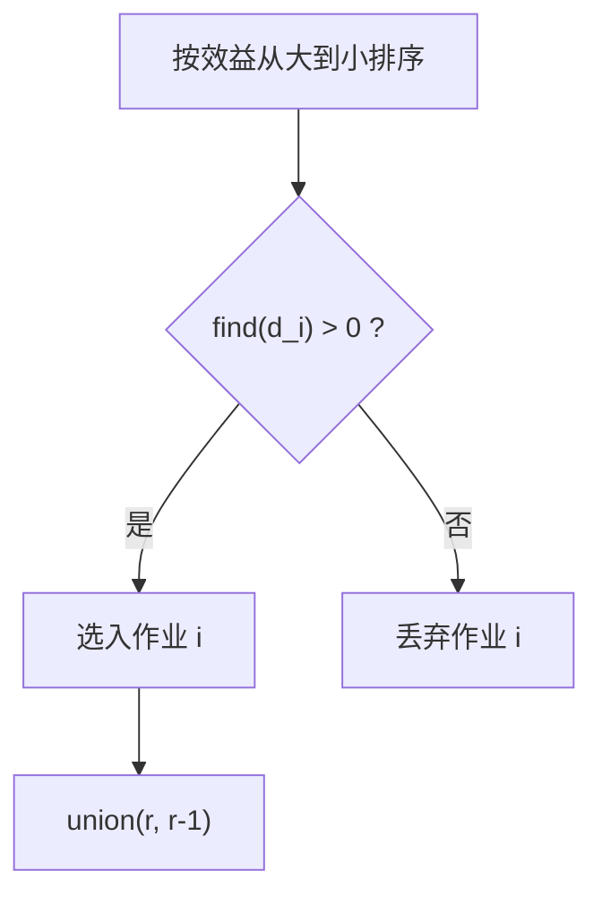

# 带时限的作业排序贪心算法及可行性判定改进

## 带时限的作业排序

有 $n$ 个作业，每个作业 $i$ 有一个**时限** $d_i$ 和一个**效益值** $p_i$。单机处理，每个作业只需一个单位时间即可完成，若在时限之前（含时限时刻）完成则获得效益 $p_i$，否则收益为 $0$。现在要选出一个作业子集并安排执行顺序，使总效益最大。

这个问题的难点在于：==效益高的作业时限可能很紧，效益低的作业时限可能很松==。贪心策略必须同时考虑"选谁"和"排哪儿"。

### 为什么按效益贪心

直觉上，我们总想优先选效益大的作业。但选完之后能不能放下，取决于时限。比如：

| 作业 | 效益 $p_i$ | 时限 $d_i$ |
|:---:|:---:|:---:|
| 1 | 100 | 2 |
| 2 | 90 | 1 |
| 3 | 80 | 2 |

按效益从大到小处理：先选作业 1（时限 2），再选作业 2（时限 1），最后看作业 3（时限 2）—— 需要 2 个单位时间内安排 3 个作业，放不下，放弃。最终选 $\{1, 2\}$，总效益 190。实际上这也是最优解。

> [!IMPORTANT]
> 带时限作业排序的贪心选择性质是：==按效益值 $p_i$ 从大到小依次考虑每个作业，若当前已选作业集合加入它之后仍然存在可行的调度安排，就选入；否则丢弃==。

### 可行性判定的朴素做法

每次考虑一个新作业时，需要判断：已选集合加上它，能否全部在各自时限前完成？

一个作业集合 $J$ 可行的充要条件是：把 $J$ 中作业按时限从小到大排序，对于排序后第 $k$ 个位置的作业（$k=1,2,\dots,|J|$），都有 $d_{[k]} \geq k$。

> [!NOTE]
> 为什么这是充要条件？每个作业占一个单位时间，最优安排就是按时限从小到大排。若某个位置 $k$ 上作业的时限 $< k$，意味着前 $k$ 个作业至少需要 $k$ 个时间单位，但它们的时限都 $\leq k-1$ 以内，必然超时。

朴素判断每次插入一个新作业后，都要对已选集重新排序再检查，时间复杂度 $O(n \log n)$。

### 改进思路：并查集加速可行性判定

重新审视可行性条件：若有 $m$ 个已选作业，只有当每个作业都能安排在自己的时限之前，才可行。换个角度——每当新作业要求时限 $d$，我们去找一个**不晚于 $d$ 的空闲时间槽**放它。如果找不到，就不行。

可以用并查集维护"往前找空闲槽"的过程。初始化时每个时间点 $t$ 都指向自己。当作业 $i$ 占用了时间槽 $t$ 后，就把 $t$ 的父亲设为 $t-1$，表示"下次找空闲槽时，$t$ 已满，从 $t-1$ 开始找"。



用数组 $f$ 模拟并查集，$find(x)$ 返回不超过 $x$ 的最大空闲时间槽：

```python
def find(x):
    if f[x] == x:
        return x
    f[x] = find(f[x])   # 路径压缩
    return f[x]
```

处理作业 $i$ 时，令 $r = find(d_i)$。若 $r > 0$，则选中作业 $i$，并令 $f[r] = find(r-1)$，表示时间槽 $r$ 已被占用。

> [!TIP]
> 把时间槽理解成"车位"，时限 $d_i$ 表示"最晚停到 $d_i$ 号车位"。每来一辆效益高的车，就从它的最晚车位往前找第一个空位。找不到就放弃这辆车。

### 一个算对了的例子

作业数据如上表：

| $i$ | $p_i$ | $d_i$ |
|:---:|:---:|:---:|
| 1 | 100 | 2 |
| 2 | 90 | 1 |
| 3 | 80 | 2 |

按效益排序：作业 1 → 2 → 3。初始 $f=[0,1,2]$。

- 处理作业 1：$d_1=2$，$find(2)=2$，选中，更新 $f[2]=find(1)=1$，即 $f=[0,1,1]$。
- 处理作业 2：$d_2=1$，$find(1)=1$，选中，更新 $f[1]=find(0)=0$，即 $f=[0,0,1]$。
- 处理作业 3：$d_3=2$，$find(2)$ 沿 $f[2]=1$ 找到 $f[1]=0$，返回 $0$，不可行，丢弃。

最终选 $\{1,2\}$，安排为：时刻 1 执行作业 2，时刻 2 执行作业 1，总效益 $100+90=190$。

> [!WARNING]
> 常见误区：直接按时限从小到大选高效益作业，而不是按效益从大到小判断可行性。前者可能丢掉"时限紧但效益超高"的作业。

> [!NOTE]
> 若各作业执行时间不都是单位时间（即 $t_i$ 不完全为 1），本算法不适用。此时属于**带不同执行时间的调度问题**，本课程不要求。
