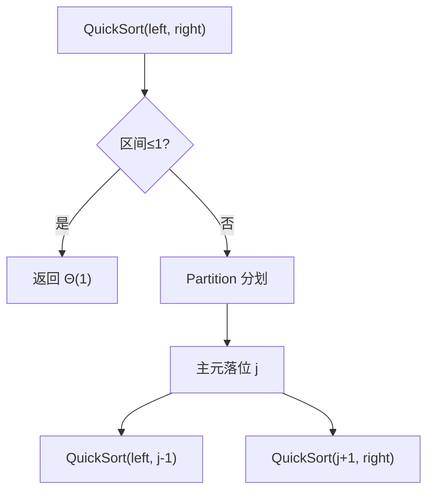

# 快速排序算法（Partition分划函数与QuickSort）及性能改善方法

快速排序（QuickSort）是分治法的典型应用：每次从待排序区间 $[l,r]$ 中选一个**主元**（划分基准），用 `Partition` 把区间切成「左小右大」两段，主元落位到下标 $j$，再对左右子区间递归排序。当区间长度为 0 或 1 时递归终止，所需时间 $\Theta(1)$。

## 算法骨架

`Partition` 的核心是**两指针向中间扫描** + 交换：设 `l[left]` 为主元，指针 $i$ 从左找 ≥ 主元的元素、$j$ 从右找 ≤ 主元的元素，交换后继续，最终把主元放到位置 $j$，==保证主元左侧所有元素都严格小于主元==，右侧都大于主元（相等元素的归置随实现而异，复习时以教材 $l[j]$ 为分界点的版本为准）。单次分划的比较次数不超过 $n+1$ 次。

## 时间与空间复杂度

| 情况 | 递推式 | 解 | 何时发生 |
|---|---|---|---|
| 最好 | $T(n)=2T(n/2)+\Theta(n)$ | $\Theta(n\log n)$ | 每次主元把区间均分 |
| 平均 | $T(n)=\frac1n\sum_{k=0}^{n-1}(T(k)+T(n-1-k))+\Theta(n)$ | $\Theta(n\log n)$ | 主元随机落位 |
| 最坏 | $T(n)\le T(n-1)+\Theta(n)$ | $\Theta(n^2)$ | 序列已有序/全相等且取端点作主元 |

> [!WARNING]
> 最坏情况下递归深度为 $n$，因此**最坏空间复杂度为 $O(n)$**（递归栈）；平均递归深度 $O(\log n)$，平均空间 $O(\log n)$。这是常考的填空/判断点。

> [!TIP]
> 记忆：==快速排序「最坏 $O(n^2)$、空间最坏 $O(n)$」；合并排序「最坏稳定 $O(n\log n)$、额外空间 $O(n)$」==。快排是**原地**排序但不稳定，归并是稳定排序但需合并。

## 改善性能：随机化主元

为避免「已有序数组退化成 $O(n^2)$」，可把固定取 `l[left]` 改为**随机选主元**：`RandomizedPartition` 先在 $[left,right]$ 随机挑一个元素换到 `l[left]`，再调用标准 `Partition`。这样每次划分基准的选择是随机的，==期望划分是对称的==，从而期望时间保持 $\Theta(n\log n)$。

引入随机过程的**主要目的就是打乱输入，使最坏情况期望上不发生**，而不是为了提高常数。

## 与合并排序的异同（8 分考点）

| 维度 | 快速排序 | 合并排序 |
|---|---|---|
| 分治结构 | 先分划再递归（分划决定一切） | 先递归再合并 |
| 合并代价 | 无需合并，$\Theta(1)$ | 合并需 $O(n)$ |
| 时间最坏 | $O(n^2)$ | $O(n\log n)$ |
| 空间 | 原地，递归栈 $O(\log n)$~$O(n)$ | 额外数组 $O(n)$ |
| 稳定性 | 不稳定 | 稳定 |

## 算例：$(5,5,8,3,4,3,2)$

取左端元素 $5_{(0)}$ 为主元，`Partition` 结束后主元落到中间，左侧均 $<5$、右侧均 $\ge 5$，再对两侧递归；对 $(1,1,1,1,1)$ 这种全相等输入，若主元取端点会退化，递推退化为 $T(n)=T(n-1)+\Theta(n)$，总比较数约 $\frac{n(n+1)}2$，即 $O(n^2)$——这正是要改随机主元的理由。

> [!NOTE]
> 「选出 $n$ 个元素中第 $k$ 小的元素」可模仿快排分划：一次分划后看主元下标 $j$，若 $j=k$ 就返回；若 $j>k$ 递归左段，否则递归右段，期望时间 $O(n)$（选择算法）。

> [!CAUTION]
> 主元左侧是「**严格小于**」还是「不大于」取决于 `Partition` 的写法；南邮教材版是严格小于，答题时按「左侧元素都（小于）主元」作答。
