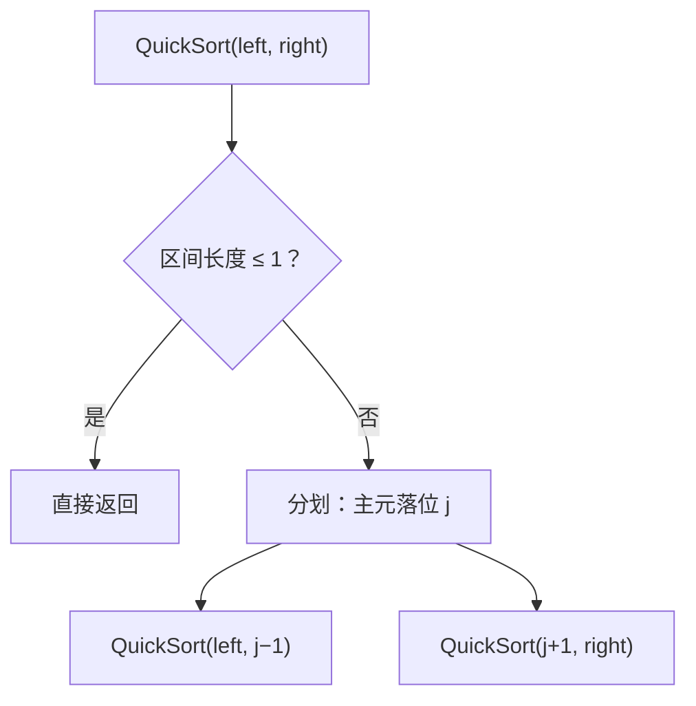

# 快速排序算法（Partition分划函数与QuickSort）及性能改善方法

快速排序先通过一次分划把主元放到下标 $j$，再分别排序它左右的两个子区间。只要左边每个元素都不大于主元、右边每个元素都不小于主元，两边各自有序之后，整个区间就已经有序，不需要归并。对于相等关键字，主元落在其中一个合法位置，不要求保持原来的相对顺序。

## 分划是怎么做的

《实验一 分治策略（2017）》给出的是**首元作主元、两端向中间扫描**的版本。设主元值为 $v$，左指针越过严格小于 $v$ 的元素，右指针越过严格大于 $v$ 的元素。找到一对停点后，若两指针还未相遇或交错，就交换两个停点，再从各自的下一格继续。交换后，被左指针越过或放到它身后的元素不大于 $v$；右侧已处理的元素不小于 $v$。结束时，将原主元与右指针停点 $j$ 交换，得到：

$$
l[left..j-1]\le v,\qquad l[j]=v,\qquad l[j+1..right]\ge v .
$$

这里的不等式是说区间内**每个元素**都满足条件。==两次扫描的比较是严格的，分划结果两侧的不等式不是严格的。== 两个指针遇到等值都停，但下一轮仍各移动一步。每个指针只往一个方向移动，因此一趟分划花费 $\Theta(n)$。

> [!WARNING]
> 原件的左扫描直接访问 `l[i]`。如果主元严格大于当前区间其余所有元素，左指针就会尝试读 `right+1`；若该处在数组外就是越界。可按原件设置一个不小于主元的右哨兵，或在读取前检查 `i <= right`。右扫描不需要另设哨兵，因为分划完成前 `l[left]` 一直等于主元。

下面是保留课件扫描规则且带显式边界的 C++ 实现片段。调用方只对 `left < right` 的有效闭区间调用，`l` 是待排序数组：

```cpp
int Partition(int left, int right) {
    const int v = l[left];
    int i = left, j = right + 1;
    for (;;) {
        do { ++i; } while (i <= right && l[i] < v);
        do { --j; } while (l[j] > v);
        if (i >= j) break;
        std::swap(l[i], l[j]);
    }
    std::swap(l[left], l[j]);
    return j;
}
```



## 算例：用两组等值输入验规则

取下标 0 的 5 为主元，分划序列 $(5,5,8,3,4,3,2)$（下标从 0 开始）：

| 操作 | 停点或落位 | 区间内容 |
| --- | --- | --- |
| 第一次扫描后交换 | $i=1,\ j=6$ | $(5,2,8,3,4,3,5)$ |
| 第二次扫描后交换 | $i=2,\ j=5$ | $(5,2,3,3,4,8,5)$ |
| 第三次扫描发现交错，交换首元与 $l[j]$ | $i=5,\ j=4$ | $(4,2,3,3,5,8,5)$ |

这里右侧有另一个 5。换用 $(5,5,5)$，两个扫描指针仍会相向移动，主元落在 $j=1$，**左右各有一个等于主元的元素**。一般地，长度为 $n$ 时，第 $t$ 轮左指针是 $left+t$，右指针是 $left+n-t$，首次相遇或交错发生在 $t=\lceil n/2\rceil$；主元因此落在 $left+\lfloor n/2\rfloor$。两个子问题的长度至多相差 1，不会退化成每次只少一个元素。

> [!TIP]
> 「全相等会退化」要看等值的分划规则。例如，把等值项全部放到主元同一侧的二路分划会失衡；此时随机换一个主元也无济于事，因为关键字仍一样。若想让全等输入在一趟结束，可以用三路分划，将等值段排除在两侧递归之外。

## 时间、空间与改进

| 情况 | 时间 | 条件 |
| --- | --- | --- |
| 平衡分划 | $\Theta(n\log n)$ | 两个子区间约各减半，包括本版的全等输入 |
| 随机主元的期望 | $\Theta(n\log n)$ | 关键字互异，每次从当前闭区间均匀选主元 |
| 极端失衡 | $\Theta(n^2)$ | 每次主元恰为极值，一个子区间为空，另一个有 $n-1$ 个元素；如固定首元处理已递增的互异数据 |

若随机选主元，先从 $[left,right]$ **包含右端点**地抽下标，换到首位再分划。随机化改善的是期望时间，不能消除最坏情况。若程序直接递归两个子区间，最坏调用栈深度是 $O(n)$；改成只递归较短的一侧、用循环处理较长的一侧，可以把调用栈限制在 $O(\log n)$，但失衡时的时间仍是 $\Theta(n^2)$。

| 比较 | 快速排序（本版） | 两路合并排序 |
| --- | --- | --- |
| 分治结构 | 先分划，再递归两侧 | 先递归两半，再合并 |
| 最坏时间 | $\Theta(n^2)$ | $\Theta(n\log n)$ |
| 主要额外空间 | 数组内分划，另有递归栈 | 线性大小的辅助数组 |
| 稳定性 | 不稳定：两个等值元素也可能互换 | 合并时遇等值先取左段，可保持稳定 |
