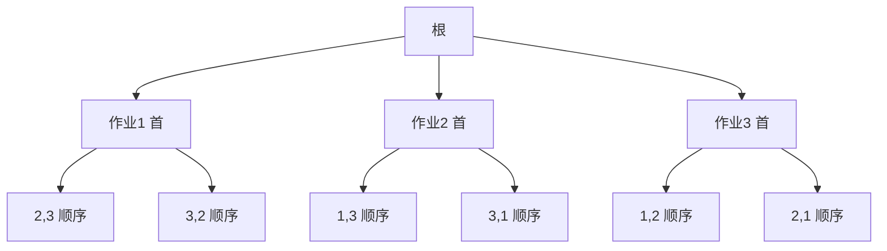
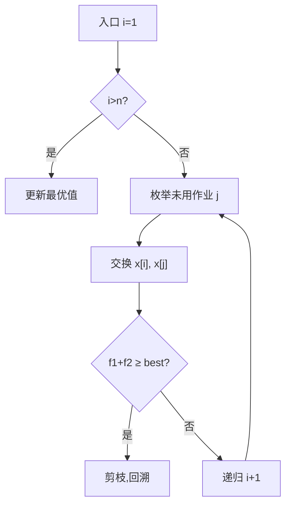

# 批处理作业调度的回溯法求解

## 什么是批处理作业调度

$n$ 个作业 $\{J_1, J_2, \dots, J_n\}$ 要在两台机器 $M_1, M_2$ 上**依次**加工：每个作业 $J_i$ 必须先在 $M_1$ 上加工 $a_i$ 时间，再在 $M_2$ 上加工 $b_i$ 时间。目标是给作业排一个执行顺序，使 ==所有作业在 $M_2$ 上完工的总时间（带权完成时间）最小==。

具体地，设排列 $\sigma$ 表示加工顺序，记 $M_1$ 上第 $k$ 个作业的开始时间为 $t_1$、$M_2$ 上的开始时间为 $t_2$，则有

$$
t_1 = \sum_{j=1}^{k-1} a_{\sigma(j)},\qquad
t_2 = \max\Big(\sum_{j=1}^{k} a_{\sigma(j)},\ \sum_{j=1}^{k-1} (a_{\sigma(j)}+b_{\sigma(j)}) \Big)
$$

最优值 $f = \sum_{k=1}^{n} t_2(k)$，目标是 $\min f$。

> [!NOTE]
> 为什么用回溯？因为作业顺序任意排列，暴力穷举要枚举 $n!$ 种顺序；回溯法用 **排列树 + 剪枝** 在枚举的同时及时剪掉不可能变优的分支。

## 解空间：排列树

$n$ 个作业的全排列构成问题的解空间，其结构是 ==排列树==（与 $0/1$ 背包的子集树不同）。

节点对应"前 $i$ 个位置已固定为某排列"，==树深 $n$、每层取一个未用作业==，叶节点是一个完整方案。

## 回溯框架与剪枝

设 $f_1$ 为 $M_1$ 当前累计时间，$f_2$ 为 $M_2$ 当前累计完成时间，`best` 记录当前最优值。剪枝条件：

$$
f_1 + f_2 \ge \texttt{best}\ \Longrightarrow\ \text{剪枝}
$$

> [!TIP]
> 记忆：**"能否变优"看部分下界**。$f_1+f_2$ 是当前已排作业在两台机器上的最小可能贡献，若已 ≥ `best`，后面再排只会更差。

## 与相近概念的区别

| 概念 | 解空间 | 变量取法 | 典型应用 |
| --- | --- | --- | --- |
| 排列树回溯 | 全排列 | 每层换入一个未用元素 | 批处理调度、TSP |
| 子集树回溯 | $2^n$ 子集 | 每层取/不取 | $0/1$ 背包 |
| 贪心法 | — | 每步局部最优 | 活动安排 |

## 常见的坑

> [!WARNING]
> - 不要写成子集树：作业必须全部加工，是"排序"问题不是"选不选"问题。
> - 剪枝条件是 **$\ge$**，等于 `best` 时也剪（已不更优）。
> - 交换式递归时要记得**回溯还原** `x[i]`、`x[j]`，否则后续分支被污染。
> - $M_2$ 完成时间 $t_2$ 取 $\max$，别漏掉"等 $M_1$ 加工完"的情况。

## 一个算对了的例子

$n=3$，加工时间 $(a_i, b_i)$：$J_1=(3,5)$，$J_2=(2,4)$，$J_3=(4,3)$，按顺序 $J_2 \to J_1 \to J_3$ 计算：

| 顺序 | $M_1$ 完成 | $M_2$ 开始 | $M_2$ 完成 |
| --- | --- | --- | --- |
| $J_2$ | $2$ | $\max(2,0)=2$ | $2+4=6$ |
| $J_1$ | $5$ | $\max(5,6)=6$ | $6+5=11$ |
| $J_3$ | $9$ | $\max(9,11)=11$ | $11+3=14$ |

故 $f = 6+11+14 = 31$，经枚举所有 $3!=6$ 种顺序，==最优值 $f^*=29$==，对应顺序 $J_1 \to J_3 \to J_2$。

> [!IMPORTANT]
> 填空高频考点：**用回溯法解批处理作业调度问题时，该问题的解空间结构为 ==排列树== 结构**。看到"调度/排序/全排列"就联想到排列树。
