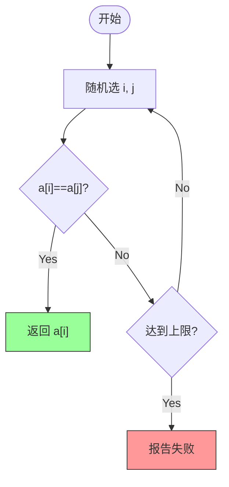

# 拉斯维加斯算法（标识重复元素算法及性能分析）

# 拉斯维加斯算法（标识重复元素）

## 它是什么与为什么需要

==拉斯维加斯算法（Las Vegas Algorithm）== 是一类随机算法。其核心特征是：**只要算法返回结果，该结果一定是正确的**；但算法可能因随机选择“运气不好”而无法在有限步骤内找到解（即报告失败）。

> [!IMPORTANT]
> 核心性质：解的正确性概率为 1，但运行时间是随机变量。

在“标识重复元素”问题中，若数组 $a[0 \dots n-1]$ 中存在重复值，确定性算法通常需 $O(n^2)$ 或排序后 $O(n \log n)$。拉斯维加斯算法通过**随机采样**，期望在 $O(1)$ 或 $O(n)$ 时间内快速命中重复对，极大优化平均性能。

## 怎么做：算法流程

算法 `RepeatedElement` 的基本逻辑是：随机选取两个不同下标 $i, j$，检查 $a[i] == a[j]$。若相等则返回该值；否则继续重试。

> [!TIP]
> 为了降低失败概率，可独立重复执行算法 $k$ 次。若 $k$ 次均失败，则判定无解或放弃。

## 性能分析

设单次迭代找到解的概率为 $p$。对于重复元素占比高的情况，$p$ 较大。
根据课件定理 11-1，算法执行时间具有概率界。若在 $k$ 次迭代中不终止，其概率小于 $(4/5)^k$（假设每次失败概率上限为 $4/5$）。

令 $k = c \log n$，则失败概率随 $n$ 增大迅速趋近于 0。
$$ P(\text{失败}) < \left(\frac{4}{5}\right)^{c \log n} = n^{-c \log(5/4)} $$
因此，算法的**期望运行时间**通常为 $O(1)$ 或 $O(n)$ 量级，具体取决于数据分布。

## 与蒙特卡罗算法的区别

| 特性 | 拉斯维加斯 (LV) | 蒙特卡罗 (MC) |
| :--- | :--- | :--- |
| **解的正确性** | ==总是正确== | 可能错误 |
| **运行时间** | 随机（可能无限） | 固定或有界 |
| **重复执行效果** | 提高找到解的概率 | 提高解正确的概率 |

> [!WARNING]
> 常见坑：混淆 LV 和 MC。记住口诀：“LV 保真不保时，MC 保时不保真”。

## 算例演示

假设数组 $a = [1, 2, 3, 2, 5]$，$n=5$。
1. **第1次随机**：选 $i=0, j=2$，$a[0]=1, a[2]=3$，不相等。
2. **第2次随机**：选 $i=1, j=3$，$a[1]=2, a[3]=2$，相等！
3. **结果**：返回 $2$。解正确。

若一直选到非重复对，算法将继续直到达到预设迭代上限。重复多次执行可显著降低“始终找不到”的风险。
