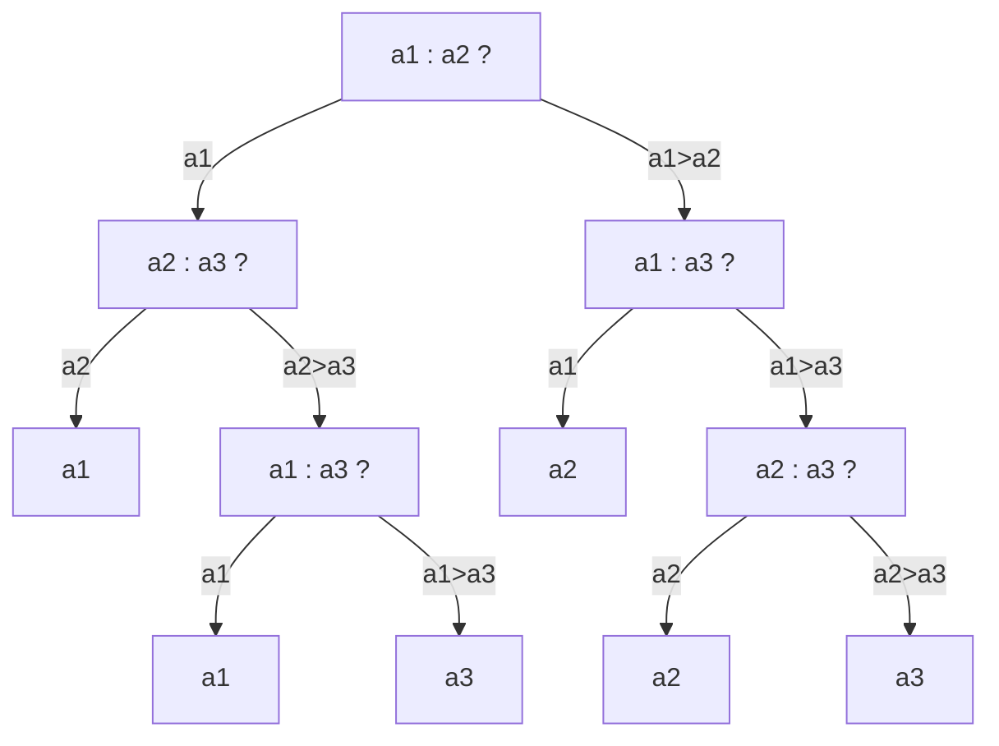

# 基于比较的排序算法时间下界Ω(nlogn)证明

## 为什么需要“下界”

学到这里你可能已经发现：两路合并排序和堆排序的最坏情况都是 $O(n\log n)$，而快速排序平均也是 $O(n\log n)$。一个自然的问题是：**基于比较的排序算法还能更快吗？** 比如能不能设计一个最坏情况 $O(n)$ 的比较排序？

答案是否定的。可以证明：**任何基于关键字比较的排序算法，其最坏情况时间下界是 $\Omega(n\log n)$**。也就是说，合并排序和堆排序在渐近意义上已经"最优"了，不存在最坏情况优于 $n\log n$ 的比较排序。

> [!IMPORTANT]
> 下界 $\Omega(n\log n)$ 只适用于**基于比较**的排序模型。一旦打破这个模型（如计数排序、桶排序、基数排序），下界就不再适用。

## 决策树模型

怎么证明所有比较排序算法都不可能比 $n\log n$ 快？关键在于把"排序过程"抽象成一棵**决策树**：

- 每个**内部结点**代表一次关键字比较（如 $a_i : a_j$，问"$a_i$ 是否小于 $a_j$"）；
- 每个**叶结点**代表一种可能的排列结果（即排序完成后的顺序）；
- 从根到某片叶子的路径，就对应算法处理某一种输入时所做的全部比较。

> [!TIP]
> 对 $n$ 个元素，共有 $n!$ 种不同排列，决策树必须有 $n!$ 片叶子（每片对应一种输出）。

## 证明

对 $n$ 个元素排序，最坏情况下的比较次数 = 决策树的**高度** $h$（根到最深叶子的路径长度）。

一棵高度为 $h$ 的二叉树，叶子数至多为 $2^h$。而排序决策树必须有 $n!$ 片叶子，因此：

$$2^h \geq n!$$

两边取对数：

$$h \geq \log(n!) = \log 1 + \log 2 + \cdots + \log n$$

利用积分估计（或斯特林公式）：

$$\log(n!) = \Theta(n\log n)$$

所以：

$$h = \Omega(n\log n)$$

即任何基于比较的排序算法，最坏情况至少需要 $\Omega(n\log n)$ 次比较。

> [!WARNING]
> 常见误区：把 $\Omega(n\log n)$ 理解成"所有排序算法都不可能比 $n\log n$ 快"。计数排序的时间下界就优于 $\Theta(n\log n)$，因为它不是基于比较的。

## 和相近概念的区别

| 概念 | 含义 | 例子 |
| :--- | :--- | :--- |
| 时间复杂度 $O(n\log n)$ | 某个算法的最坏/平均运行时间上界 | 合并排序 $T(n)=O(n\log n)$ |
| 时间下界 $\Omega(n\log n)$ | 所有基于比较的排序算法的最坏情况都不可能低于这个量级 | 决策树证明 |
| $\Theta(n\log n)$ | 上界与下界重合，算法渐近最优 | 合并排序、堆排序 |

## 一个算对了的例子

对关键字序列 $65, 78, 21, 30, 80, 7, 79, 57, 35, 26$（$n=10$）：

- $n! = 10! = 3{,}628{,}800$ 种排列
- $\log_2(10!) \approx \log_2(3.6\times 10^6) \approx 21.8$

所以任何比较排序算法，处理这 10 个元素最坏至少要比较约 22 次。而两路合并排序实际比较次数约为 $n\lceil\log n\rceil = 10\times 4 = 40$ 次（含辅助比较），处于同一量级，验证了 $O(n\log n)$ 的合理性。

> [!NOTE]
> 堆排序建堆需 $2n$ 次比较，排序阶段需 $2n\log n$ 次比较，总的最坏情况也是 $O(n\log n)$，因此和合并排序一样，达到了基于比较排序的下界，是"最优算法"。
