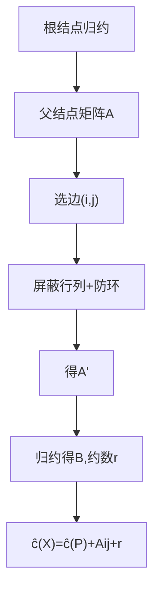

# 旅行商问题的分枝限界法求解（代价矩阵归约与下界函数）

## 为什么TSP需要代价矩阵归约

旅行商问题（TSP）的解空间是==排列树==，结点数量随城市数 $n$ 呈阶乘级增长。若直接搜索，计算量不可接受。分枝限界法的核心在于：能否在扩展结点前，快速估算“从该结点出发能得到的最优解至少是多少”？这个估算值就是下界函数 $\hat{c}(X)$。如果某结点的下界已超过当前已知最优解的上界 $u(X)$，则该子树必不含更优解，可直接剪枝。而==代价矩阵归约==正是为TSP量身定制的高效下界计算方法。

## 归约与下界函数的计算逻辑

如何从一个部分路径推导出可靠的下界？关键在于利用邻接矩阵的结构特性。

> [!IMPORTANT]
> TSP中任意可行回路必须包含每个城市的一条入边和一条出边。因此，对代价矩阵每行、每列减去其最小值（归约），所得约数之和即为所有回路的公共下界偏移量。

具体计算遵循以下递推规则：

- **根结点R**：对原始邻接矩阵进行行列归约，得到归约矩阵，其下界 $\hat{c}(R) = L$，$L$ 为行列归约的总约数。
- **非叶结点X**：设其父结点P的归约矩阵为A，选择边 $(i,j)$ 扩展至X，则先将A中第 $i$ 行、第 $j$ 列置 $\infty$，并令 $A[j][i]=\infty$（防子环），得到临时矩阵 $A'$；再对 $A'$ 归约得新矩阵B，约数为 $r$。则：
  $$
  \hat{c}(X) = \hat{c}(P) + A[i][j] + r
  $$
- **叶结点S**：$\hat{c}(S) = c(S)$，即完整路径的实际代价。

## 与回溯法及其他下界的区别

| 对比维度 | TSP分枝限界（归约法） | 回溯法 | 简单累加下界 |
| :--- | :--- | :--- | :--- |
| 搜索策略 | LC或FIFO，优先扩展下界最小结点 | DFS，盲目深入 | 仅用于粗略估计 |
| 下界精度 | ==紧确==，利用矩阵结构 | 无下界，不剪枝 | 松弛大，剪枝弱 |
| 计算开销 | 每次扩展需归约，但剪枝高效 | 低，但搜索量大 | 极低，效果差 |

> [!WARNING]
> 归约后矩阵中的0不代表实际代价为0，而是“相对最小”。计算 $\hat{c}(X)$ 时务必加上原始边权 $A[i][j]$，否则下界偏低导致无法有效剪枝。

## 一个正确计算的示例

考虑4城市TSP，初始代价矩阵经行列归约后总约数 $L=25$，故 $\hat{c}(R)=25$。若从R扩展边 $(1,3)$，原矩阵中 $A[1][3]=8$，屏蔽相关行列并置 $A[3][1]=\infty$ 后，对新矩阵归约得约数 $r=3$，则子结点下界为：
$$
\hat{c}(X) = 25 + 8 + 3 = 36
$$
此值表示：任何包含边 $(1,3)$ 的TSP回路代价至少为36。若当前上界 $u=35$，则该结点立即被剪去。

> [!TIP]
> 考试中常考归约步骤与下界递推公式。牢记：==下界 = 父下界 + 所选边原权 + 新归约约数==，三者缺一不可。
