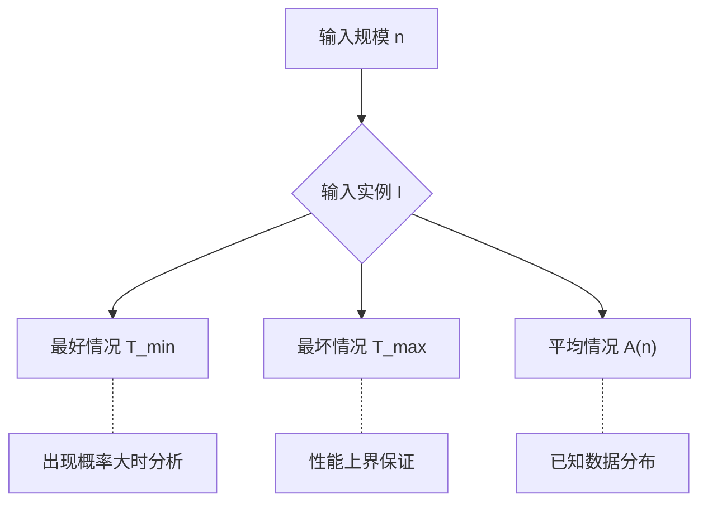

# 算法的时间复杂度定义（最好、最坏、平均情况）

> [!IMPORTANT]
> 算法的时间复杂度不仅取决于输入规模 $n$，还取决于==具体的输入实例 $I$==。同一个算法面对不同数据，执行时间可能天差地别。

## 为什么需要区分三种情况

思考一个问题：用插入排序排 100 万个数，如果数据已经正序，还要做多少比较？如果是逆序呢？

根据课件实测数据（单位：毫秒）：

| 排序算法 | 最好情况(正序) | 最坏情况(逆序) | 平均情况 |
| :--- | :--- | :--- | :--- |
| 插入排序 | 0.897 | 515621 | 253115 |
| 快速排序 | 30 | 93 | 39 |

只看一个数字无法全面评价算法。因此，分析时必须考察关键操作在不同输入下的执行次数，将其分为三种情况。

## 定义与数学表达

设 $D_n$ 为规模为 $n$ 的所有输入实例集合，$T(I)$ 为算法在实例 $I$ 上的执行时间，$p(I)$ 为实例 $I$ 出现的概率。

- **最好情况时间复杂度**：$T_{\min}(n) = \min\{ T(I) \mid \text{size}(I)=n \}$。当输入最“配合”算法时的耗时。
- **最坏情况时间复杂度**：$T_{\max}(n) = \max\{ T(I) \mid \text{size}(I)=n \}$。算法耗时的==严格上界==，是衡量算法可靠性的核心指标。
- **平均情况时间复杂度**：$A(n) = \sum_{I \in D_n} p(I)T(I)$。通常假设输入数据服从等概率分布（即 $p(I) = \frac{1}{|D_n|}$）。

> [!NOTE]
> **最优性**的定义正是基于最坏情况：若算法最坏情况下的执行时间已达到求解该类问题所需时间的下界，则称该算法为最优算法。例如堆排序和两路合并排序最坏为 $O(n\log n)$，达到了排序问题的下界，即为最优算法。

## 易错点辨析

> [!WARNING]
> 不要把“最好/最坏情况”与“大 O / 小 o”混淆！最好、最坏描述的是**输入数据的分布特征**；而 $O, \Omega, \Theta$ 描述的是函数的**渐近增长率**。你可以说“最坏情况是 $O(n^2)$”，但不能说“$O(n^2)$ 是最坏情况”。

> [!CAUTION]
> 平均情况分析不能简单地将最好和最坏相加除以 2！必须明确概率分布模型 $p(I)$ 后求期望。

## 算对的一个例子：对半搜索

以南邮常考的对半搜索（折半查找）为例，通过二叉判定树分析其关键字比较次数：

- **成功搜索**：比较次数至少 $\lfloor \log n \rfloor$，至多 $\lfloor \log n \rfloor + 1$。故最好、最坏均为 $\Theta(\log n)$。
- **失败搜索**：比较次数至少 $\lfloor \log n \rfloor + 1$，至多 $\lfloor \log n \rfloor + 2$。故最好、最坏也均为 $\Theta(\log n)$。

对于平均情况，假定查找表中任何元素被查找的概率相等（均为 $\frac{1}{n}$），设内路径长度为 $I$，外路径长度为 $E$（且 $E = I + 2n$）：

$$A_s(n) = \frac{I+n}{n} = \frac{E-n}{n} = \frac{E}{n}-1 = \Theta(\log n)$$

不成功搜索的平均时间复杂度：

$$A_u(n) = \frac{E}{n+1} = \Theta(\log n)$$

> [!TIP]
> 因为基于比较的搜索算法最坏情况下界就是 $\Omega(\log n)$，而对半搜索的最坏情况是 $\Theta(\log n)$，上下界吻合，所以==对半搜索是最优算法==。
