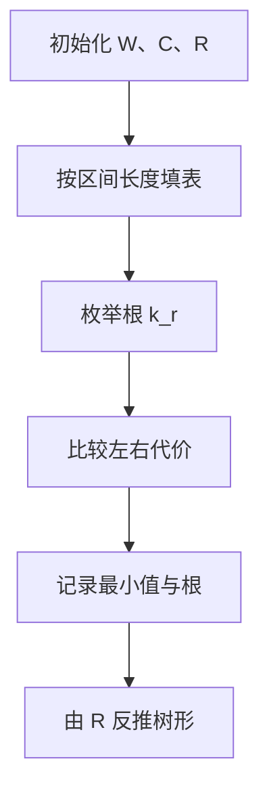

# 最优二叉搜索树问题的动态规划求解

## 问题与记号

最优二分检索树（OBST）要解决的问题是：给定有序关键字 $k_1<k_2<\cdots<k_n$，成功检索概率 $p_i$ 与失败检索概率 $q_j$（$q_0$ 对应小于 $k_1$，$q_n$ 对应大于 $k_n$），构造一棵二分检索树，使平均检索代价最小。若结点深度从 $1$ 起算，则

$$E=\sum_{i=1}^{n}p_i\cdot \text{depth}(k_i)+\sum_{j=0}^{n}q_j\cdot \text{depth}(E_j).$$

为什么不能直接取概率最大的关键字作根？因为根的左右子树必须分别包含较小、较大的关键字，局部最优不一定导致全局最优。把根选为 $k_r$ 后，左右子树仍是同类问题，且互不影响，因此具有最优子结构性，可用动态规划求解。

## 三张表与递推式

对区间 $(i,j)$，它包含关键字 $k_{i+1},\ldots,k_j$，以及失败结点 $E_i,\ldots,E_j$。定义

$$W(i,j)=q_i+\sum_{t=i+1}^{j}(p_t+q_t),$$

$C(i,j)$ 为该区间最优树代价，$R(i,j)$ 为最优根下标。边界为

$$W(i,i)=q_i,\qquad C(i,i)=0,\qquad R(i,i)=0.$$

当 $i<j$ 时，

$$W(i,j)=W(i,j-1)+p_j+q_j,$$

$$\boxed{C(i,j)=W(i,j)+\min_{i<r\le j}\{C(i,r-1)+C(r,j)\}}.$$

$R(i,j)$ 记录使上式最小的 $r$。这里加 $W(i,j)$ 的原因是：左右子树接到根下后，==该区间所有成功、失败结点的深度都增加 1==，而不是只增加根结点的代价。

> [!IMPORTANT]
> 考试核心是==会算 $W,C,R$ 三张表，并由 $R$ 反推树形==。按区间长度 $1,2,\ldots,n$ 填表，不能按任意顺序计算。

## 一个完整算例

取两个关键字，$(p_1,p_2)=(0.4,0.3)$，$(q_0,q_1,q_2)=(0.1,0.1,0.1)$。

先算权值：

$$W(0,0)=W(1,1)=W(2,2)=0.1,$$
$$W(0,1)=0.1+0.4+0.1=0.6,$$
$$W(1,2)=0.1+0.3+0.1=0.5,$$
$$W(0,2)=0.6+0.3+0.1=1.0.$$

单关键字区间：

$$C(0,1)=0.6,\ R(0,1)=1;\qquad C(1,2)=0.5,\ R(1,2)=2.$$

整个区间有两种选根方式：

- 根为 $k_1$：$1.0+0+C(1,2)=1.5$；
- 根为 $k_2$：$1.0+C(0,1)+0=1.6$。

故 $C(0,2)=1.5$，$R(0,2)=1$。最优树以 $k_1$ 为根、$k_2$ 为右孩子；直接验证平均代价为 $0.4+2(0.3)+3(0.1+0.1+0.1)=1.9$？这里要注意：失败结点 $E_0$ 深度为 $1$，$E_1,E_2$ 深度为 $2$，所以正确值是

$$0.4+2(0.3)+0.1+2(0.1+0.1)=1.5.$$

## 易错点与相近问题

> [!WARNING]
> 区间 $(i,j)$ 不是 $k_i$ 到 $k_j$，而是 $k_{i+1}$ 到 $k_j$；枚举根时必须满足 $i<r\le j$，并正确使用空区间 $C(i,i)=0$。

> [!CAUTION]
> 树形推导不能只看最后一张 $C$ 表。先取 $R(0,n)$ 为总根，再递归查左右区间；若左区间为空就没有左孩子，右区间同理。

| 问题 | 划分依据 | 区间权值 | 主要区别 |
|---|---|---|---|
| 最优二分检索树 | 根结点 $k_r$ | $W(i,j)$ | 含成功、失败概率 |
| 矩阵链乘法 | 最后乘法位置 | 无此 $W$ 项 | 代价来自矩阵维度 |
| 普通平衡 BST | 结构平衡 | 不使用概率 | 不保证检索期望最小 |

算法直接实现需枚举 $O(n^2)$ 个区间，每个区间尝试 $O(n)$ 个根，因此时间复杂度为 $O(n^3)$，空间复杂度为 $O(n^2)$；算法细节了解即可，但递推含义、表格计算和树形恢复必须熟练。
