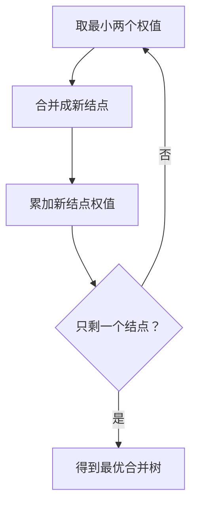

# 最优归并模式（扩充二叉树、Huffman编码与带权外路径长度）

## 最优归并模式是什么

把 $n$ 个有序文件（有序子文件、初始游程）反复合并，最终得到一个有序文件，称为**归并模式**。若每次合并 $k$ 个文件，就得到 **$k$ 路合并**；$k=2$ 时就是两路合并。

不同合并顺序会产生不同代价。例如，长度为 $20,30,30,10,5$ 的文件采用课件中的两种两路合并模式，带权外路径长度分别为 $240$ 和 $265$。因此，==最优归并模式就是使总合并代价最小的合并顺序==。

## 用扩充二叉树描述合并

**扩充二叉树**中，除叶子结点外，其余结点都必须有两个孩子。在合并树中：

- 叶子结点（外结点）表示初始文件，权值 $w_i$ 表示文件长度；
- 内部结点表示一次合并，其权值为参与合并的文件长度之和；
- 根结点表示最终文件。

设叶子 $i$ 的深度为 $l_i$，则**带权外路径长度**为

$$
WPL=\sum_{i=1}^{n}w_i l_i .
$$

它表示每个初始文件的记录被重复读写的总次数。另一个常用算法是：

$$
\boxed{WPL=\text{所有内部结点的权值之和}}
$$

> [!IMPORTANT]
> 两路合并最佳模式问题的最优量度标准是==带权外路径长度最小==。Huffman 算法既能构造最优两路合并树，也能用于构造前缀码，但“最优归并”和“字符编码”是同一树结构的不同应用。

## 贪心算法怎么做

两路合并时，每次选择权值最小的两个结点合并，并将新结点放回集合，直到只剩根结点。定理 6-4 说明：以 $W=\{w_0,w_1,\ldots,w_{n-1}\}$ 为外结点权值，该贪心算法能生成最小带权外路径长度的二叉树。

推广到 $k$ 路合并，每次取最小的 $k$ 个权值。但最后一次也必须恰好合并 $k$ 个结点，因此先检查

$$
(n-1)\bmod(k-1).
$$

若不为 $0$，需补充权值为 $0$ 的**虚结点（虚游程）**，补结点数为

$$
r=(k-1)-(n-1)\bmod(k-1).
$$

> [!WARNING]
> 不要一开始随意补若干个 $0$，也不要在最后不足 $k$ 个时直接合并。虚结点只用于保证每次均进行 $k$ 路合并，且不会改变 $WPL$。

## 一个算对的例子

设 $W=\{3,7,8,9,15,16,18,20,23,25,28\}$，构造最优 $3$ 路合并树。这里 $n=11$，且

$$
(11-1)\bmod(3-1)=0,
$$

所以无需补虚游程。每次取最小的三个权值：

| 合并次序 | 合并权值 | 新内部结点 |
|---|---|---:|
| 1 | $3,7,8$ | $18$ |
| 2 | $9,15,16$ | $40$ |
| 3 | $18,18,20$ | $56$ |
| 4 | $23,25,28$ | $76$ |
| 5 | $40,56,76$ | $172$ |

因此

$$
WPL=18+40+56+76+172=\boxed{362}.
$$

> [!TIP]
> 解题固定流程：**排序 → 检查虚结点 → 每次取最小 $k$ 个 → 累加新结点权值**。若题目问“至少读写多少条记录”，通常也是求这个 $WPL$；若明确说每次合并“读写两个文件的全部记录各一次”，则按题目的 I/O 计数约定处理，不要自行乘 $2$。
