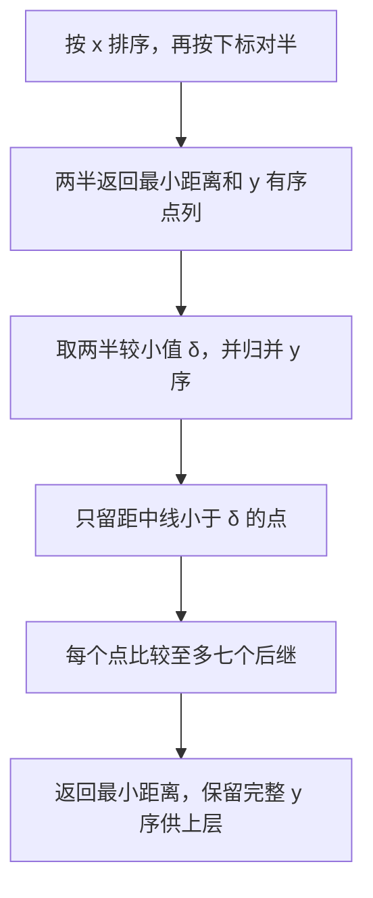

# 寻找最近点对的分治算法（垂直带状区域扫描）

只求两半各自的最近点对会漏掉跨界解；但有了两半的答案，就知道跨界点对想改写结果必须靠近中线。令两半最近距离的较小值为 $\delta$。若 $\delta=0$ 已找到最小距离。否则，点对若跨界且距离严格小于 $\delta$，其两点到分割线 $x=m$ 的距离及二者纵向差都严格小于 $\delta$。

## 为什么只看七个后继？

固定按 $y$ 排序后正在处理的点 $p$。若后继点 $q$ 能改写两半答案，$q$ 必落在前向纵向窗口 $[p.y,p.y+\delta)$ 内。中线两侧的带区分别与该窗口相交，形成两个宽不超过 $\delta$、高 $\delta$ 的矩形。分别把每侧矩形划成二行二列，格内点距至多 $\delta/\sqrt{2}<\delta$，因此同一侧同一格不能有两个点。每侧至多四个，两侧合计至多八个，包含 $p$ 自己。

> [!IMPORTANT]
> 这个界依赖==同一侧内部最短距离至少为 $\delta$==，不要求跨界两点也相隔 $\delta$。边界等于中线的点按原来分割出的组计数，而不是重新按坐标归组。只输出最小距离时，等于最优值的并列点对无需枚举。

## 把跨界距离算完整

用四个点 $(0,0),(1,5),(3,5),(3,10)$，按 $x$ 序切成前后各两点，中线 $x=3$。左侧内距离平方为 $26$，右侧为 $25$，故 $\delta=5$。四个跨界点对的距离平方依次是 $34,109,4,29$。因此最近点对是 $(1,5),(3,5)$，真实距离为 $2$，确实小于两半提供的上界 $5$。不比较跨界对，会把 $5$ 错当作答案。

| 做法 | 保证或问题 |
| --- | --- |
| 只保留两半答案 | 可能漏掉跨界更近的点对 |
| 带区中任意两点都比较 | 带区本身可以含有全部输入点，比较可能是平方级 |
| 每级重新排序带区的 $y$ 序 | 不能从扫描线性推出合并线性；上界可到 $O(n\log^2 n)$ |
| 按下标平分、线性归并 $y$ 序 | 每级线性处理，总时间为 $O(n\log n)$ |

> [!WARNING]
> 把所有 $x=m$ 的点都交给同一边可能使递归不缩小。按排好序的下标等分才保证规模缩减；$y$ 相同的点则由一致的排序键确定顺序，不能直接略过。
