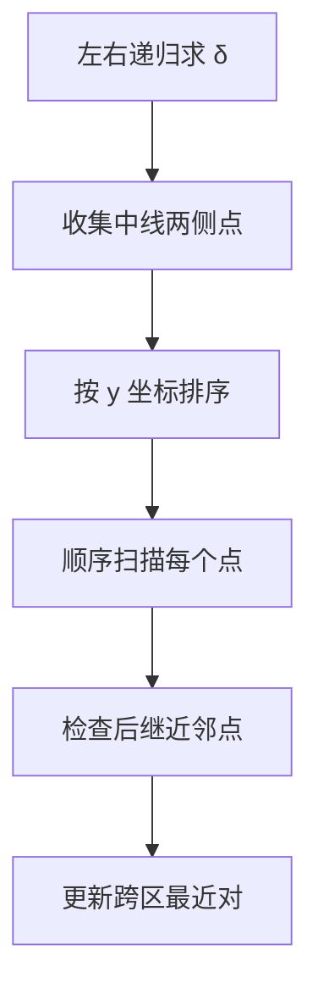

# 寻找最近点对的分治算法（垂直带状区域扫描）

## 为什么要扫描垂直带状区域

分治法求最近点对时，先按 $x$ 坐标排序，以中线 $x=m$ 将点集分成左右两部分，递归求得两侧最近距离

$$
\delta=\min(\delta_L,\delta_R).
$$

但最近点对也可能==一个点在中线左侧，另一个点在右侧==。因此还需检查跨越中线的点对，候选点只能落在垂直带状区域

$$
S=\{p\mid m-\delta\le p.x\le m+\delta\}.
$$

若直接比较 $S$ 中所有点对，仍可能需要 $O(n^2)$ 次距离计算；垂直带状区域扫描的作用，就是把这一步降为 $O(n)$。

## 扫描过程与关键结论

将 $S$ 中的点按 $y$ 坐标升序排列，依次扫描。对于当前点 $p$，只需检查它后面、且纵坐标满足

$$
q.y-p.y\le \delta
$$

的点。若发现更近点对，就更新 $\delta$ 及答案。

为什么不用检查后面的所有点？以 $p$ 为参照，需要考虑的点位于一个 $2\delta\times\delta$ 的矩形中。将该矩形划分成边长为 $\delta/2$ 的小方格；同一侧任意两点距离不小于 $\delta$，所以每个小方格至多有一个点。因此，==每个点至多检查其后 7 个点==（常见教材也表述为“至多 6 个”，取决于常数优化和计数口径），常数与实现细节不影响线性结论。

> [!IMPORTANT]
> “常数个后继点”依赖左右两侧内部距离均不小于 $\delta$，以及候选点按 $y$ 坐标有序；不是凭空规定只比较 7 个点。

## 一个算对的例子

设左右递归得到 $\delta_L=5,\delta_R=4$，故 $\delta=4$，中线为 $x=10$。带状区域为 $6\le x\le14$，其中按 $y$ 排序后的点为

$$
p_1=(8,0),\quad p_2=(12,1),\quad p_3=(9,9),\quad p_4=(13,10).
$$

扫描 $p_1$ 时，$p_2$ 满足 $1-0\le4$，计算

$$
d(p_1,p_2)=\sqrt{(12-8)^2+(1-0)^2}=\sqrt{17}<4.
$$

于是跨区最近距离更新为 $\sqrt{17}$。$p_3$ 与 $p_1$ 的纵坐标差为 $9>4$，且后续点的 $y$ 更大，因此都可跳过。最终最近点对为 $(p_1,p_2)$，全题答案为 $\sqrt{17}$。

## 与相近做法的区别及常见坑

| 做法 | 合并阶段 | 总时间复杂度 |
|---|---|---|
| 暴力枚举 | 比较全部点对 | $O(n^2)$ |
| 只递归左右两侧 | 漏掉跨中线点对 | 结果可能错误 |
| 带状区两两比较 | 候选点全部互查 | 最坏仍可能退化 |
| 正确带状区扫描 | 每点检查常数个后继 | $O(n\log n)$ |

> [!WARNING]
> 不要只按 $x$ 排序后直接扫描，也不要把“$|q.x-p.x|\le\delta$”当作唯一的后继筛选条件；关键是按 $y$ 排序并利用 $q.y-p.y\le\delta$ 提前停止。

> [!TIP]
> 答题主线记成：**左右递归得 $\delta$ → 取宽 $2\delta$ 带区 → 按 $y$ 排序 → 常数次比较**。若每轮重新排序，通常写作 $O(n\log^2 n)$；预先维护 $y$ 序或线性合并，可优化为 $O(n\log n)$。
