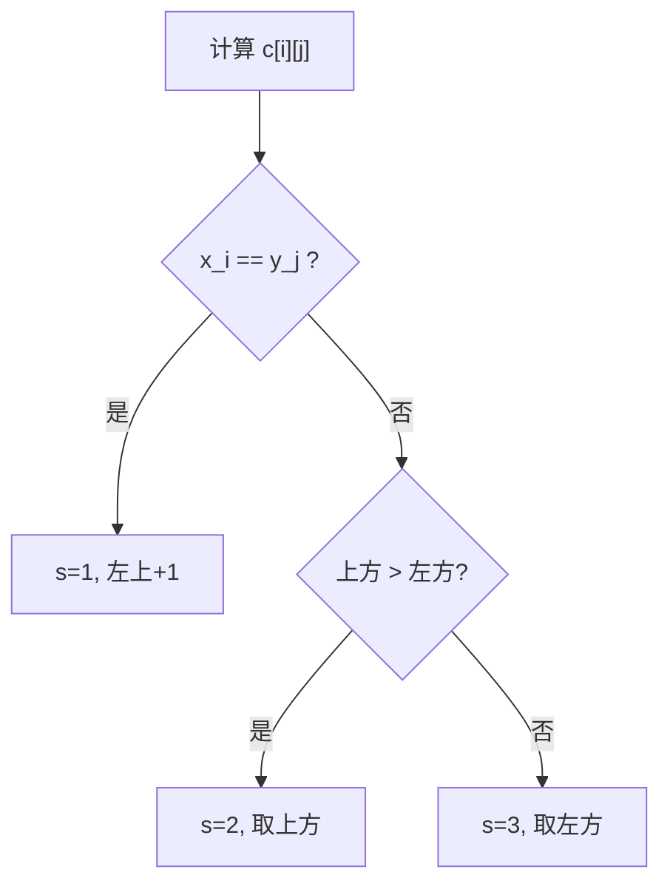

# 最长公共子序列（LCS）的最优子结构证明、递推公式与构造最优解

---
requires: [算法分析与设计/动态规划法]
---

给定两个序列 $X=(x_1, x_2, \ldots, x_m)$ 和 $Y=(y_1, y_2, \ldots, y_n)$，如何找出它们共有的、最长的子序列？如果直接暴力枚举所有子序列去比对，复杂度是指数级的。我们能不能把大问题拆成小问题？这就引出了动态规划求解最长公共子序列（LCS）的核心逻辑。

## 最优子结构证明

设 $Z=(z_1, z_2, \ldots, z_k)$ 是 $X$ 和 $Y$ 的一个最长公共子序列。观察末尾元素，必然面临三种情况：

> [!IMPORTANT]
> 定理7-2：LCS的最优子结构性质
> - 若 $x_m = y_n$，则 $z_k = x_m = y_n$，且 $Z_{k-1}$ 是 $X_{m-1}$ 和 $Y_{n-1}$ 的LCS。
> - 若 $x_m \neq y_n$ 且 $z_k \neq x_m$，则 $Z$ 是 $X_{m-1}$ 和 $Y$ 的LCS。
> - 若 $x_m \neq y_n$ 且 $z_k \neq y_n$，则 $Z$ 是 $X$ 和 $Y_{n-1}$ 的LCS。

这说明原问题的最优解包含了子问题的最优解，满足==最优子结构==特性。

## 递推公式

用 $c[i][j]$ 记录前缀 $X_i$ 和 $Y_j$ 的LCS长度。根据上述定理，自底向上填表的递推关系为：

$$
c[i][j] = \begin{cases} 
0 & i=0 \text{ 或 } j=0 \\
c[i-1][j-1]+1 & i,j>0 \text{ 且 } x_i=y_j \\
\max(c[i-1][j], c[i][j-1]) & i,j>0 \text{ 且 } x_i \neq y_j 
\end{cases}
$$

为了后续能构造出具体序列，还需一个数组 $s[i][j]$ 记录 $c[i][j]$ 的值是由哪个子问题转移来的：
- $s[i][j]=1$：由 $c[i-1][j-1]+1$ 得到（匹配成功）；
- $s[i][j]=2$：由 $c[i-1][j]$ 得到（舍弃 $x_i$）；
- $s[i][j]=3$：由 $c[i][j-1]$ 得到（舍弃 $y_j$）。

## 构造最优解

求出 DP 表后，从右下角 $s[m][n]$ 开始逆向回溯：
- 若 $s[i][j]=1$，说明 $x_i$ 属于 LCS，将其加入结果，并向**左上角**移动至 $(i-1, j-1)$；
- 若 $s[i][j]=2$，向**正上方**移动至 $(i-1, j)$；
- 若 $s[i][j]=3$，向**正左方**移动至 $(i, j-1)$。

当 $i=0$ 或 $j=0$ 时停止。由于是从后往前收集的字符，最后反转即为 LCS。该 `CLCS` 算法时间复杂度为 $O(m+n)$。

## 算例演示

以习题 7-9 为例：$A=\text{"xzyzzyx"}$，$B=\text{"zxyyzxz"}$。
填表得到的 $c$ 矩阵与 $s$ 矩阵最后几行如下（节选关键路径部分）：

| | 0 | z | x | y | y | z | x | z |
|---|---|---|---|---|---|---|---|---|
| **0** | 0 | 0 | 0 | 0 | 0 | 0 | 0 | 0 |
| **x** | 0 | 0 | 1 | 1 | 1 | 1 | 1 | 1 |
| ... |...|...|...|...|...|...|...|...|
| **y** | 0 | 1 | 1 | 2 | 2 | 3 | 3 | 4 |
| **x** | 0 | 1 | 2 | 2 | 3 | 3 | 4 | 4 |

$c[7][7]=4$，即 LCS 长度为 4。根据 $s$ 数组从 $(7,7)$ 回溯，遇到 $s=1$ 时提取对应字符，最终得到一组最长公共子序列为 $\text{(x, y, z, z)}$。

> [!TIP]
> 空间优化技巧：如果题目**只要求计算 LCS 的长度**而不需构造最优解，因为计算第 $i$ 行只用到了第 $i-1$ 行，所以只需保留两行滚动数组，空间复杂度可降为 $\Theta(\min(m,n))$。

> [!WARNING]
> 常见坑点：子序列（Subsequence）不要求连续，而子串（Substring）必须连续！LCS 求的是子序列。此外，当 $c[i-1][j] = c[i][j-1]$ 时，选择上或左均可，这意味着==可能存在多组不同的最长公共子序列==，但它们的长度必定相同。
