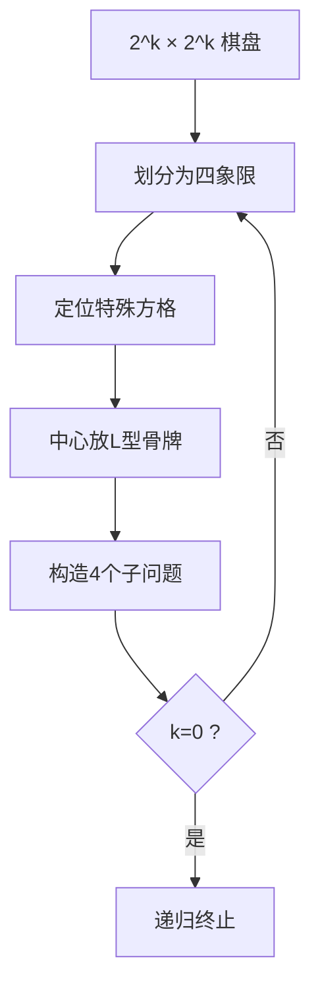

# 棋盘覆盖问题的分治法求解

> [!IMPORTANT]
> 棋盘覆盖问题：用分治法将 $2^k \times 2^k$ 的缺一个方格的棋盘，恰好铺满 L 型骨牌（每块占 3 格）。

## 它是什么与为什么需要

给定一个 $2^k \times 2^k$ 的棋盘，其中恰有一个方格是“特殊方格”（已被占据或损坏），要求用若干 L 型骨牌（由 3 个方格组成）覆盖其余所有方格，且骨牌之间不能重叠。

为什么需要分治？直接尝试摆放 L 型骨牌，搜索空间随 $k$ 指数爆炸。但如果把大问题拆成结构完全相同的小问题呢？这就是分治法的威力。

## 怎么做：分治策略

思考一个问题：如果把 $2^k \times 2^k$ 的棋盘等分成四个 $2^{k-1} \times 2^{k-1}$ 的子棋盘，特殊方格必然落在其中一个子棋盘里。那另外三个子棋盘没有特殊方格，不满足递归条件，怎么办？

答案是在==四个子棋盘的交汇处放置一块 L 型骨牌==，让它分别占据那三个“干净”子棋盘各一个角上的方格。这样，每个子棋盘都恰好包含一个“特殊方格”，原问题被分解为 4 个规模减半的同构子问题。

**算法步骤：**

1. **分解**：将当前棋盘均分为左上、右上、左下、右下四个象限。
2. **判断**：确定特殊方格位于哪个象限。
3. **处理**：在剩余三个不含特殊方格的象限的相邻角上，放置一块 L 型骨牌（将其标记为新的特殊方格）。
4. **递归**：对四个象限分别递归执行上述过程，直到子棋盘大小为 $1 \times 1$（即 $k=0$）。

> [!TIP]
> 记忆口诀：“一分为四找特殊，中心补 L 造特殊，四块递归到底停。”

## 算对了的例子

以 $k=2$（即 $4 \times 4$ 棋盘）为例，假设特殊方格在坐标 $(0,0)$（左上角），编号规则：初始特殊方格为 0，每次放置的 L 型骨牌依次编号 1, 2, 3, 4, 5。

| | 列 0 | 列 1 | 列 2 | 列 3 |
|---|:---:|:---:|:---:|:---:|
| **行 0** | 0 | 2 | 3 | 3 |
| **行 1** | 2 | 2 | 1 | 3 |
| **行 2** | 4 | 1 | 1 | 5 |
| **行 3** | 4 | 4 | 5 | 5 |

- **第 1 层递归**：$(0,0)$ 在左上象限，在中心交汇处 $(1,1),(1,2),(2,1)$ 放置骨牌 **1**。
- **第 2 层递归**：四个 $2 \times 2$ 子棋盘各自特殊方格分别为 $(0,0)$、$(1,2)$、$(2,1)$、$(1,1)$（后三个由骨牌 1 制造），再分别放置骨牌 **2, 3, 4, 5**。

所需骨牌总数公式：$T(k) = \frac{4^k - 1}{3}$。当 $k=2$ 时，$T(2)=5$，与上表吻合。

## 相近概念的区别

| 维度 | 棋盘覆盖 | 归并排序 |
|---|---|---|
| 子问题关系 | 相互独立但需==人工制造依赖==（放 L 型骨牌） | 天然独立 |
| 合并操作 | 无需合并，骨牌已在原位 | 必须执行 Merge |
| 递归基 | $1 \times 1$ 棋盘 | 长度为 1 的数组 |

## 常见的坑

> [!WARNING]
> 坐标计算错误：划分象限时，右下角起始坐标是 `(mid_row+1, mid_col+1)` 而非 `mid`，务必根据行列中点严格判定特殊方格属于哪个象限。

> [!CAUTION]
> 遗漏递归基：当 $k=0$ 时棋盘只有 1 格且就是特殊方格，必须直接返回，否则死递归。

> [!NOTE]
> 时间复杂度分析：每次产生 4 个子问题，规模为原来的 $1/4$，加上常数时间的中心判断与放置，递推式为 $T(n) = 4T(n/4) + O(1)$（此处 $n$ 指边长 $2^k$ 对应的子问题数）。由主定理得总时间复杂度为 $O(4^k)$，即恰好等于骨牌数量，是最优的。
