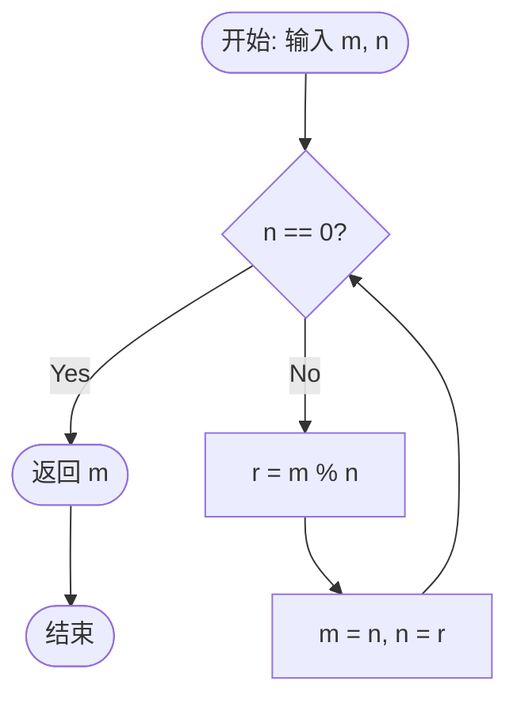

# 欧几里德算法（递归与迭代实现求最大公约数）

## 它是什么与为什么需要

欧几里德算法（Euclidean Algorithm），又称==辗转相除法==，是求解两个正整数 $m$ 和 $n$ 的==最大公约数==（Greatest Common Divisor, GCD）的经典算法。

在算法设计中，它是理解==递归==与==迭代==转换、以及分析算法效率（特别是取模运算对规模缩减的作用）的基础案例。相比于暴力枚举法（从 $\min(m,n)$ 向下试探），欧几里德算法利用数学性质 $\gcd(m, n) = \gcd(n, m \bmod n)$，将问题规模迅速缩小，时间复杂度仅为 $O(\log(\min(m,n)))$。

> [!IMPORTANT]
> 核心定理：$\gcd(m, n) = \gcd(n, m \bmod n)$，其中 $m \ge n > 0$。当 $n=0$ 时，$\gcd(m, 0) = m$。

## 怎么做：递归与迭代实现

算法的核心在于不断用“除数”和“余数”替换原来的“被除数”和“除数”，直到余数为 0。

### 1. 递归实现
递归版本直接映射了数学定义，代码简洁，但需注意栈空间消耗。

```cpp
int RGcd(int m, int n) {
    if (n == 0) return m;      // 基础情况 (Base Case)
    return RGcd(n, m % n);     // 递归步骤 (Recursive Step)
}
```

### 2. 迭代实现
迭代版本通过 `while` 循环消除递归调用，节省栈空间，通常效率更高。

```cpp
int IGcd(int m, int n) {
    while (n != 0) {
        int r = m % n;
        m = n;
        n = r;
    }
    return m;
}
```



## 算例演示

以计算 $\gcd(48, 18)$ 为例：

1.  $48 \bmod 18 = 12$，转化为 $\gcd(18, 12)$
2.  $18 \bmod 12 = 6$，转化为 $\gcd(12, 6)$
3.  $12 \bmod 6 = 0$，转化为 $\gcd(6, 0)$
4.  $n=0$，返回 $m=6$。

故 $\gcd(48, 18) = 6$。

## 常见坑与辨析

| 特性 | 递归实现 | 迭代实现 |
| :--- | :--- | :--- |
| **代码可读性** | 高，贴近数学定义 | 中，需维护变量状态 |
| **空间复杂度** | $O(\log n)$，依赖递归深度 | $O(1)$，仅常数个变量 |
| **尾递归优化** | 编译器可能优化为跳转 | 天然无栈开销 |

> [!WARNING]
> **边界条件**：确保输入为非负整数。若 $m < n$，第一次取模后会自动交换位置（因为 $m \bmod n = m$），所以无需预先判断大小，但明确 $m \ge n$ 有助于理解。

> [!TIP]
> **效率对比**：在复习题中曾出现对比，对于特定大数，迭代或优化的辗转相除比简单减法快上千倍。关键在于使用 `%` (取模) 而非 `-` (减法) 来快速缩减规模。

## 总结

欧几里德算法是==分治策略==的一个特例（虽然子问题只有一个，但规模显著减小）。掌握其递归到迭代的转换，不仅有助于编写高效代码，也是后续学习更复杂递归算法（如快速排序、归并排序）的基础。记住：**余数为零时，除数即答案**。
