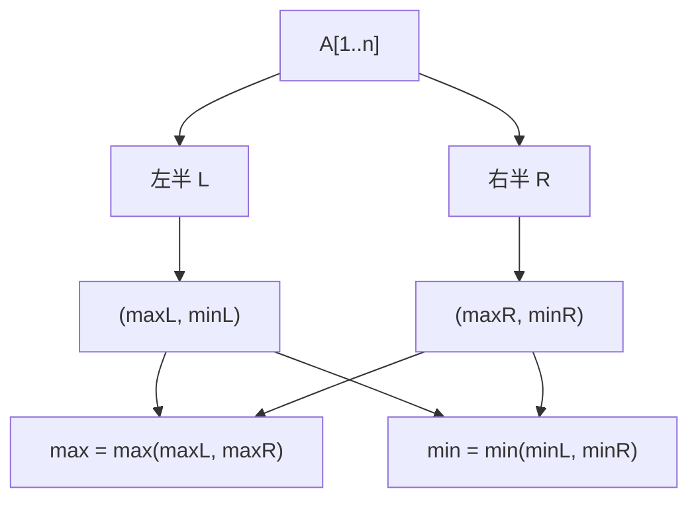

# 分治法求最大最小元及其比较次数分析

## 分治法求最大最小元

在一个无序的集合中同时找出最大值和最小值，是算法设计中一个看似简单却值得深究的问题。当数据规模很大，或者比较操作本身代价高昂时，如何用更少的比较次数完成任务，就变得重要起来。

### 为什么不能直接遍历两遍

最朴素的想法是：先用 $n-1$ 次比较找到最大值，再在剩余元素中用 $n-2$ 次比较找到最小值，总共 $2n-3$ 次比较。

能不能更省？==分治法的核心机会在于：两个元素之间只需比较一次，就能同时为一对“候选最大值”和“候选最小值”的角逐提供信息。==

### 分治法的做法

将序列 $A[1\dots n]$ 不断对半划分，直到子问题规模足够小（通常是 1 或 2），直接得出该子数组的最大最小元；然后自底向上合并。

**递归描述**

1. **递归出口**：当区间长度 $len \le 2$ 时，直接比较出该区间的最大、最小元。
   - $len = 1$：最大最小均为该元素。
   - $len = 2$：一次比较即可分出最大、最小。
2. **划分**：将区间平分为左半 $L$ 和右半 $R$。
3. **递归求解**：分别求出 $L$ 的最大最小元 $(max_L, min_L)$ 和 $R$ 的最大最小元 $(max_R, min_R)$。
4. **合并**：$max = \max(max_L, max_R)$，$min = \min(min_L, min_R)$。

### 比较次数分析

设 $T(n)$ 为对 $n$ 个元素求最大最小元所需的比较次数。递推关系为：
- 当 $n = 1$：$T(1) = 0$
- 当 $n = 2$：$T(2) = 1$
- 当 $n > 2$：$T(n) = T(\lceil n/2 \rceil) + T(\lfloor n/2 \rfloor) + 2$

合并阶段需要 2 次比较：一次比较两个最大值，一次比较两个最小值。

为了便于求解，设 $n = 2^k$，则有：
$$
T(n) = 2T(n/2) + 2
$$
展开：
$$
\begin{aligned}
T(n) &= 2\big[2T(n/4) + 2\big] + 2 = 4T(n/4) + 4 + 2 \\
&= \cdots = 2^{k-1}T(2) + 2(2^{k-1} - 1) \\
&= 2^{k-1} \times 1 + 2^k - 2 = \frac{3}{2}n - 2
\end{aligned}
$$

> [!IMPORTANT]
> 分治法求最大最小元的最坏情况比较次数为 $\frac{3}{2}n - 2$（当 $n$ 为 2 的幂时），对于一般 $n$，比较次数约为 $\lceil \frac{3}{2}n \rceil - 2$。

这明显优于朴素方法的 $2n-3$。

### 与直接两两分组法的对比

另一种优化思路是“两两分组法”：从头开始，每两个元素比一次，大的去争最大值，小的去争最小值。该方法的比较次数同样是 $\frac{3}{2}n - 2$。

| 方法 | 核心思想 | 比较次数（n 为偶数时） |
| :--- | :--- | :--- |
| 朴素遍历 | 先找最大，再找最小 | $2n - 3$ |
| 分治法 | 递归划分，合并时比较极值 | $\frac{3}{2}n - 2$ |
| 两两分组 | 相邻配对，胜者组/败者组分头比较 | $\frac{3}{2}n - 2$ |

> [!TIP]
> 分治法与两两分组法在比较次数上等效，但分治法的结构更容易并行化，在并行计算环境下优势明显。

### 算对了的例子

设序列为 $[5, 3, 8, 1, 9, 2]$（$n=6$），用分治过程模拟：

1. **划分**：$L=[5,3,8]$，$R=[1,9,2]$
2. **左半再分**：$L_1=[5]$（max=5,min=5），$L_2=[3,8]$（比较一次：max=8,min=3）
   - 合并 $L$：比较两个 max（5 和 8）→ max=8；比较两个 min（5 和 3）→ min=3。左半：(8,3)
3. **右半再分**：$R_1=[1,9]$（比较一次：max=9,min=1），$R_2=[2]$（max=2,min=2）
   - 合并 $R$：比较 max（9 和 2）→ max=9；比较 min（1 和 2）→ min=1。右半：(9,1)
4. **最终合并**：比较左右两半的 max（8 和 9）→ max=9；比较 min（3 和 1）→ min=1。

结果：最大值 9，最小值 1。

让我们清点比较次数：
- 左侧细分：1（处理[3,8]）+ 2（合并左半）= 3
- 右侧细分：1（处理[1,9]）+ 2（合并右半）= 3
- 最终合并：2
- **总计**：8 次比较。

验证公式：$\lceil \frac{3}{2} \times 6 \rceil - 2 = 9 - 2 = 7$。为什么实际是 8 次？
因为 $n=6$ 并非 2 的幂，子问题划分不对称，实际递推 $T(6) = T(3)+T(3)+2$，$T(3) = T(2)+T(1)+2 = 1+0+2=3$，所以 $T(6)=3+3+2=8$。公式 $\frac{3}{2}n-2$ 是 $n$ 为 2 的幂时的精确下界，一般情况会略有上浮，但仍优于 $2n-3=9$ 次。

> [!WARNING]
> 非 2 的幂长度下，划分不均会导致比较次数略高于 $\frac{3}{2}n-2$，但性能依然明显优于朴素方法。解题时若题目未要求精确递推，可用 $\lceil \frac{3}{2}n \rceil - 2$ 作为上界估算。
