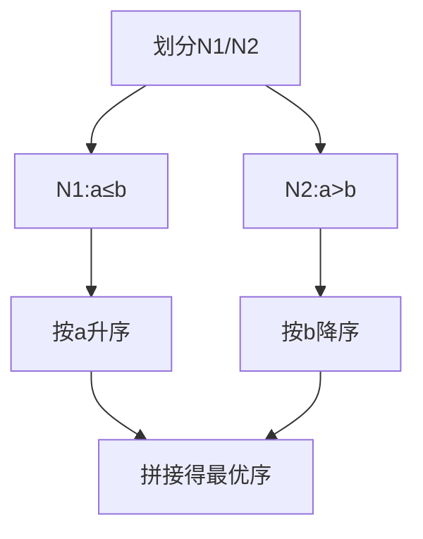

# 流水作业调度问题与Johnson算法

## 问题本质与最优子结构

双机流水作业调度问题要求确定 $n$ 个作业在设备 $P_1$ 和 $P_2$ 上的加工顺序，使总完工时间 $F(S)$ 最小。每个作业必须 ==先在 $P_1$ 加工，再在 $P_2$ 加工==，且两台设备同一时刻只能处理一个作业。

为什么不能简单按 $a_i$ 或 $b_i$ 排序？因为 $P_2$ 的空闲等待时间取决于相邻作业的衔接。若前一个作业在 $P_2$ 耗时过长，会导致后续作业在 $P_1$ 完成后被迫等待。定理7-3指出该问题具有==最优子结构性质==，这为动态规划提供了理论基础，但直接DP状态爆炸，需借助Johnson法则转化为高效算法。

> [!IMPORTANT]
> 尽管Johnson算法表现为贪心策略，但在南邮《算法分析与设计》课程体系中，它被归类为==动态规划算法==的特例，因其正确性依赖于最优子结构的严格证明。

## Johnson算法执行步骤

设作业 $i$ 在 $P_1$、$P_2$ 上的加工时间分别为 $a_i$ 和 $b_i$。如何安排才能让 $P_2$ 尽可能“不闲着”？核心思想是将作业分为两组分别排序：

具体操作如下：

1.  将作业集划分为 $N_1 = \{i \mid a_i \leq b_i\}$ 和 $N_2 = \{i \mid a_i > b_i\}$；
2.  $N_1$ 中作业按 $a_i$ ==非递减==排序；
3.  $N_2$ 中作业按 $b_i$ ==非递增==排序；
4.  将 $N_1$ 序列接上 $N_2$ 序列，即为最优调度方案。

> [!TIP]
> 记忆口诀：“小a在前按a升，大a在后按b降”。三元组 `(jobNo, t, ab)` 排序时，`ab=0` 表示属于 $N_1$（键值为 $a_i$），`ab=1` 表示属于 $N_2$（键值为 $b_i$）。

## 实例演算与复杂度

设有4个作业，$(a_i, b_i)$ 分别为：(3,6)、(5,2)、(8,4)、(1,7)。

| 作业 | $a_i$ | $b_i$ | 分组 | 排序键 |
| :--- | :--- | :--- | :--- | :--- |
| 0    | 3     | 6     | $N_1$ | $a=3$ |
| 1    | 5     | 2     | $N_2$ | $b=2$ |
| 2    | 8     | 4     | $N_2$ | $b=4$ |
| 3    | 1     | 7     | $N_1$ | $a=1$ |

$N_1$ 按 $a$ 升序：作业3(1)、作业0(3)；$N_2$ 按 $b$ 降序：作业2(4)、作业1(2)。最优调度序列为 ==3→0→2→1==。可验证该顺序下 $P_2$ 等待时间最短。

> [!WARNING]
> 当 $a_i = b_i$ 时，作业既可归入 $N_1$ 也可归入 $N_2$，但==必须统一归入 $N_1$== 并按 $a_i$ 升序排列，否则可能破坏最优性。

算法瓶颈在于排序，时间复杂度为 $O(n \log n)$，空间复杂度 $O(n)$。注意区分：一般多机流水作业是NP-hard问题，唯有==双机情形==可用Johnson算法多项式求解。考试中若选项同时出现“贪心”与“动态规划”，依据课件应选==动态规划算法==。
