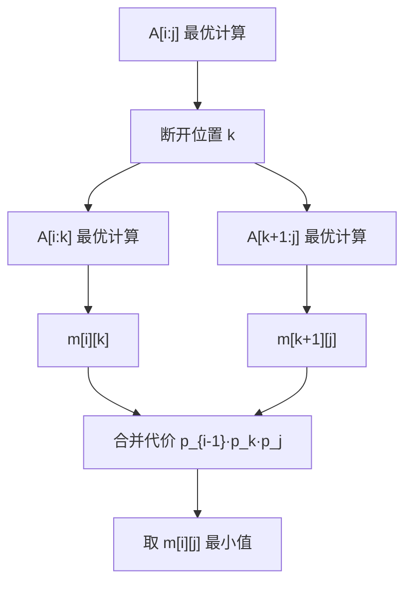

# 矩阵连乘问题的动态规划求解（完全加括号、递推关系、备忘录方法）

## 矩阵连乘问题的动态规划求解

矩阵连乘问题要回答的是：给定 $n$ 个可乘矩阵 $A_1, A_2, \dots, A_n$，由于矩阵乘法满足结合律，不同的加括号方式虽然不改变计算结果，却会导致数乘次数产生巨大差异。我们需要找到一种加括号方式，使得总的数乘次数最少。

### 为什么加括号会改变计算量

设矩阵 $A$ 是 $p \times q$ 维，矩阵 $B$ 是 $q \times r$ 维，则计算 $A \times B$ 需要 $p \times q \times r$ 次数乘。矩阵链越长，中间结果矩阵的规模会因结合顺序而截然不同，计算量自然相差悬殊。

> [!IMPORTANT]
> ==矩阵连乘只改变计算次序，不改变乘积结果==，但数乘次数的差距可能是数量级的。

### 完全加括号

完全加括号的矩阵连乘积可递归定义为：

- 单个矩阵是完全加括号的；
- 若矩阵连乘积 $A$ 是完全加括号的，则 $A$ 可表示为两个完全加括号的矩阵连乘积 $B$ 和 $C$ 的乘积再加括号，即 $A = (BC)$。

例如四个矩阵 $A(50 \times 10)$、$B(10 \times 40)$、$C(40 \times 30)$、$D(30 \times 5)$，五种完全加括号方式的计算量如下：

| 完全加括号形式 | 连乘积所需计算量 |
|---|---|
| `(A(B(CD)))` | $40 \times 30 \times 5 + 10 \times 40 \times 5 + 50 \times 10 \times 5 = 10500$ |
| `(A(BC)D)` | $10 \times 40 \times 30 + 10 \times 30 \times 5 + 50 \times 10 \times 5 = 16000$ |
| `((AB)(CD))` | $50 \times 10 \times 40 + 40 \times 30 \times 5 + 50 \times 40 \times 5 = 36000$ |
| `(((AB)C)D)` | $50 \times 10 \times 40 + 50 \times 40 \times 30 + 50 \times 30 \times 5 = 87500$ |
| `((A(BC))D)` | $10 \times 40 \times 30 + 50 \times 10 \times 30 + 50 \times 30 \times 5 = 34500$ |

同样的四个矩阵，最优的 10500 次与最差的 87500 次相差超过 8 倍。这是动态规划求解该问题的直接动机。

### 递推关系的建立

记 $A[i:j]$ 表示连乘积 $A_i A_{i+1} \cdots A_j$，其中 $i \leq j$。设矩阵 $A_i$ 的维数为 $p_{i-1} \times p_i$。

考察 $A[i:j]$ 的最优计算次序。设它在矩阵 $A_k$ 与 $A_{k+1}$ 之间断开（$i \leq k < j$），则相应加括号方式为：

$$
(A_i A_{i+1} \cdots A_k)(A_{k+1} A_{k+2} \cdots A_j)
$$

设 $m[i][j]$ 为计算 $A[i:j]$ 所需的最少数乘次数。当 $i = j$ 时，单个矩阵无需计算，$m[i][i] = 0$。当 $i < j$ 时：

$$
m[i][j] = \min_{i \leq k < j}\big\{ m[i][k] + m[k+1][j] + p_{i-1} p_k p_j \big\}
$$

其中 $p_{i-1} p_k p_j$ 是将左右两个子链的结果矩阵相乘所需的数乘次数。

用二维数组 $s[i][j]$ 记录最优断开位置 $k$，便于最后构造完整的加括号表达式。

### 动态规划自底向上求解

由于 $m[i][j]$ 依赖更短区间的值，计算顺序应按区间长度递增进行：先算所有长度为 1 的区间，再算长度为 2 的区间，直至长度为 $n$ 的完整链。

> [!TIP]
> 计算顺序的口诀：==“由短到长，穷举断点”==。短区间先算好，长区间才能在 $O(1)$ 时间内取到子问题值。

### 备忘录方法

备忘录方法是动态规划的一种变形。它保持自顶向下的递归结构，但为每个已经计算过的子问题建立备忘录，即把结果存入 `m[i][j]` 中。递归进入某个子问题前先查看备忘录，若已有结果则直接返回，否则计算并存入。

> [!NOTE]
> 备忘录方法与动态规划法的核心区别：==备忘录方法是自顶向下递归，动态规划法是自底向上迭代==。两种方法都保存子问题的解，只是触发计算的顺序不同。

备忘录方法在只有部分子问题需要求解时更有利，因为它只计算实际访问到的子问题；而动态规划法会把所有子问题都计算一遍。

### 一个算对了的例子

给定 4 个矩阵，维数分别为 $p_0 = 50$、$p_1 = 10$、$p_2 = 40$、$p_3 = 30$、$p_4 = 5$。填表过程按区间长度递增：

**长度 1**：$m[0][0] = m[1][1] = m[2][2] = m[3][3] = 0$

**长度 2**：

- $m[0][1] = 50 \times 10 \times 40 = 20000$，断开位置 $k=0$
- $m[1][2] = 10 \times 40 \times 30 = 12000$，断开位置 $k=1$
- $m[2][3] = 40 \times 30 \times 5 = 6000$，断开位置 $k=2$

**长度 3**：

- $m[0][2] = \min\{ m[0][0] + m[1][2] + 50 \times 10 \times 30,\ m[0][1] + m[2][2] + 50 \times 40 \times 30 \}$
  $= \min\{ 0 + 12000 + 15000,\ 20000 + 0 + 60000 \} = 27000$，取 $k=0$
- $m[1][3] = \min\{ 0 + 6000 + 10 \times 40 \times 5,\ 12000 + 0 + 10 \times 30 \times 5 \}$
  $= \min\{ 8000,\ 13500 \} = 8000$，取 $k=1$

**长度 4**：

- $m[0][3] = \min\{ 0 + 8000 + 50 \times 10 \times 5,\ 20000 + 6000 + 50 \times 40 \times 5,\ 27000 + 0 + 50 \times 30 \times 5 \}$
  $= \min\{ 8000 + 2500 = 10500,\ 26000 + 10000 = 36000,\ 27000 + 7500 = 34500 \} = 10500$，取 $k=0$

最优值为 10500，对应加括号方式 `(A(B(CD)))`。

> [!IMPORTANT]
> 填表时 ==$m[i][j]$ 必须按区间长度从小到大计算==，因为递归关系中用到的 $m[i][k]$ 和 $m[k+1][j]$ 代表的区间一定比 $[i,j]$ 短。

### 常见易错点

> [!WARNING]
> 维数数组 $p$ 的长度是 $n+1$，不是 $n$。矩阵 $A_i$ 的维数是 $p_{i-1} \times p_i$，计算合并代价时必须写 $p_{i-1} \cdot p_k \cdot p_j$，漏写 $p_k$ 或写错下标是最常见的错误。

> [!CAUTION]
> 断开位置 $k$ 的范围是 $i \leq k < j$，不能取到 $j$，否则右侧子链 $A[k+1:j]$ 会变成空链。
