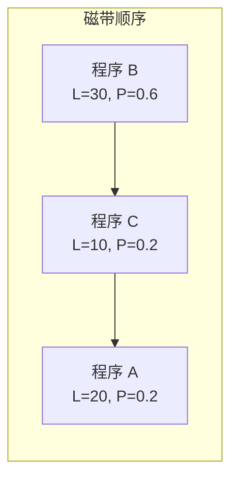

# 磁带最优存储问题（单带与多带最优存储）

## 问题是什么？

想象你是一台老式磁带机管理员，磁带只能顺序读写。现在有 $n$ 个程序需要存储在磁带上，第 $i$ 个程序的长度是 $L_i$，被调用的概率是 $P_i$。系统每次寻找一个程序，都需要从磁带开头依次扫描，直到找到目标程序并读入。显然，如果把最常用的程序放在磁带最前面，平均等待时间就会大大缩短。

==磁带最优存储问题==，就是要找到一种程序在磁带上的排列顺序，使得**平均检索时间（Mean Retrieval Time, MRT）最小**。
$$
MRT = \sum_{j=1}^{n} \left( P_{i_j} \cdot \sum_{k=1}^{j} L_{i_k} \right)
$$
其中 $i_1, i_2, \dots, i_n$ 是程序的排列顺序。

## 为什么需要贪心法？

如果程序数量 $n$ 很大，穷举所有 $n!$ 种排列是不可能的。一个直觉是：调用概率大、长度短的程序应该放在前面，这样它对后续程序的“拖累”就小。如何量化这种“拖累”？我们可以考虑一个**单位长度的调用价值**。

## 单带最优存储

### 贪心策略

对于只有一条磁带的情况，最优存储策略是：==按 $\frac{P_i}{L_i}$ 的比值**非递增**（即递减或相等）排列程序==。

[!IMPORTANT]
> 核心贪心因子是“单位长度的调用概率” $P_i / L_i$，比值越大，越应靠前。如果比值相同，则任意排列都不影响总 MRT。如果某个程序 $P_i = 0$，它应放在最后。

### 为什么这样做是对的？

我们可以通过交换论证来理解。假设在某个排列中，程序 $A$ 紧邻在程序 $B$ 之前。如果交换 $A$ 和 $B$ 的顺序，那么 MRT 的变化量是 $P_B L_A - P_A L_B$。我们希望交换后 MRT 减小，那就需要 $P_B L_A - P_A L_B < 0$，即 $\frac{P_A}{L_A} > \frac{P_B}{L_B}$。这说明，只要相邻的两个程序不满足“比值大者在前”的规则，交换它们就能让总 MRT 变小。因此，按 $P_i/L_i$ 降序排列就是全局最优解。

### 算一个例子

已知三个程序：

| 程序   | 长度 $L$ |  概率 $P$  | 比值 $P/L$ |
|--------|:--------:|:----------:|:----------:|
| $A$    |    20    |    0.2     |   0.010    |
| $B$    |    30    |    0.6     |   ==0.020== |
| $C$    |    10    |    0.2     |   0.020    |

按 $P/L$ 降序排列：$B$ 和 $C$ 比值相等，可放前面。我们采用顺序：$B, C, A$。

计算 MRT：
- 检索 $B$ 的等待时间：从头读到 $B$ 末尾，长度 = $30$。贡献：$0.6 \times 30 = 18$。
- 检索 $C$ 的等待时间：需要经过 $B$ 和 $C$，长度 = $30+10 = 40$。贡献：$0.2 \times 40 = 8$。
- 检索 $A$ 的等待时间：需要经过 $B, C, A$，长度 = $30+10+20 = 60$。贡献：$0.2 \times 60 = 12$。
**总 MRT = $18 + 8 + 12 = 38$**。

## 多带最优存储

### 问题升级

现在我们有 $m$ 条独立的磁带，每个程序只能完整地存储在一条磁带上。每条磁带的读取头独立移动，因此不同磁带上的检索可以并行开始。但是，在**同一条磁带内部**，仍然是顺序检索。

我们的目标依然是使总的平均检索时间最小。这需要两个决策：
1.  如何将 $n$ 个程序分组到这 $m$ $ 条磁带上？
2.  在每条磁带内部，程序如何排序？

### 贪心策略

==多带最优存储仍基于 $P_i/L_i$ 比值==，策略采用最大处理时间（LPT）或类似思想，这里给出南邮课件中的经典方法：

1.  **排序**：将所有程序按 $P_i/L_i$ 降序排列。
2.  **初始分配**：取出前 $m$ 个程序，依次放入磁带 $1, 2, \dots, m$。
3.  **循环分配**：对于第 $m+1$ 及以后的程序，总是将其分配给当前**总检索时间（或总长度，取决于具体模型变种）最小**的那条磁带，并放在该磁带已有程序的**末尾**。

[!WARNING]
> 一个常见误区：多带问题并不是简单地将单带最优序列切成 $m$ 段分给每条磁带。必须考虑“每条磁带的开头都是高优先级程序”，所以要先将比值最大的 $m$ 个程序分别“播种”到每条磁带上，作为各自的开路先锋。

### 延伸辨析：单带 vs 多带

| 特性 | 单带最优存储 | 多带最优存储 |
|:---|:---|:---|
| **排列依据** | $P_i/L_i$ 降序 | 先按 $P_i/L_i$ 降序，再结合各带负载平衡 |
| **问题本质** | 一维顺序排列 | 先分组，再在组内一维排列 |
| **贪心策略** | 简单排序即可 | 排序 + 分配（类似多机调度思想） |
| **最优性** | $P_i/L_i$ 降序是全局最优解 | 课件中给出的方法是近似算法，不一定保证绝对最优，但效果很好 |

[!TIP]
> 记忆口诀：“单带看比值排到底，多带开荒再平衡”——先把最强的 $m$ 个种子选手分到各带当排头，后续选手哪带弱就跟哪带。
