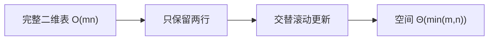

# 算法的空间复杂度定义

## 先理解问题

算法运行需要消耗两类资源：**时间**和**存储空间**。时间复杂性衡量运行快慢，空间复杂性则衡量算法运行时需要占用多少内存。

一个直观感受：同样是求前 $n$ 个数的和，可以一个个累加，只用一个变量存中间结果；也可以先建一个长度 $n$ 的数组把所有数存起来再加。两种做法结果相同，但后者额外占用了 $O(n)$ 的存储空间。

> [!IMPORTANT]
> 算法的**空间复杂度**定义为：算法运行过程中临时占用的存储空间随问题规模 $n$ 增长的变化趋势，记作 $S(n)$。通常用渐近记号（如 $O$、$\Theta$）表示。

## 空间复杂度到底算哪些

空间复杂度的统计范围是**临时辅助空间**，不包括：

| 计入 | 不计入 |
|------|--------|
| 局部变量占用的空间 | 输入数据本身占用的空间 |
| 递归调用栈的深度 | 程序代码占用的固定空间 |
| 动态分配的辅助数组 | 输出结果占用的空间 |

例如快速排序，输入数组本身不占用"额外空间"，但递归调用的栈深度在最坏情况下达到 $n$ 层，因此最坏空间复杂度为 $O(n)$。两路合并排序需要一个与输入等长的辅助数组暂存归并结果，空间复杂度为 $O(n)$。

> [!WARNING]
> 递归算法的空间复杂度容易算错：递归深度 $\times$ 每层局部变量大小。快速排序最好情况下递归深度 $\log n$，空间 $O(\log n)$；最坏情况下深度 $n$，空间退化为 $O(n)$。

## 为什么需要关注空间

时间当然重要，但内存不是无限的。动态规划中，往往可以同时算出整个二维表，但如果每次只用到前一行或前两行，就能大幅压缩空间。

以最长公共子序列（LCS）为例。经典算法需要一个 $m \times n$ 的数组 `c` 和一个方向数组 `s`。如果==只计算 LCS 的长度而不构造解==，则计算 `c[i][j]` 时只用到了 `c[i-1][j]`、`c[i][j-1]` 和 `c[i-1][j-1]`。也就是说，当前行只依赖上一行。此时只需保存**两行**元素，空间从 $O(mn)$ 降为 $\Theta(\min(m,n))$——选取较短的序列长度作为"行数"，交替使用两行滚动更新。



## 一个算对了的例子

补充题：用动态规划求组合数 $C_n^m$。

递推公式为 $C_n^m = C_{n-1}^{m-1} + C_{n-1}^m$，边界条件 $C_n^0 = C_n^n = 1$。

**朴素做法**：开一个 $(n+1)\times(m+1)$ 的二维数组 `dp`，逐行填表。空间复杂度 $O(nm)$。

**改进做法**：观察递推公式，`dp[i][j]` 只依赖上一行 `i-1` 的 `j-1` 和 `j`。可以用一维数组从右往左滚动更新：

```c
int combinat(int m, int n) {
    int dp[m + 1];
    for (int i = 0; i <= m; i++) dp[i] = 0;
    dp[0] = 1;
    for (int i = 1; i <= n; i++) {
        for (int j = m; j >= 1; j--) {
            dp[j] = dp[j] + dp[j - 1];
        }
    }
    return dp[m];
}
```

> [!TIP]
> 内层循环**从右往左**遍历，是为了避免 `dp[j-1]` 被同一轮刚更新过的值覆盖。从右往左时，`dp[j-1]` 仍然是上一轮（即第 $i-1$ 行）的值。

这个版本的空间复杂度从 $O(nm)$ 降为 **$O(m)$**。如果 $m$ 比 $n$ 大，可以交换 $m$ 和 $n$ 的角色，使空间复杂度为 $O(\min(m,n))$。

> [!NOTE]
> 空间换时间、时间换空间是算法设计中的经典权衡。动态规划中"滚动数组"是压缩空间最常用的手段，但并非所有问题都能压缩——需要确认当前状态只依赖固定数量的前序行。
