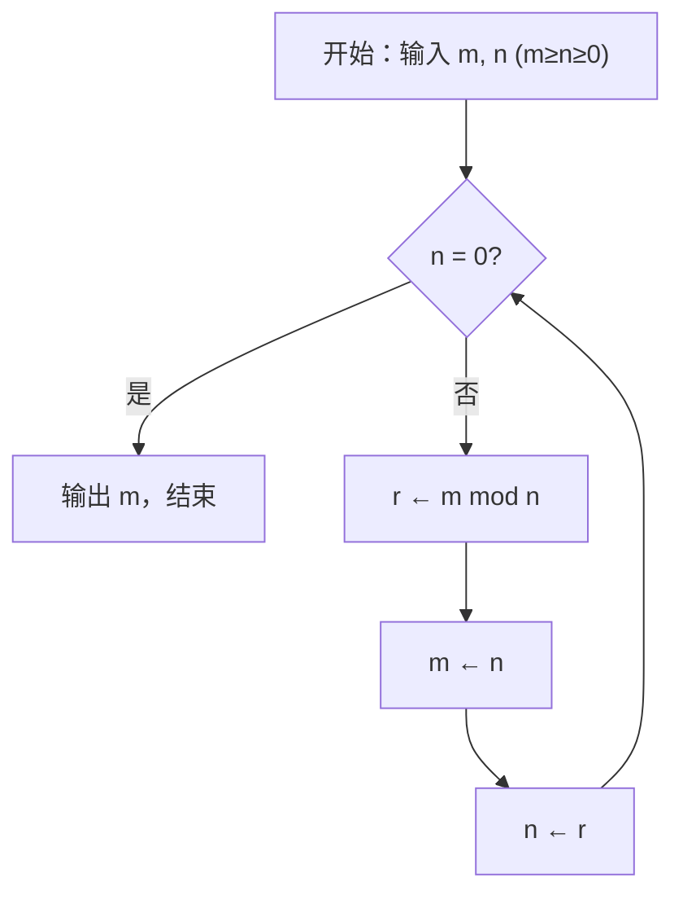

# 算法的概念与基本特性（确定性、有限性等）

---

算法的概念与基本特性是理解整个课程体系的逻辑起点。我们从一个直观的问题开始：如果面临一道从未见过的数学难题，你更希望得到一份含糊的指引，还是一张清晰、无歧义的步骤清单？答案显然是后者。在计算机科学中，这样一份精确、无二义、能在有限时间内完成的操作序列，就是**算法**。

### 什么是算法？从“食谱”到“指令集”

算法的核心定义是：==算法是求解一类特定问题的有限、确定、可行且有效的指令序列==。它不只是一个模糊的方法，而是一个具体的过程。为了更精确地界定，算法必须具备五大核心特性，它们是区分“一段有用的描述”和“一段计算机可执行的算法”的根本标准。

我们可以通过下表清晰地把握每个特性的含义：

| 算法特性 | 核心含义 | 关键刻画 | 日常类比（以做菜为例） |
| :--- | :--- | :--- | :--- |
| **输入** (Input) | 算法有**零个或多个**从外界获得的量。 | 算法加工的对象，可以有，也可以没有。 | 菜谱中的“食材与调料”。 |
| **输出** (Output) | 算法**至少产生一个**量。 | 算法计算的结果，必须得有产出。 | 最终做出的“菜肴”。 |
| **确定性** (Definiteness) | 每条指令都有**确切的、无二义**的定义。 | 执行者（人或机器）在任何时刻都知道下一步该做什么。 | “将盐放入锅中”，而非“适量加盐”。 |
| **能行性** (Effectiveness) | 指令足够基本，可通过已实现的基本操作**执行有限次**来实现。 | 每条指令都是能真正“做到”的，而非空中楼阁。 | “用锅铲翻炒”，而非“使食材变得美味”。 |
| **有穷性** (Finiteness) | 算法必须在执行**有限步**之后终止。 | 避免了“无限循环”，是算法的关键约束。 | 菜谱总有一个“出锅装盘”的结束步骤。 |

其中，==确定性是重中之重==，它保证了算法的机械性，使得不同的执行者对同一算法在相同的输入下，总能得到完全相同的执行过程和结果。

`[!WARNING]`
`> 算法与程序：一个常挖的坑`
`> 程序是算法用特定程序设计语言的具体实现，但程序可以不满足“有穷性”。例如，一个没有停机条件的操作系统就是一个程序，但它不是我们定义下的“算法”，因为它被设计为永不停机。可以说，算法是程序的核心逻辑，但一个合格的程序未必是一个严格意义上的算法。`

### 如何判断？两个核心特性的辨析

在考试中，经常会出现“这个描述违反了哪个特性”的辨析题，尤其是**确定性**和**能行性**。

- **确定性**侧重于指令含义的唯一性。例如，“如果 `x` 比较小，就执行操作A”就违反了确定性，因为“较小”是模糊的。
- **能行性**侧重于指令的可操作性。例如，一条指令“计算圆周率 `π` 的最后一位数字”是确定的（你知道就是那个数），但在当前理论下是==不可行的==，因为它永远无法通过有限步基本运算来完成。

`[!TIP]`
`> 记忆口诀：`
`> 零入一出必须有，指令确定无歧义。`
`> 步骤基本能执行，有限步后必停机。`

### 一个算对了的例子：欧几里德算法

为了将这些概念具体化，我们来看求两个非负整数最大公约数的**欧几里德算法**。它完美诠释了所有特性。

- **输入**：两个整数 `m, n`。
- **有穷性**：每次循环，`n` 的值严格递减，非负整数序列不可能无限下降，因此算法必在有限步内到达 `n=0` 并终止。
- **确定性**：`m`、`n` 的赋值、取模运算 `mod` 的含义没有丝毫歧义。
- **能行性**：取模、赋值、比较等操作都是计算机可直接执行的基本运算。
- **输出**：算法终止时，变量 `m` 就是所求的最大公约数。

例如，计算 `gcd(12, 8)`：
初始 `m=12, n=8`。`8≠0`，`r=12 mod 8 = 4`，赋值后 `m=8, n=4`。
`4≠0`，`r=8 mod 4 = 0`，赋值后 `m=4, n=0`。
`n=0`，输出最终结果 `m=4`。

---
**常见考题回顾**：
- 选择：算法的（ **确定性** ）是指指令无二义性。
- 选择：算法的（ **能行性** ）是指指令必须足够基本。
- 判断/选择：欧几里德算法是求解（ **最大公约数** ）的经典算法。
