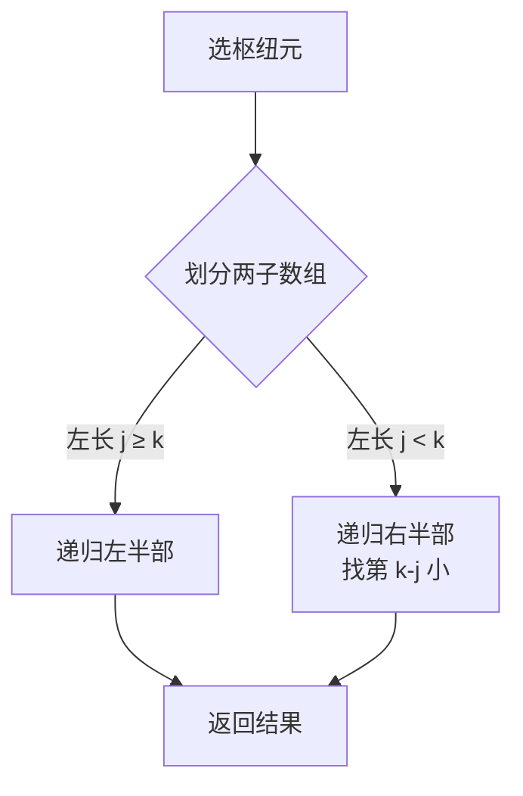
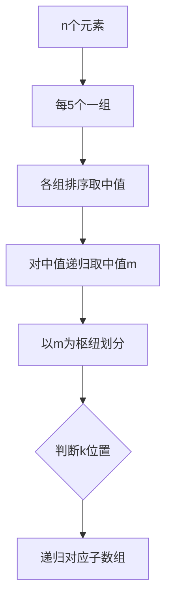

# 选择问题与线性时间选择算法（五元中值组取中值分割法）

---
requires: [算法分析与设计/分治法, 算法分析与设计/快速排序]
---

## 选择问题与随机化选择

**选择问题**是指在 $n$ 个元素中寻找第 $k$ 小的元素（即顺序统计量）。如果先排序再取第 $k$ 个，时间复杂度至少为 $O(n \log n)$。但我们真的需要把所有元素都排好序吗？其实只要找到那个“刚好排在第 $k$ 位”的元素即可。

借助快速排序的分治思想，我们可以选一个枢纽元将数组划分为左右两部分：若左半部分元素个数 $j \geq k$，说明第 $k$ 小在左边；否则在右边找第 $k-j$ 小。这就是 `RandomizedSelect` 算法，平均时间为 $O(n)$，但==最坏情况仍会退化到 $O(n^2)$==（例如每次恰好选到极值作为枢纽元）。

> [!WARNING]
> 随机化选择的最坏情况是 $O(n^2)$。考试中若题目只要求“利用快排思想”，写随机化选择即可；但若强调“线性时间最坏保证”，则必须用二次取中法。

## 五元中值组取中值分割法

如何保证每次划分都不会太偏？核心思路是：**人为制造一个“足够好”的枢纽元**。

具体步骤如下：

1. **分组**：将 $n$ 个元素每 5 个分为一组（最后一组可能不足 5 个），共 $\lceil n/5 \rceil$ 组。
2. **组内取中值**：对每组内部排序（5 个元素排序视为 $O(1)$），取出每组的中位数。
3. **二次取中**：对这 $\lceil n/5 \rceil$ 个中位数，**递归调用本算法本身**，找出它们的中位数 $m$。
4. **划分**：以 $m$ 为枢纽元对原数组进行划分，然后像随机化选择一样决定进入左或右子数组递归。

> [!IMPORTANT]
> 为什么是 5 个一组？因为这样可以保证枢纽元 $m$ 划分出的两个子数组长度都至少为原数组长度的 $\varepsilon$ 倍（$0<\varepsilon<1$，此处 $\varepsilon = 3/10$）。这是实现最坏情况 $O(n)$ 的关键。

## 复杂度对比

| 算法 | 最好 | 最坏 | 平均 |
|---|---|---|---|
| 随机化选择 | $O(n)$ | $O(n^2)$ | $O(n)$ |
| 五元中值取中法 | $O(n)$ | ==$O(n)$== | $O(n)$ |

设 $T(n)$ 为最坏时间。找中值的中值需 $T(n/5)$，划分后子问题规模至多为 $7n/10 + 6$，故：

$$T(n) \leq T\left(\frac{n}{5}\right) + T\left(\frac{7n}{10} + 6\right) + O(n)$$

由于 $\frac{1}{5} + \frac{7}{10} = \frac{9}{10} < 1$，可证明 $T(n) = O(n)$。

> [!TIP]
> 记忆口诀：“五元分组取中值，中值再取中值做枢纽”。考试常考简答：请说明如何在线性时间内完成选择——答出分组、两次取中、划分的流程即可拿满分。

## 算例演示

在数组 `[12, 3, 5, 7, 4, 19, 2, 8, 1, 6]` 中找第 $k=4$ 小的元素。

1. **分组**：`[12,3,5,7,4]` 和 `[19,2,8,1,6]`。
2. **组内排序取中值**：第一组排序为 `[3,4,5,7,12]`，中值 $5$；第二组排序为 `[1,2,6,8,19]`，中值 $6$。
3. **二次取中**：中值集合 `{5, 6}` 的中位数 $m = 5$（取下中位数）。
4. **以 5 划分**：小于等于 5 的为 `[3, 4, 5, 2, 1]`（共 $j=5$ 个），大于 5 的为 `[12, 7, 19, 8, 6]`。
5. **判断**：$k=4 \leq j=5$，第 4 小在左半部分。
6. **递归**：在 `[3, 4, 5, 2, 1]` 中找第 4 小。排序后为 `[1, 2, 3, 4, 5]`，第 4 小即为 ==4==。

> [!CAUTION]
> 计算 $j$ 时务必包含枢纽元本身！代码中 `j = i - p + 1` 就是左侧子数组（含枢纽）的元素总数，比较时用 `k <= j` 而非 `k < j`。
