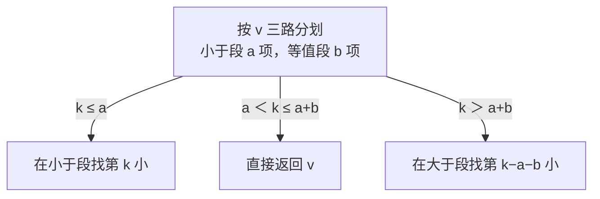
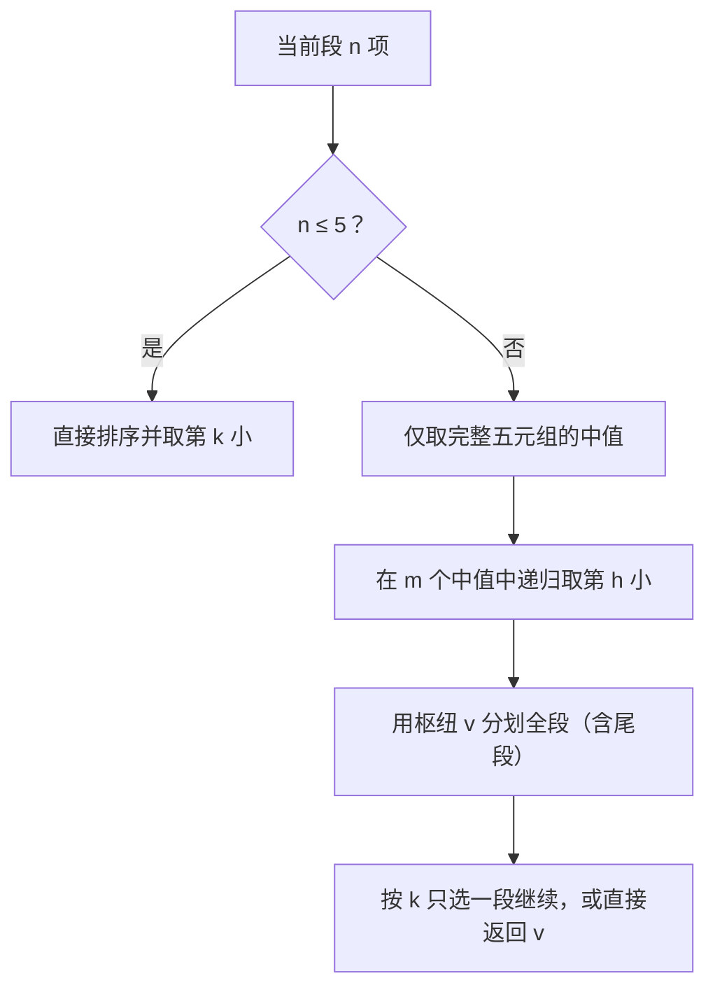

# 选择问题与线性时间选择算法（五元中值组取中值分割法）

---
requires: [算法分析与设计/分治法, 算法分析与设计/快速排序]
---

## 选择问题与随机化选择

选择问题是找出 $n$ 个元素中第 $k$ 小的值，$k$ 从 1 开始；重复值按出现次数占据多个位置。先排序再取值当然可行，但在比较模型中，完整排序需要 $\Omega(n\log n)$ 的最坏时间。选择算法不必给其他元素排序，只要判断第 $k$ 小在哪一段。

选定枢纽元 $v$ 后做三路分划。若严格小于 $v$ 的段有 $a$ 项，等于 $v$ 的段有 $b$ 项，那么在大于段递归时要减去 $a+b$，而不是只减去 $a$：

均匀随机选择枢纽元时，对互异关键字的期望时间为 $O(n)$，但仍可能每次取到极值，只丢掉一项，最坏时间为 $O(n^2)$。若题目要求**最坏线性时间**，就要保证递归留下的段不会过大，而不是指望每次抽中合适的枢纽。

## 五元中值组取中值分割法

按《实验一 分治策略（2017）》的取法，把数据划成 $m=\lfloor n/5\rfloor$ 个完整五元组，再加一个可能不足五元的尾段。组内排序，取出每个完整组的第三项；只在这 $m$ 个中值上递归，取第 $h=\lceil m/2\rceil$ 小作为枢纽元 $v$。偶数个中值时，这相当于取下中值。**尾段不参与选枢纽，但仍参加全表分划。** 当 $n\le 5$ 时，直接对当前段排序取值，不必分组。

### 为什么能丢掉足够多的元素？

至少有 $h$ 个组的中值不大于 $v$；每一组里，它和前两项共三个元素也都不大于 $v$。这些组互不相交，因此严格大于段至多有 $n-3h$ 项。另一边至少有 $m-h+1\ge h$ 个组的中值不小于 $v$，取每组的中值和后两项，可同样限制严格小于段。等于 $v$ 的元素不会进入任何一个继续递归的段，所以重复值不会破坏这个界。

当 $n=10q+5$ 且各值互异时，原件第 5 页给出的计数更直观：枢纽组自身向每侧各贡献 2 项，另有 $q$ 个完整组向每侧各保证 3 项。于是每侧至少有 $3q+2$ 项，较大一侧也至多有 $7q+2$ 项。**这是大小范围，不是固定分成 $0.3n$ 和 $0.7n$ 两段。**

> [!WARNING]
> 不能把一般情形写成「两个严格侧都至少有 $0.3n$ 项」。例如 9 项中先放完整组 $(1,2,3,4,5)$，另有尾段 $(6,7,8,9)$，枢纽为 3，严格小于段只有 2 项，严格大于段却有 6 项。若所有值相等，两个严格侧甚至都为空，恰好可以直接返回枢纽。

更一般地，写 $n=5m+r$，$0\le r\le 4$。用 $h\ge m/2$ 可得严格侧的整数上界：

$$
n-3h\le 0.7n+0.3r\le 0.7n+1.2 .
$$

对 $n=6,7,8,9$，只有一组完整五元组，$h=1$，递归侧的上界分别是 3、4、5、6；都小于原问题。对 $n\le5$ 已直接返回，不存在空中值表。

### 为什么最坏仍是线性时间？

分组取中值、搬动这些中值以及全表分划，每一层的本地工作量合为 $O(n)$。两个递归分别用于**找枢纽**和**找答案**，规模分别是 $m$ 和至多 $n-3h$，不是分划之后两边都做。单次规模为 $n$ 的调用，其最坏时间可用下式上界（右侧子问题规模按上界计）：

$$
T(n)\le T(m)+T(n-3h)+O(n).
$$

当 $n\ge10$ 时，$m\ge n/5-1\ge n/10$，且 $3h\ge 1.5m$。因此两个递归规模之和至多为 $n+m-3h\le n-m/2\le 19n/20$。递归树每层的总规模至多按固定比例缩小，合计本地工作量为 $O(n)$；规模小于 10 的有限个边界情形可以并入常数。==用递归在中值表里做选择，而不是给整个中值表排序，才保住这个线性界。==

| 算法 | 期望时间 | 最坏时间 |
| --- | --- | --- |
| 随机化选择（互异关键字） | $O(n)$ | $O(n^2)$ |
| 五元中值组取中值分割法 | $O(n)$ | $O(n)$ |

## 算例：三段分别如何处理秩？

对 $(12,3,5,7,4,19,2,8,1,6)$，第一组的中值是 5，第二组是 6，取下中值 5 作枢纽。小于段有 $(3,4,2,1)$ 共 4 项，等值段只有 $(5)$，大于段有 $(12,7,19,8,6)$ 共 5 项。

- 找第 4 小：在小于段找第 4 小，结果为 4。
- 找第 5 小：落在等值段，直接返回 5。
- 找第 8 小：转到大于段找第 $8-4-1=3$ 小，结果为 8。

> [!TIP]
> 遇到重复值，先数清等值段有多少项。对于 $(5,1,5,3,5,2)$，以 5 为枢纽时小于段 3 项、等值段 3 项，第 4、5、6 小都是 5，不需要再分划这些 5。
