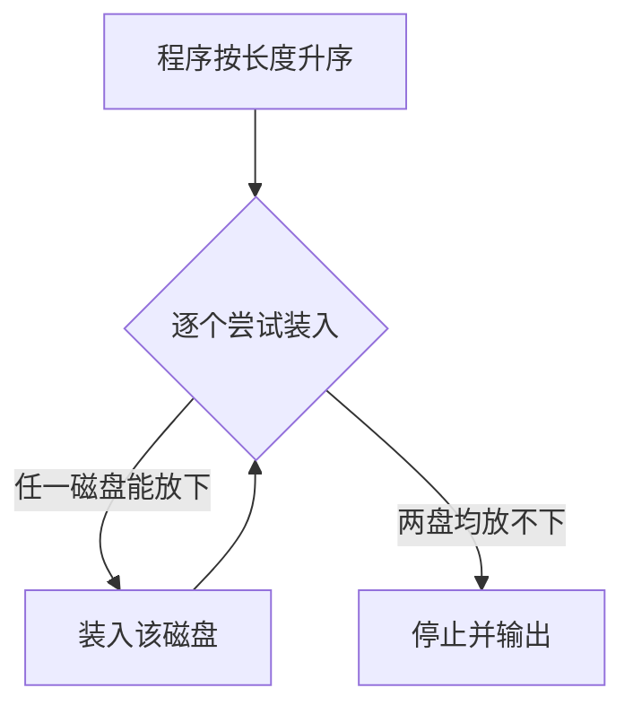

# 绝对近似算法（最多程序存储问题）

---
requires: [算法分析与设计/NP完全性理论, 算法分析与设计/多项式时间归约]
---

如果一个问题是 NP 难度的，我们通常无法在多项式时间内求出精确最优解。那退而求其次：==能不能设计一个多项式时间算法，使得它的解与最优解的差距被严格限制在一个常数之内？==这就是绝对近似算法要回答的问题。

## 什么是绝对近似算法

> [!IMPORTANT]
> 定义12-2：绝对近似算法是求解问题 P 的一个多项式时间算法，使得存在常数 $k > 0$，对 P 的所有实例 I，都有绝对误差 $|OPT(I) - A(I)| \le k$。

其中 $OPT(I)$ 是最优解的值，$A(I)$ 是近似算法求得的解值。注意这里衡量的是**绝对差值**，而不是比值。

## 最多程序存储问题

设有 $n$ 个程序和两个磁盘，每个程序长度为 $l_i$，每个磁盘容量都是 $L$。要求将程序保存在这两个磁盘上（程序不能分割），使两个磁盘存储的程序总数最多。

这个问题为什么难？课件中通过归约证明了它：

> [!NOTE]
> 定理12-1：分划问题 $\propto$ 最多程序存储问题。构造方法为令 $l_i = e_i$，且 $L = \frac{1}{2}\sum_{i=1}^{n} e_i$。集合 S 有分划当且仅当全部 $n$ 个程序都能存入两个磁盘。因分划问题是 NP 完全的，故该问题是 NP 难度的。

## 贪心策略与误差界

既然求精确解很难，怎么快速得到一个“足够好”的解？直觉告诉我们：要想装得多，应该优先装小的。

算法步骤如下：
1. 将所有程序按长度升序排序：$l_1 \le l_2 \le \dots \le l_n$。
2. 依次尝试将程序放入还有剩余空间的磁盘中。
3. 若当前最小的未装入程序连任何一个磁盘都放不下，则停止。

> [!IMPORTANT]
> 定理12-2：令 I 是任一实例，L 是每个磁盘的容量，F(I) 为该贪心算法的解值，则 $|OPT(I) - F(I)| \le 1$。

这意味着贪心算法最多比最优解少装 ==1== 个程序，常数 $k=1$，因此它是绝对近似算法。

## 算对了的例子

设 $n=4$，程序长度分别为 $2, 3, 4, 5$，磁盘容量 $L=6$。

- **排序后**：$2, 3, 4, 5$
- **贪心执行**：
  - 装入 2：磁盘①剩 4，磁盘②剩 6
  - 装入 3：放磁盘②，剩 3
  - 装入 4：放磁盘①，剩 0
  - 装入 5：磁盘①剩 0，磁盘②剩 3，均放不下，停止
- **结果**：$F(I) = 3$（装了 2, 3, 4）
- **验证最优**：无论怎么分配，总容量为 12，程序总长为 14，不可能全装下；若装 3 个，如 $\{2,4\}$ 和 $\{3\}$ 可行。故 $OPT(I)=3$。
- **误差**：$|OPT(I) - F(I)| = |3 - 3| = 0 \le 1$，符合定理。

## 相近概念辨析与常见坑

| 对比维度 | 绝对近似算法 | 相对近似算法 |
| :--- | :--- | :--- |
| **误差度量** | $|OPT - A| \le k$（常数差值） | $A / OPT \le \rho$（比例因子） |
| **适用场景** | 解值为整数且范围受限的问题 | 解值可能任意大的优化问题 |
| **典型例子** | 最多程序存储、图的着色（部分） | 旅行商问题（TSP）、顶点覆盖 |

> [!WARNING]
> 不要误以为所有 NP 难度问题都存在绝对近似算法！对于许多问题（如一般 TSP），除非 P=NP，否则不存在任何常数 $k$ 的绝对近似算法。

> [!CAUTION]
> 考试易错点：证明某算法是绝对近似算法时，必须明确指出常数 $k$ 是多少（如本题 $k=1$），并说明算法本身是多项式时间的。只说“接近最优”不得分。

> [!TIP]
> 记忆口诀：“绝对看差值，常数定生死；贪心先排小，误差不过一。”
