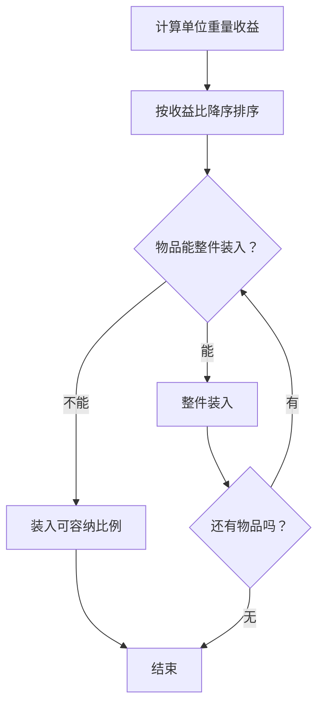

# 一般背包问题的贪心法求解及最优度量标准证明

## 问题模型

一般背包问题与 0-1 背包不同：每件物品可以取一部分。设背包容量为 $M$，第 $i$ 件物品的重量、收益分别为 $w_i,p_i$，装入比例为 $x_i$，则模型为

$$
\max Z=\sum_{i=0}^{n-1}p_i x_i
$$

满足

$$
\sum_{i=0}^{n-1}w_i x_i\le M,\qquad 0\le x_i\le 1.
$$

这里 $x_i=1$ 表示整件装入，$x_i=0$ 表示不装，$0<x_i<1$ 表示装入一部分。

> [!IMPORTANT]
> 一般背包可用贪心法求解：按“单位重量收益” $p_i/w_i$ 从大到小装入，最后一件物品允许只装一部分。

## 为什么按单位重量收益排序

同样占用 $1$ 单位重量，收益越大的物品越值得优先装入。因此先比较

$$
v_i=\frac{p_i}{w_i}.
$$

若 $v_i\ge v_j$，就应优先考虑物品 $i$。这相当于把有限容量分配给“每单位重量创造收益更多”的物品。

算法步骤如下：

1. 计算所有物品的单位重量收益 $p_i/w_i$；
2. 按 $p_i/w_i$ 从大到小排列；
3. 依次装入。若剩余容量为 $R$，且 $w_i\le R$，则取 $x_i=1$；若 $w_i>R$，则取
   $$
   x_i=\frac{R}{w_i},
   $$
   随后结束；
4. 若所有物品均已装入，背包仍未装满，也直接结束。

## 最优性证明

设贪心算法得到的解为 $x^G$，任意可行解为 $x$。记

$$
v_i=\frac{p_i}{w_i},\qquad
P=\sum_i p_i x_i=\sum_i v_iw_ix_i.
$$

若 $x$ 与 $x^G$ 在前 $k$ 个物品上的装入比例相同，而第 $k$ 个物品存在差异，则可以交换这两个物品的装入数量，使总重量不变、收益不下降。

具体地，若贪心顺序中物品 $i$ 在前、物品 $j$ 在后，且 $v_i\ge v_j$，从 $j$ 处转移 $\delta$ 单位重量给 $i$，收益变化为

$$
\Delta Z=\delta(v_i-v_j)\ge 0.
$$

不断进行这种交换，就能把任意可行解调整为贪心解，并保证收益不降低。因此贪心解的收益不小于任意可行解的收益，即

$$
Z(x^G)\ge Z(x).
$$

> [!IMPORTANT]
> ==单位重量收益降序装入所得解是一般背包问题的全局最优解。==

证明的关键不是“每件物品都装得越多越好”，而是通过等重量交换，把容量从低收益物品转移到高收益物品，收益不会减少。

## 计算示例

取容量 $M=15$ 的实例：

$$
w=(2,3,5,7,1,4,1),\qquad
p=(10,5,15,7,6,18,3).
$$

单位重量收益为

$$
\left(\frac{p_i}{w_i}\right)
=(5,1.67,3,1,6,4.5,3).
$$

按降序排列为物品 $4,5,0,2,6,1,3$。

依次装入：

- 物品 4：重量 $1$，收益 $6$，剩余容量 $14$；
- 物品 5：重量 $4$，收益 $18$，剩余容量 $10$；
- 物品 0：重量 $2$，收益 $10$，剩余容量 $8$；
- 物品 2：重量 $5$，收益 $15$，剩余容量 $3$；
- 物品 6：重量 $1$，收益 $3$，剩余容量 $2$；
- 物品 1 最多装入 $2/3$，收益为 $5\times 2/3$；
- 物品 3 无法再装入。

因此一个最优解为

$$
x=\left(1,\frac23,1,0,1,1,1\right),
$$

总重量为 $15$，最大收益为

$$
Z_{\max}
=10+\frac{10}{3}+15+6+18+3
=\frac{166}{3}
\approx55.33.
$$

## 易混点与常见错误

| 项目 | 一般背包 | 0-1 背包 |
|---|---|---|
| 装入数量 | $0\le x_i\le1$ | $x_i\in\{0,1\}$ |
| 贪心适用性 | 可按单位重量收益求解 | 一般不可直接贪心 |
| 最后一件物品 | 可装一部分 | 只能整件装或不装 |

> [!WARNING]
> 不能用“总收益最大”代替“单位重量收益最大”。某件物品总收益很高，但重量也可能很大，必须比较 $p_i/w_i$。

> [!CAUTION]
> 单位重量收益相等时，先取哪件都可以，但所得总收益可能不同：应继续优先选择较重物品，使背包剩余容量尽量小。若单位收益严格递减，则不会出现这种分歧。

> [!NOTE]
> 贪心法保证的是一般背包问题最优；不要把这一结论直接套到 0-1 背包问题上。
