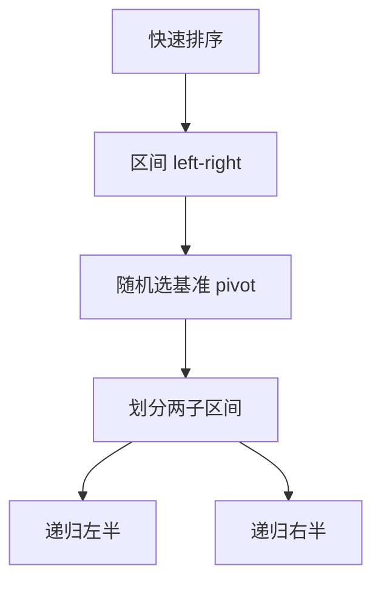

# 舍伍德算法（随机快速排序消除最坏情况）

舍伍德算法（Sherwood algorithm）属于==随机算法==的一类，特点是**总能求得问题的正确解**（确定性正确），只是通过在算法中引入随机性来==消除最坏情况与特定输入实例之间的关联==。换句话说，舍伍德算法不是去"避免"最坏情况，而是让最坏情况"随机地落到任意输入上"，从而把运行时间的差异抹平。

与其它随机算法对比：

| 类型 | 解的正确性 | 时间特性 | 典型例子 |
| --- | --- | --- | --- |
| 数值随机算法 | 数值近似 | 随机 | 数值积分 |
| 蒙特卡罗算法 | 可能出错 | 多项式时间 | 素性测试 |
| 拉斯维加斯算法 | 一定正确 | 时间随机 | 随机快速排序求解选择问题 |
| ==舍伍德算法== | ==一定正确== | ==消除实例差异== | 随机基准快速排序 |

> [!NOTE]
> 舍伍德算法常用于"平均复杂度好、但存在某些坏输入"的确定性算法，如快速排序、选择算法、跳表。

## 为什么需要它

确定性快速排序在最坏情况下（如序列==已经递增或递减有序==）时间复杂度为 $O(n^2)$，而平均为 $O(n\log n)$。这个差距源于**分划元素的选取与输入分布强相关**：每次取首/尾元素作基准，遇有序序列就退化为最坏情况。

问一句：问题出在"算法本身"还是"输入结构"？其实是后者——只要让基准==随机选取==，最坏情况就不会固定在特定实例上。

## 怎么做：随机化快速排序

在原确定性算法上增加一步：==随机选择分划元素==，其余逻辑不变。



伪代码骨架（对应课件【程序 11-5】）：

```cpp
QuickSort(left, right):
    if left < right:
        k = RandomInt(left, right)      // 随机选位置
        Swap(A[k], A[left])             // 基准移到左端
        j = Partition(left, right)      // 确定性划分
        QuickSort(left, j-1)
        QuickSort(j+1, right)
```

==核心结论==：随机化快速排序**不改变原算法的平均时间**，仍是 $O(n\log n)$，但把最坏 $O(n^2)$ 的发生概率降到极低，使其在==期望意义==下对所有实例都高效。

> [!TIP]
> 记忆口诀："随机基准，不改均值；消除特例，抹平差距。"

## 与相近概念的区别

- **与拉斯维加斯算法**：两者都保证正确，但拉斯维加斯是"时间随机"（如随机选择可能失败需重试），舍伍德是"消除实例间时间差异"。
- **与蒙特卡罗算法**：蒙特卡罗可能给出错误解，舍伍德不会。
- **与确定性算法**：舍伍德保留正确性，只改"时间分布"。

## 常见坑

> [!WARNING]
> - 随机化快速排序并不能==保证==一定 $O(n\log n)$ 结束，最坏仍可能 $O(n^2)$，只是概率极低。
> - 舍伍德算法==不改善平均时间==，只削弱最坏情况与实例的关联。
> - 跳表的结点级别分配用的是**几何分布**（1 个指针概率 1/2，2 个 1/4……），也是舍伍德思想的应用。

## 一个算对了的例子

题目："快速排序中引入随机过程的主要目的是？"

- A. 改善平均时间 ✗（舍伍德不改平均）
- B. 保证 $O(n\log n)$ 结束 ✗（最坏仍可能 $O(n^2)$）
- **C. 避免算法最坏情况下的发生 ✓**
- D. 改善最坏情形下的平均运行时间 ✗（表述混淆）

==答案 C==。随机基准使最坏情况（有序序列触发 $O(n^2)$）的概率变得极低，从而==避免了最坏情况的确定性发生==。
