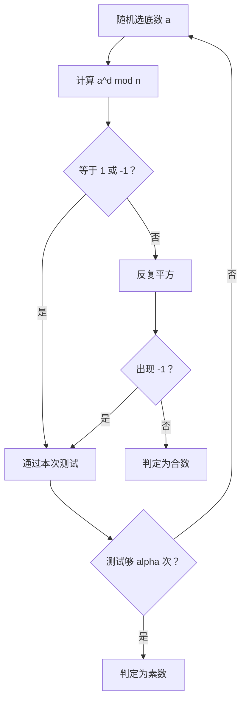

# 蒙特卡罗算法（素数测试、伪素数测试、米勒-拉宾算法）

## 是什么：允许出错的随机算法

蒙特卡罗算法是**不保证解一定正确**的随机算法：它求得的解有时是错误的，但可以通过增加计算时间把错误概率压到任意小。这是它与拉斯维加斯算法最本质的区别——拉斯维加斯算法对相同输入**总是**给出相同（且正确）的输出，只是运行时间有长有短；而蒙特卡罗算法对相同输入，**结果可能不同**。

> [!IMPORTANT]
> 蒙特卡罗算法的核心特征：==解的正确性存在随机性==，通常无法有效判断所得解是否正确。求得正确解的概率随计算时间增加而增大，但永远不能确保正确。

## 为什么需要：确定性测试太慢

素数测试问题：给定大奇数 $n$，判断它是否素数。如果逐个试除 $2$ 到 $\sqrt{n}$，当 $n$ 是几百位的大数时完全不可行。蒙特卡罗算法用**多次随机抽样**换取极高的正确率，是这类"判定问题"的标准做法。

## 怎么做：从伪素数到米勒-拉宾

**伪素数测试**基于费马小定理：若 $n$ 是素数，则对任意 $1\le a<n$ 有
$$a^{n-1}\equiv 1\pmod n$$
程序 `ModExp(a, n)` 用快速幂在 $O(\log n)$ 时间内算出 $a^{n-1}\bmod n$。但存在**卡迈克尔数**（如 561）——合数却对所有 $a$ 都满足上式，会骗过测试。

**米勒-拉宾算法**加强了费马测试：把 $n-1$ 写成 $2^s\cdot d$（$d$ 为奇数），若 $n$ 是素数，则对任意 $a$ 必满足下列之一：
$$a^d\equiv 1\pmod n \quad\text{或}\quad \exists\,0\le r<s,\ a^{2^r d}\equiv -1\pmod n$$
`MillerRabin(n, alpha)` 随机选 $alpha$ 个底数 $a$ 分别测试，全部通过则判素数。单次测试把合数误判为素数的概率不超过 $1/4$，独立重复 $alpha$ 次后错误率 $\le (1/4)^{alpha}$，随 $alpha$ 指数下降。

## 另一个用途：估计回溯法效率

蒙特卡罗方法还能**估计**回溯法中状态空间树实际生成的结点数。从根出发随机走一条完整路径，记录各层"不受限制的孩子数" $m_0,m_1,m_2,\dots$，则总结点数估计为
$$1+m_0+m_0m_1+m_0m_1m_2+\cdots$$

> [!WARNING]
> 这是**估计值**，不是精确值。判断题"蒙特卡罗方法可以精确得到状态空间树上实际生成的结点数"答案是 ×。随机路径不同，估计结果就不同。

## 算例：8 皇后问题

随机选取路径 $(2,5,3,0,4)$，各层不受限制的孩子数如下：

| 层 | $m_0$ | $m_1$ | $m_2$ | $m_3$ | $m_4$ |
|---|---|---|---|---|---|
| 孩子数 | 8 | 5 | 3 | 3 | 2 |

> [!TIP]
> 第 0 层根有 8 个孩子（8 列都可放）；沿随机路径走到某结点后，数它**还剩几个合法扩展**即为下一层 $m_i$。

$$
\begin{aligned}
N &= 1+8+8\times5+8\times5\times3+8\times5\times3\times3 \\
  &\quad +\,8\times5\times3\times3\times2 \\
  &= 1+8+40+120+360+720 = \boxed{1249}
\end{aligned}
$$

> [!CAUTION]
> 求和项数比路径长度多 1：开头的 $1$ 是根结点本身，不要漏掉；每项是**累计乘积**而非 $m_i$ 直接相加。
