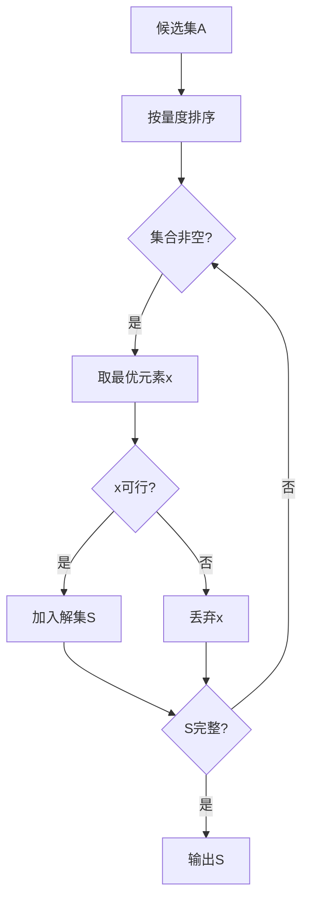

# 贪心法的一般算法框架（按量度标准排序后逐步决策）

贪心法的核心思想是“==局部最优推导全局最优==”。面对一个最优化问题，我们能否不枚举所有可能，而是通过某种“量度标准”排序后，一步步做出当前看似最好的选择？这要求问题必须具备==贪心选择性质==和==最优子结构==。若不具备，贪心只能得到近似解（如0/1背包），而非精确最优解。

## 通用算法框架

贪心法并非单一算法，而是一种策略范式。其一般框架可概括为：

> [!IMPORTANT]
> 框架的灵魂在于==量度标准的选择==。不同的量度决定了算法的正确性。例如分数背包选“单位重量价值 $p_i/w_i$”，而最小生成树Kruskal选“边权 $w(u,v)$”。

## 经典应用场景对比

虽然都叫贪心，但不同问题的“量度”与“决策方式”差异巨大：

| 问题模型 | 量度标准 | 决策特点 | 关键陷阱 |
| :--- | :--- | :--- | :--- |
| 分数背包 | $p_i / w_i$ 降序 | 物品可分割，装满为止 | 0/1背包不可用此法 |
| 最佳合并模式 | 权值升序 | 每次取最小$k$个合并 | $k$路合并需补虚结点 |
| Prim算法 | 连接树的最小边权 | 从点出发，逐步扩张顶点集 | 适合稠密图 |
| Kruskal算法 | 全局最小边权 | 从边出发，避免成环 | 适合稀疏图 |
| 删数问题 | 高位递减趋势 | 删除使高位变大的数字 | 需处理前导零 |

> [!WARNING]
> ==最佳合并模式的虚结点==是高频考点。对于$k$路合并，若$(n-1) \bmod (k-1) \neq 0$，必须补充$r = (k-1) - (n-1)\bmod(k-1)$个权值为0的虚结点，否则无法保证每次都能凑齐$k$个结点进行合并，导致WPL计算错误。

## 算例演示：分数背包

以习题6-1为例，展示“按量度排序后逐步决策”的完整过程。已知 $M=15$，物品数据如下：

| 物品 | 0 | 1 | 2 | 3 | 4 | 5 | 6 |
| :--- | :--- | :--- | :--- | :--- | :--- | :--- | :--- |
| 重量 $w_i$ | 2 | 3 | 5 | 7 | 1 | 4 | 1 |
| 收益 $p_i$ | 10 | 5 | 15 | 7 | 6 | 18 | 3 |
| **单位收益** | **5** | 1.67 | 3 | 1 | **6** | **4.5** | 3 |

1.  **排序**：按 $p_i/w_i$ 降序排列，优先级为：4(6) > 0(5) > 5(4.5) > 2(3)=6(3) > 1(1.67) > 3(1)。
2.  **贪心装入**：
    -   装物品4 ($w=1, p=6$)，剩余容量14；
    -   装物品0 ($w=2, p=10$)，剩余容量12；
    -   装物品5 ($w=4, p=18$)，剩余容量8；
    -   装物品2 ($w=5, p=15$)，剩余容量3；
    -   装物品6 ($w=1, p=3$)，剩余容量2；
    -   装物品1 ($w=3$)，但只剩2，故装入比例 $x_1 = 2/3$，收益 $5 \times 2/3$。
3.  **结果**：最大收益 $= 6+10+18+15+3+10/3 = ==166/3 \approx 55.33==$。

> [!TIP]
> 验证贪心正确性的直觉方法：检查“交换论证”。假设最优解中某步没选当前单位价值最高的物品，将其替换为贪心选择的物品，总收益不会下降，则贪心策略成立。

## 与动态规划的区别

贪心法是动态规划的“特化版”。DP自底向上求解所有子问题，时间复杂度较高；贪心只做一次排序和线性扫描，效率通常为 $O(n \log n)$。但==贪心没有回溯机制==，一旦做出选择就不可更改。因此，在使用贪心前，务必确认问题满足贪心选择性质，切勿盲目套用框架。
