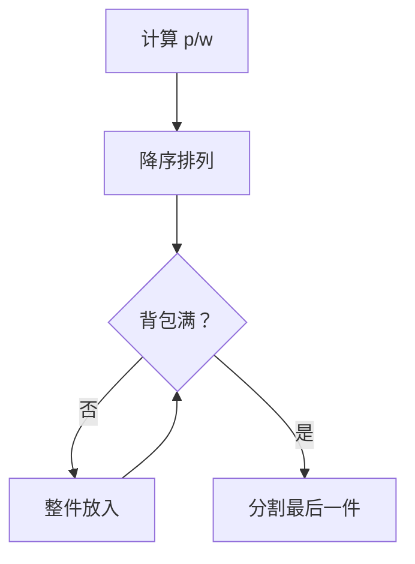

# 贪心法的基本要素（贪心选择性质/最优量度标准、最优子结构性质）

## 贪心法的基本要素

贪心法用于求解最优化问题，其基本思想是：**每一步都做出当前看来最好的选择**，希望通过局部最优的堆叠最终得到全局最优解。但并非所有问题都能这样“贪”成功——贪心法可行的前提，是问题必须满足两个基本性质。

### 两个基本性质

#### 贪心选择性质

> [!IMPORTANT]
> 贪心选择性质是指：==所求问题的整体最优解可以通过一系列局部最优的选择（即贪心选择）来达到==。这是贪心算法可行的第一个基本要素。

换句话说，贪心法**不需要回溯**，每一步选了就不改。做出贪心选择后，原问题就简化为规模更小的子问题，继续贪下去即可。

要确认一个问题是否具有贪心选择性质，不能只靠直觉——“感觉每次选最大/最小的就行”。==必须证明每一步的贪心选择最终能导致整体最优解==。

#### 最优子结构性质

> [!IMPORTANT]
> 当一个问题的最优解包含其子问题的最优解时，称此问题具有==最优子结构性质==。

这个性质不是贪心法独有的——**动态规划也要求问题具有最优子结构性质**。两者的区别在于：

| 性质 | 贪心法 | 动态规划 |
|------|--------|----------|
| 最优子结构 | 需要 | 需要 |
| 贪心选择 | 需要 | 不需要 |
| 选择方式 | 每一步做局部最优选择，不回溯 | 每步考虑所有子问题，比较后做决策 |
| 效率 | 通常更高 | 通常需要填表，开销更大 |

> [!NOTE]
> 两者的关键区别：动态规划是**先求解子问题，再由子问题的解构造原问题的解**；贪心法是**先做贪心选择，再求解剩下的唯一子问题**。动态规划是自底向上的，贪心法是自顶向下的。

### 最优量度标准

> [!IMPORTANT]
> 贪心法每一步上用作决策依据的选择准则被称为==最优量度标准（optimization criterion）==。

选择最优量度标准是使用贪心法求解问题的**核心问题**。同一个问题，选错了标准就得不到最优解。

以一般背包问题（物品可分割）为例：

有 5 个物品，重量 $w=(2,1,3,5,6)$，价值 $p=(2,3,1,4,5)$，背包载重为 6。

如果贪心标准选“价值最大者优先”，会先放价值 5（重 6）的物品，总价值仅 5；但如果选“单位重量价值最大者优先”，情况完全不同：

| 物品 | $w_i$ | $p_i$ | $p_i/w_i$ |
|------|-------|-------|------------|
| 1 | 2 | 2 | 1.0 |
| 2 | 1 | 3 | **3.0** |
| 3 | 3 | 1 | 0.33 |
| 4 | 5 | 4 | 0.8 |
| 5 | 6 | 5 | 0.83 |

按 $p_i/w_i$ 降序：物品 2（重 1，价值 3）→ 物品 1（重 2，价值 2）→ 物品 5（重 6，价值 5，但只剩载重 3，故取 $3/6$ 得价值 2.5）。

最大价值 $=3+2+2.5=7.5$，解向量 $X=(1,\ 1,\ 0,\ 0,\ 1/2)$。

> [!TIP]
> 可见 ==$p_i/w_i$（单位重量价值）== 就是一般背包问题的最优量度标准。

### 常见误区

> [!WARNING]
> **“局部最优就是全局最优”并不天然成立**。比如 0-1 背包问题（物品不可分割），单位价值最大的贪心策略不保证最优——反例：$w=(2,2,3)$，$p=(3,3,5)$，容量 4，贪心选单位价值 1.5 的两件（总重 4，价值 6），但最优是选价值 5 和价值 3 的两件（总重 4，价值 8）。**0-1 背包不具有贪心选择性质，只能用动态规划**。

> [!CAUTION]
> 做题时务先验证问题是否满足贪心选择性质，不能“看着像贪心题”就直接贪。证明通常采用**交换论证法**：假设存在一个不包含贪心选择的最优解，通过交换元素可以构造出不差于它的、包含贪心选择的解，从而证明贪心选择不会失去最优性。
