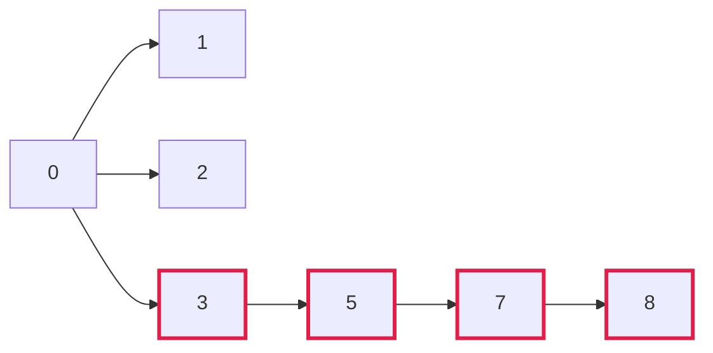

# 多段图的应用：资源分配问题与关键路径算法（earliest递推）

## 从多段图到 AOE 网络

多段图最短路径用动态规划求解：把顶点按阶段划分，定义 $d(i,j)$ 为第 $i$ 阶段顶点 $j$ 到汇点 $t$ 的最短距离，用**向后递推**（从 $t$ 往 $s$ 推）或**向前递推**（从 $s$ 往 $t$ 推）填表，最后回溯 $d$ 数组得到路径。

关键路径问题可以看作它的"对偶"：把多段图中的"段"看成时间先后，把边权看成活动持续时间，求的不是最短而是**最长**路径——因为整个工程的工期由最耗时的那条链路决定。

> [!IMPORTANT]
> 完成工程所需的最短时间 = AOE 网络中从源点到汇点的 ==最长路径长度==，这条最长路径就是关键路径。

## earliest 与 latest 的递推

设事件 $i$ 的最早发生时间为 $earliest[i]$，最晚发生时间为 $latest[i]$，活动 $\langle i,j\rangle$ 的持续时间为 $weight(i,j)$。

**earliest（从源点向后递推）**

$$earliest[j] = \max_{i \in \text{前驱}(j)} \left( earliest[i] + weight(i,j) \right)$$

源点 $earliest[0]=0$。含义：事件 $j$ 必须等所有入边活动都完工，取==最大值==。

**latest（从汇点向前递推）**

$$latest[i] = \min_{j \in \text{后继}(i)} \left( latest[j] - weight(i,j) \right)$$

汇点 $latest[t]=earliest[t]$（即工程总工期）。含义：事件 $i$ 再晚就会拖延工期，取==最小值==。

## 寻找关键活动与构造关键路径

活动 $\langle i,j\rangle$ 的最早开始时间为 $earliest[i]$，最晚开始时间为 $latest[j]-weight(i,j)$。若二者相等，该活动没有机动时间，称为==关键活动==。

> [!WARNING]
> 关键路径应由**关键活动** $\langle i,j\rangle$ 来确定，而不是由事件 $i$ 来确定。一个事件即使 $earliest[i]=latest[i]$，从它出发的活动也可能不是关键活动。

## 算例

对复习提纲中的 AOE 网络，已知：

| $i$ | 0 | 1 | 2 | 3 | 4 | 5 | 6 | 7 | 8 |
|---|---|---|---|---|---|---|---|---|---|
| $earliest[i]$ | 0 | 2 | 3 | 4 | 5 | 6 | 8 | 8 | 11 |
| $latest[i]$ | 0 | 5 | 4 | 4 | 6 | 6 | 10 | 8 | 11 |

验证节点 5：$earliest[5]=earliest[3]+weight(3,5)=4+2=6$；$latest[5]=latest[7]-weight(5,7)=8-2=6$。活动 $\langle 3,5\rangle$ 的最早、最晚开始时间均为 6，是关键活动。

依次检查所有活动，可得关键路径为 $(0,3,5,7,8)$，路径长度 $=11$，即工程最短工期为 11 个时间单位。

> [!TIP]
> 计算口诀：earliest 从前往后**取大**，latest 从后往前**取小**；$earliest[i]=latest[i]$ 的事件在关键路径上，但最终要用活动两端时间差是否为零来确认关键活动。
