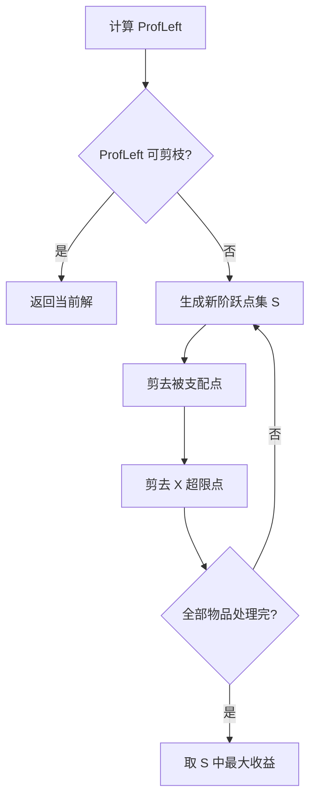

# 近似算法概念（寻找近似解而非最优解）

## 它是什么

近似算法针对的是==最优化问题==：当精确求解代价过高（如 NP 难问题）或问题本身允许误差时，用可接受的代价换取一个"足够好"的解，而不是穷尽搜索得到的最优解。求解最优化问题时，近似算法必须保证==结果与最优解之间的误差在一定范围之内==——这是它区别于"随手给个解"的关键。

## 为什么需要它

很多组合优化问题（0/1 背包、TSP、顶点覆盖等）精确算法是指数级的，但工程上常常只要一个近似解就够了。近似算法在"可行时间"和"解的质量"之间做取舍，用确定性的误差上界换取多项式时间。

## 怎么做：以 0/1 背包为例

0/1 背包是近似算法的经典载体。常见的思路是**贪心（启发式）**：先算"性价比" $p_i/w_i$，按性价比降序处理，再用 ==阶跃点集合== $S^k$ 维护"已考虑前 $k$ 件物品时"的可行收益前沿。启发式方法会记录剩余收益上界 ProfLeft，在==可以安全剪枝==时提前结束。

> [!WARNING]
> 阶跃点集合维护两条铁律：==被支配的阶跃点==（重量更大、收益更小的点）必须删除；==所有 $X > M$ 的阶跃点==也必须删除，否则集合会爆炸，且违背背包载重约束。

## 和相近概念的区别

| 概念 | 目标 | 是否保证误差上界 | 典型场景 |
| --- | --- | --- | --- |
| 精确算法 | 最优解 | — | 规模小或多项式可解 |
| ==近似算法== | 近似解 | ==是== | NP 难优化问题 |
| 启发式/随机算法 | "好"解 | 否 | 实用快速求解 |

> [!NOTE]
> 课件中 0/1 背包的"启发式方法"属于近似算法范畴：它快速剪枝、给出近似收益，但收敛到的就是当前实例的最优解——小实例下仍可能==精确==得到最优值，只是不保证多项式复杂度。

## 算对了的例子

背包 $M=6$，4 件物品 $(w_i)=(3.3,2,1.2,5)$，$(p_i)=(4,5,6,1)$。按启发式方法求解。

先算剩余收益上界：$\text{ProfLeft}(0)=16,\ 12,\ 7,\ 1,\ 0$，取 $x_0=0$ 前判断 $\sum_{i\ge 1} w_i = 5.5 < M=6$，因此不需要部分装入。

$$S^0=\{(0,0),(3.3,4)\},\quad x_0=0$$
$$S^1=\{(2,5),(5.3,9)\},\quad x_1=1$$
$$S^2=\{(3.2,11)\},\quad x_2=1$$
$$S^3=\{(3.2,11)\},\quad x_2=0$$

因此 ==最大收益 11==，最优解 $(x_0,x_1,x_2,x_3)=(0,1,1,0)$。

> [!TIP]
> 记忆口诀：**"先算剩余收益，再逐步剪枝，去掉被支配点与超载点，最后取前沿最大收益。"** 判断题若问"近似算法需保证结果在一定误差之内"——==√==。
