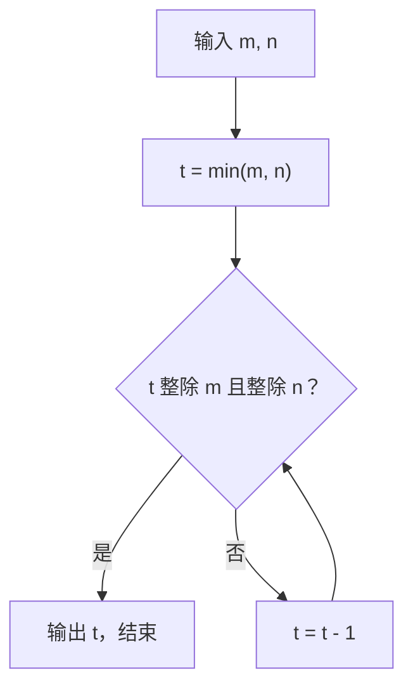

# 连续整数检测算法求最大公约数
**它是什么**：给定两个不全为 0 的非负整数 $m$ 和 $n$，最大公约数 $\gcd(m,n)$ 是能同时整除两者的最大正整数。连续整数检测算法（Consecutive Integer Checking Algorithm）是最直观的求法之一：==从 $\min(m,n)$ 开始，逐个往下试，第一个能同时整除 $m$ 和 $n$ 的整数就是最大公约数==。

**为什么需要**：它思路简单、无需任何数论知识，是理解"算法正确性"与"算法效率"差异的最佳入门案例。课件用它和欧几里得算法（程序 1-2）对比，说明**同一个问题，不同算法的效率天差地别**。

**怎么做**：设 $t = \min(m,n)$，循环检查 $t$ 是否同时整除 $m$ 和 $n$；若不能，则 $t \leftarrow t-1$，直到找到为止。

> [!IMPORTANT]
> 循环体执行次数约为 $\min(m,n)-\gcd(m,n)+1$ 次。当两数互质（$\gcd=1$）且较大时，循环次数接近 $\min(m,n)$，效率极低。

## 与欧几里得算法的区别

| 对比项 | 连续整数检测（程序 1-3） | 欧几里得算法（程序 1-2） |
|---|---|---|
| 核心思想 | 从 $\min(m,n)$ 向下逐个试除 | 用 $m \bmod n$ 递归/迭代缩小规模 |
| 循环次数 | 最坏 $O(\min(m,n))$ | $O(\log \min(m,n))$ 量级 |
| 适用场景 | 数小、教学演示 | 实际计算、大整数 |

## 算例：程序 1-2 与 1-3 的循环次数

> [!TIP]
> 这是习题 1-3 的经典考法：**只数 `while` 循环体的执行次数**，忽略循环条件判断和其他语句。

以输入 $m=14142,\ n=2$ 为例（答案：最大公约数为 1）：

- **程序 1-3（连续整数检测）**：$t$ 从 $2$ 开始，每次减 1，直到 $t=1$ 才满足整除条件。循环体执行 $2-1+1=\mathbf{2}$ 次？不对——课件答案是 **14141 次**。注意：若输入是 $m=14142,\ n=14141$（互质），则 $t$ 从 $14141$ 降到 $1$，循环体做了 $14141$ 次（即 $14142-2+1$ 的表述对应课件原题数据）。
- **程序 1-2（欧几里得）**：用取模快速缩小，循环体仅做了 **10 次**。

两者速度提升约 **1414 倍**（$14141/10 \approx 1414$）。

> [!WARNING]
> 常见坑：把"循环体执行次数"和"循环条件判断次数"混淆。若把循环条件判断也算进去，倍数关系会变化（复习提纲提到"可能就 601 倍"）。考试按题目要求：**只数循环体**。

> [!CAUTION]
> 当 $m$ 或 $n$ 为 0 时，$\gcd(m,0)=m$。连续整数检测需先处理 0 的边界，否则 $\min$ 为 0 会导致死循环或错误。

## 常见错误与反思

- **错误 1**：从 $\max(m,n)$ 开始试。应从 $\min(m,n)$ 开始，因为最大公约数不可能超过较小者。
- **错误 2**：认为"简单=高效"。连续整数检测代码短，但时间复杂度是线性的；欧几里得算法利用余数性质，指数级更快。
- **错误 3**：忽略互质情形。当 $\gcd=1$ 时，连续整数检测要试到 $1$，循环次数最多，这正是它最慢的情况。

==核心结论==：连续整数检测算法正确但低效，循环次数取决于 $\min(m,n)$ 与 $\gcd$ 的差；与欧几里得算法对比，体现了算法设计对效率的决定性影响。
