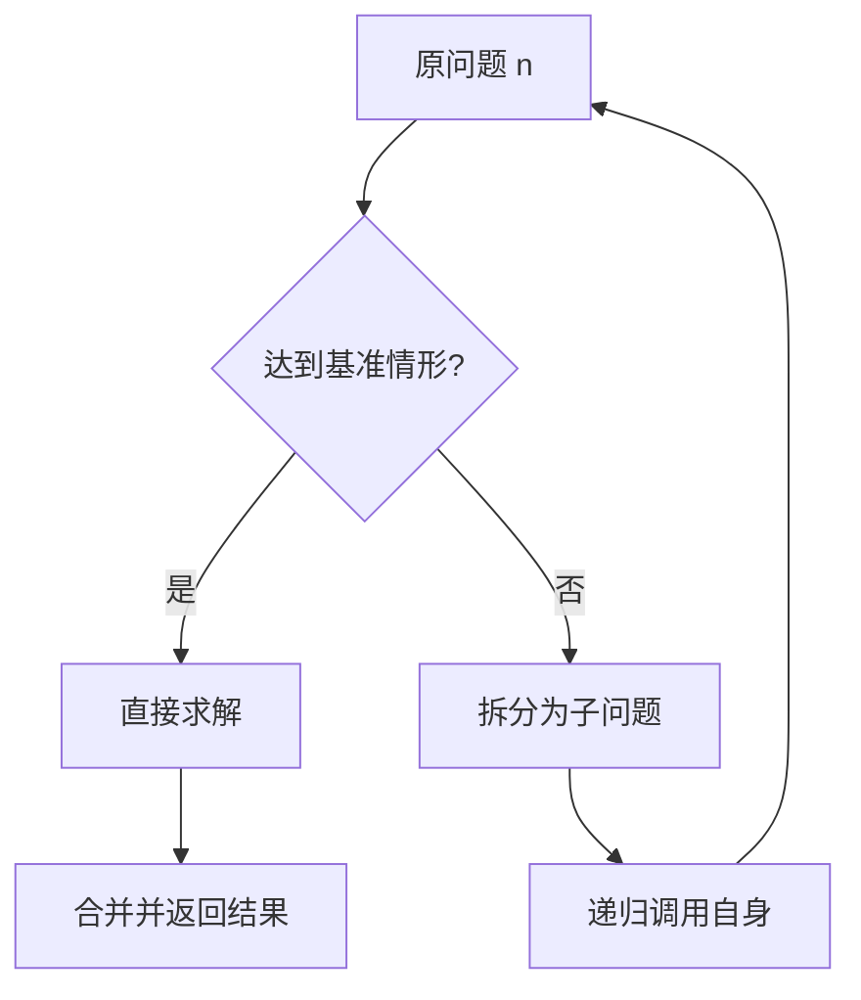

# 递归概念与归纳证明（斐波那契数列、Hanoi塔问题）

> [!IMPORTANT]
> ==递归==是函数直接或间接调用自身的编程机制；==归纳证明==则是验证递归算法正确性的数学工具。两者结合，构成了分治、动态规划等高级策略的基石。

## 什么是递归与归纳证明

如果一个问题能拆解成“规模更小但结构相同”的子问题，你会怎么做？自然是让程序自己调用自己去解决子问题——这就是递归。

一个完整的递归必须包含两个要素：
- **基准情形（Base Case）**：无需继续拆分，直接返回结果。
- **递归步骤（Recursive Step）**：将原问题转化为规模更小的同类问题。

但写出的递归代码真的对吗？这就需要**归纳证明**来兜底。其逻辑与数学归纳法一致：先证明基准情形成立，再假设规模为 $k$ 时成立，推导规模为 $k+1$ 时也成立。



## 经典实例剖析

### 斐波那契数列

定义递推式：$F(n) = F(n-1) + F(n-2)$，其中 $F(0)=0, F(1)=1$。

课件习题要求用递归输出前 20 个数。为避免重复计算的低效树形递归，可采用带状态传递的尾递归写法：

```cpp
#include <iostream>
void printFibonacci(int n, int a = 0, int b = 1) {
    if (n <= 0) return;          // 基准情形
    std::cout << a << " ";
    printFibonacci(n - 1, b, a + b); // 递归步骤
}
int main() {
    printFibonacci(20);
    return 0;
}
```

台阶问题本质上也是斐波那契模型：上 $n$ 级台阶的方法数 $f(n) = f(n-1) + f(n-2)$。

### Hanoi塔问题

将 $n$ 个盘子从 A 移到 C，借助 B：
1. 把上面 $n-1$ 个盘子从 A 移到 B（递归）。
2. 把第 $n$ 个盘子从 A 移到 C（基准操作）。
3. 把 B 上的 $n-1$ 个盘子移到 C（递归）。

移动次数满足 $T(n) = 2T(n-1) + 1$，解得 $T(n) = 2^n - 1$。

## 如何用归纳证明验证算法

考试中常考对递归排序（如 StoogeSort）的正确性证明。标准答题模板如下：

1. **验证基准**：当 $n=1, 2, 3$ 时，程序显然正确。
2. **归纳假设**：假设元素个数小于 $n$ 时算法正确。
3. **推导步骤**：当规模为 $n$ 时，分析每次递归调用后序列的状态变化（例如第一次递归使前 2/3 有序，第二次使后 2/3 有序……），最终得出整个序列有序。
4. **得出结论**：由归纳法知，算法对所有 $n$ 均正确。

> [!TIP]
> 答题口诀：“==基准起步，假设缩小，推导当前，归纳收尾==”。证明题切忌只写结论不写推导过程。

## 易混辨析与避坑指南

| 对比维度 | 纯递归法 | 备忘录方法（动态规划变形） |
| :--- | :--- | :--- |
| **求解方向** | 自顶向下 | 自顶向下 |
| **核心思想** | 分治 | 分治 + 记忆化 |
| **子问题处理** | 大量重复计算 | 查表避免重复计算 |
| **时间复杂度** | 指数级（如 $O(2^n)$） | 多项式级（如 $O(n)$） |

> [!WARNING]
> 最常见的致命错误是==漏写或错写基准情形==，这会导致无限递归，最终栈溢出（Stack Overflow）。

> [!CAUTION]
> 不要盲目使用朴素递归求斐波那契！计算 $F(50)$ 时，朴素递归会产生天文数字的重复节点。实际工程中应改用备忘录方法或迭代法。
