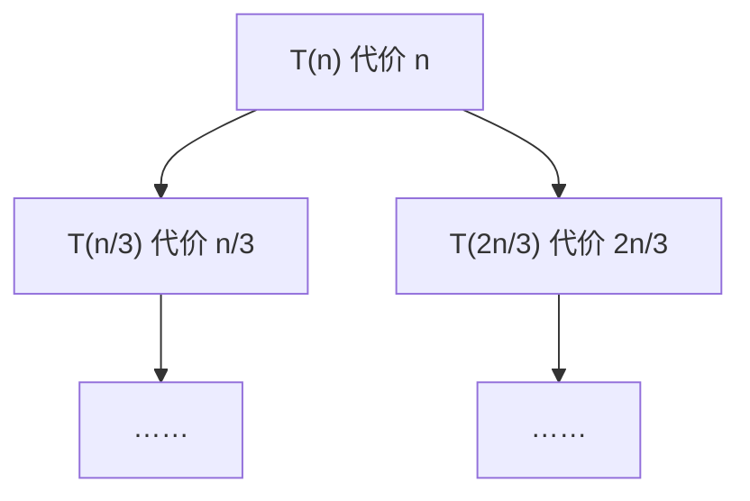

# 递推方程的求解方法（替换法、迭代法、递归树、主方法）

## 求解递推方程：从猜想到证明

分析递归算法时，我们常得到形如 $T(n)=aT(n/b)+f(n)$ 的递推方程。解出 $T(n)$ 的渐近阶，就能判断算法效率。常用的四种方法各有适用场景，难点在于“怎么想到”和“怎么严谨地证明”。

### 替换法：先猜后证

替换法（代换法）的核心是==先猜测解的形式，再用数学归纳法证明==。它不负责“猜”，只负责“证”。

**操作步骤：**

1. 猜一个渐近上界，如 $T(n)=O(n^2)$；
2. 假设对更小的 $m<n$ 成立 $T(m)\le c\cdot m^2$；
3. 代入递推式，验证能否推出 $T(n)\le c\cdot n^2$；
4. 若常数 $c$ 选取受阻，尝试减去一个低阶项（如 $-dn$）补强归纳假设。

> [!WARNING]
> 归纳假设必须严格保持“同一常数 $c$”。若推得 $T(n)\le c n^2 + n$，不能直接说“当 $n$ 很大时 $n$ 可忽略”——必须减掉低阶项或调整假设形式。

### 迭代法与递归树：看清展开的代价

**迭代法**把 $T(n)$ 反复代入自身，直到初始条件出现：

$$
T(n)=T(n-1)+2=T(n-2)+4=\cdots=T(0)+2n=2n+2=\Theta(n)
$$

**递归树**是迭代的图形化：每个节点代表一层递归产生的代价，逐层求和。

每层代价之和就是当前层的总工作量。对于 $T(n)=T(n/3)+T(2n/3)+n$，左右子树深度不同（右侧深度约为 $\log_{3/2}n$），递归树恰恰能展示这种==不平衡性==：总代价按层求和，上界为 $O(n\log n)$。

> [!TIP]
> 递归树适合“看出答案”，替换法适合“证明答案”。两者常配合使用。

### 主方法：形如 $T(n)=aT(n/b)+f(n)$ 的速查

主定理比较 $f(n)$ 与 $n^{\log_b a}$ 的增长快慢，分三种情况：

| 情况 | 条件 | 结论 |
|:---:|:---|:---:|
| 1 | $f(n)=O(n^{\log_b a-\varepsilon})$ | $T(n)=\Theta(n^{\log_b a})$ |
| 2 | $f(n)=\Theta(n^{\log_b a}\log^k n)$ | $T(n)=\Theta(n^{\log_b a}\log^{k+1}n)$ |
| 3 | $f(n)=\Omega(n^{\log_b a+\varepsilon})$ 且 $af(n/b)\le cf(n)$ | $T(n)=\Theta(f(n))$ |

> [!IMPORTANT]
> 情况 3 的**正则条件** $af(n/b)\le cf(n)\ (c<1)$ 不可忽略。只看 $f(n)$ 增长更快是不够的。

**算例**：$T(n)=T(n/2)+n$

这里 $a=1,\ b=2$，故 $n^{\log_b a}=n^0=1$。$f(n)=n=\Omega(n^{0+1})$，取 $\varepsilon=1$；验证正则条件 $af(n/b)=n/2\le cn$，取 $c=2/3$ 成立。因此 $T(n)=\Theta(n)$。

> [!CAUTION]
> 若 $f(n)$ 与 $n^{\log_b a}$ 差距不是多项式级别的（如 $f(n)=n/\log n$，介于 $n^{1-\varepsilon}$ 与 $n$ 之间），主方法失效。
