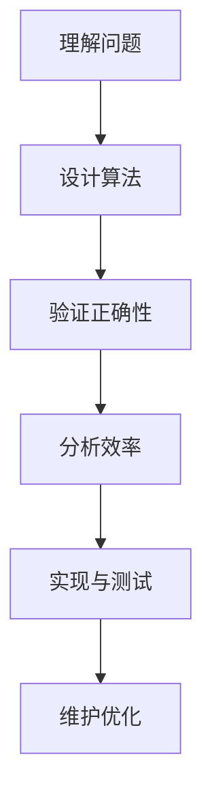

# 问题和问题求解方法与系统生命周期

## 什么是问题与问题求解

在《算法分析与设计》的开篇，我们首先要建立一个清晰的认识：**算法不是凭空产生的，它是为了解决问题而存在的**。所谓问题（Problem），可以看作是从输入到输出的一个映射——给定一组输入数据，希望得到满足特定条件的输出结果。而问题求解（Problem Solving），就是寻找一种方法来实现这个目标。

> [!IMPORTANT]
> **问题求解过程**是人们通过使用问题领域知识来理解和定义问题，并凭借自身的经验和知识去选择和使用适当的问题求解策略、技术和工具，将一个问题描述转换成问题解的过程。

这里有一个关键问题：计算机求解问题的核心是什么？答案就是——**寻找一种问题求解策略（Problem Solving Strategy），得到求解问题的算法，从而得到问题的解**。

## 为什么需要系统化的求解方法

假设你的负责人交给你一个很难的任务，几天后询问进展。你可能会遇到三种情况：

| 回答 | 背后的含义 |
|------|-----------|
| "我找不到一个有效的算法来解决它" | 承认自己未能解决，但问题可能有解 |
| "这样的算法是不存在的" | 声称证明了问题的不可解性 |
| "所有名人也都找不到有效算法" | 暗示问题可能属于"很难"的类别 |

> [!WARNING]
> **要证明一个问题不存在有效算法，往往跟寻找有效算法一样难。** 这正是 NP 完全理论研究的核心动机——识别那类"非常难的问题"。

课件中提到的旅行售货员问题（TSP）就是典型代表：设有 $n$ 个城市，已知任意两城市间距离，推销员想从某城市出发巡回经过每城市一次且仅一次，最后回到出发点，如何找一条最短路径？这类问题属于 **NP-Complete** 问题，至今没有找到多项式时间的精确算法。

## 算法问题的求解过程

面对一个实际问题，我们该如何着手？课件给出了清晰的求解流程：

### 第一步：理解问题（Understand the Problem）

这是最容易被忽视却最关键的一步。你需要明确：
- 问题的**输入**是什么？
- 要求的**输出**是什么？
- 有哪些**约束条件**？

### 第二步：设计算法——选择求解策略

根据问题的特性，选择合适的**算法设计策略**：

| 问题特性 | 适用策略 | 典型问题 |
|---------|---------|---------|
| 可分解为独立子问题 | 分治法 | 最大最小元、二分搜索、Strassen 矩阵乘法 |
| 具有贪心选择性质 | 贪心法 | 一般背包问题、最小生成树 |
| 具有最优子结构和重叠子问题 | 动态规划法 | 0/1 背包、最长公共子序列 |
| 解空间可树形搜索 | 回溯法/分支限界法 | n-皇后、子集和数 |

### 第三步：算法的分类与选择

同一个问题可能有多种算法，如何选择？

| 算法类型 | 特点 | 适用场景 |
|---------|------|---------|
| **精确算法** | 总能保证求得问题的精确解 | 问题规模可控时 |
| **启发式算法** | 通过规则、简化或智能猜测减少求解时间，不保证最优 | 大规模问题，求"满意解" |
| **近似算法** | 解最优化问题时，结果能保证在一定误差之内 | NP-难问题，需可证明的近似比 |

> [!TIP]
> 课件指出：对于最优化问题，若一个算法致力于寻找**近似解**而不是最优解，且解的质量有理论保证，则称为近似算法。例如，符合三角不等式的 TSP 可用 **2-近似算法**求解。

## 系统生命周期：从算法到软件

一个计算机程序的开发过程，就是使用计算机求解问题的过程。**软件工程**将软件开发和维护过程分成若干阶段，称为**系统生命周期（System Life Cycle）**或**软件生命周期**。

算法设计处于"设计"阶段的核心位置。只有具有良好的算法基础，才能成为训练有素的软件人才——因为你必须知道来自不同计算领域的重要算法，也必须学会**设计新的算法、确认其正确性并分析其效率**。

## 常见误区辨析

> [!CAUTION]
> **算法 ≠ 程序**。算法是对特定问题求解步骤的一种描述，是指令的有限序列；程序是算法的具体实现。算法可以用自然语言、伪代码、流程图等多种方式描述，**并非只能用程序设计语言**。

> [!NOTE]
> 算法的五个重要特征：有穷性、确定性、可行性、输入、输出。其中"有穷性"强调算法必须在执行有限步后终止。

---

**一个简单例子**：以课件中的**一般背包问题**（物品可分割）为例，背包容量 $C=50$，物品重量 $w=(10,20,30)$，价值 $p=(60,100,120)$。贪心策略是**按单位重量价值 $p_i/w_i$ 从大到小选取**：

| 物品 | $w_i$ | $p_i$ | $p_i/w_i$ | 选取比例 |
|:---:|:---:|:---:|:---:|:---:|
| 1 | 10 | 60 | 6.0 | 全部（$x_1=1$）|
| 2 | 20 | 100 | 5.0 | 全部（$x_2=1$）|
| 3 | 30 | 120 | 4.0 | 部分（$x_3=2/3$）|

总收益 $= 60 + 100 + \frac{2}{3}\times120 = 240$ 元。这正体现了"根据问题特性选择算法设计策略"的思想——可分割背包具有贪心选择性质，故可用贪心法求得最优解。
