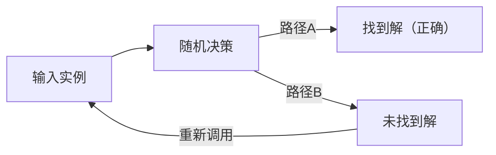
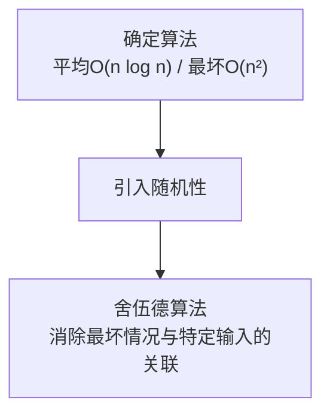

# 随机算法基本概念与分类（蒙特卡罗、拉斯维加斯、舍伍德）

## 随机算法的动机

确定性算法面对相同输入，每次执行的每一步都完全确定。但有些问题的最坏情况与平均情况差异悬殊——比如快速排序，在输入已经有序时会退化到 $O(n^2)$，而平均却是 $O(n \log n)$。随机算法通过引入受控的随机选择，让算法不再依赖输入实例的“恶意”排列。

> [!IMPORTANT]
> ==随机算法的核心思想==：用随机性打破“最坏输入”与“特定算法行为”之间的因果链，让算法在所有输入上都以高概率表现良好。

## 三类主要的随机算法

教材将随机算法分为四类（数值随机算法、蒙特卡罗、拉斯维加斯、舍伍德），其中后三类是本章重点。它们的区别集中在一个问题上：**解的质量和运行时间，哪个是随机的？**

| 类型 | 解是否正确 | 是否总能终止 | 运行时间 | 关键风险 |
| :--- | :--- | :--- | :--- | :--- |
| **拉斯维加斯** | 总是正确 | 可能找不到解 | 随机 | 运行时间可能很长 |
| **蒙特卡罗** | 可能错误 | 总在时限内终止 | 固定或可控 | 解可能出错 |
| **舍伍德** | 总是正确 | 总能找到解 | 趋于平均化 | 不改变平均复杂度 |

### 拉斯维加斯算法

拉斯维加斯算法做出的随机选择会影响执行路径。**一旦它返回一个解，这个解一定是正确的**；但它可能因随机选择不当而“空手而归”。典型对策是：反复独立调用直到成功。

> [!WARNING]
> 常见误区：拉斯维加斯算法不会给出错误答案，它的失败形式是“没有答案”而非“错误答案”。

### 蒙特卡罗算法

蒙特卡罗算法以固定的时间预算换取**概率意义上的正确性**。它总在有限时间内返回结果，但该结果可能错误。教材指出其两个特征：
- 无法有效判断所求解是否确实正确；
- 正确解的概率随计算时间增加而增大（可以通过重复实验提高置信度）。

一个典型应用是教材的*素数测试的蒙特卡罗算法*（Miller-Rabin）。

> [!TIP]
> 记忆口诀：拉斯维加斯是“慢但靠谱”，蒙特卡罗是“快但可能忽悠”。

### 舍伍德算法

舍伍德算法瞄准的是**确定性算法的最坏情况与平均情况差距过大**的问题。它不改变算法的平均时间复杂度，而是给算法添加随机性，**消除或减少不同实例之间运行时间的巨大差异**。

> 教材快速排序的舍伍德版本：每次随机选择分划元素，而不是固定选第一个或最后一个。这样，即使输入本身有序，算法也不会必然退化。

## 蒙特卡罗估计回溯法结点数

这一应用常常出现在考题中，用于**估计回溯法状态空间树上实际生成的结点数**，而非精确计算。

假设随机选取一条从根到叶的路径，记录路径上每个结点不受限制的子女数 $m_0, m_1, m_2, \dots$，则整个状态空间树上实际生成结点数的估计为：

$$1 + m_0 + m_0 m_1 + m_0 m_1 m_2 + \dots$$

**8 皇后例题推演**  
若随机选取路径为 $(4,1,3,0,2,7,5)$，各层不受限制的子女数分别为：

| $m_0$ | $m_1$ | $m_2$ | $m_3$ | $m_4$ | $m_5$ | $m_6$ | $m_7$ |
| :---: | :---: | :---: | :---: | :---: | :---: | :---: | :---: |
| 8 | 5 | 3 | 3 | 3 | 1 | 1 | 0 |

估计值 $= 1 + 8 + (8 \times 5) + (8 \times 5 \times 3) + \dots$，最后一层因为 $m_7 = 0$ 乘积也为 0。

> [!CAUTION]
> 蒙特卡罗估计给出的是==近似值，不是精确值==。考试判断题往往在此处设陷阱。

## 快速排序引入随机性的考点

快速排序在最坏情况下复杂度为 $O(n^2)$，引入随机过程的主要目的不是改善平均时间，而是 **==避免最坏情况的发生==** ——即消除最坏行为与特定输入实例之间的固定关联。选项中的常见干扰项是“改善平均时间”或“保证总是 $O(n\log n)$”。

舍伍德化后的快速排序不要求算法在所有输入上都有 $O(n\log n)$ 保证，但它使得算法对任何输入都以高概率表现良好，这正是舍伍德算法精神的体现。
