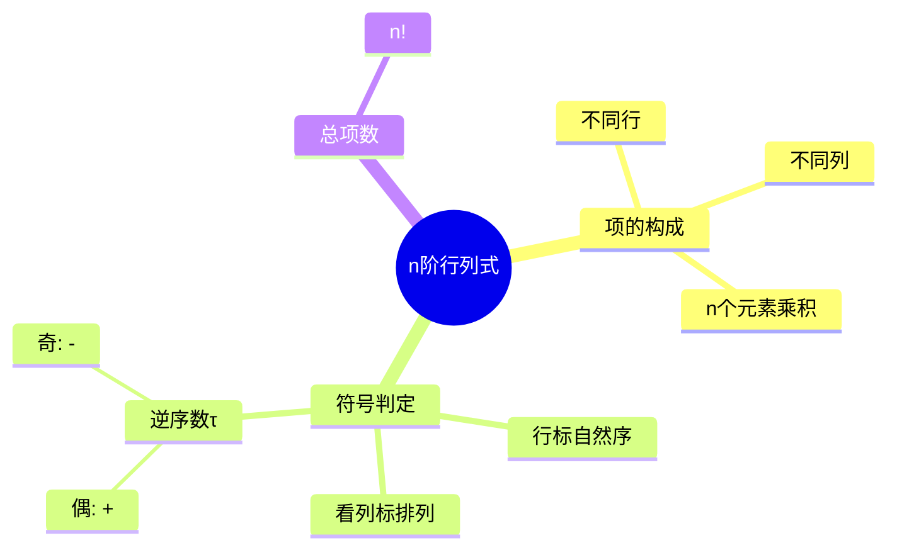

# n阶行列式的定义（逆序数与排列）

# n阶行列式的定义（逆序数与排列）

## 它是什么：从具体到一般的推广

三阶行列式展开有 $3!=6$ 项，每项是不同行、不同列元素的乘积。对于 **n阶行列式** $D = |a_{ij}|$，其定义基于 **排列** 与 **逆序数**：

$$
D = \sum_{j_1 j_2 \cdots j_n} (-1)^{\tau(j_1 j_2 \cdots j_n)} a_{1j_1} a_{2j_2} \cdots a_{nj_n}
$$

其中 $\sum$ 对所有 $n$ 元排列 $j_1 j_2 \cdots j_n$ 求和。
*   **项的构成**：取自不同行、不同列的 $n$ 个元素之积。
*   **符号确定**：当行下标为自然顺序 $1,2,\dots,n$ 时，列下标排列的 ==逆序数 $\tau$== 决定正负。偶排列为正，奇排列为负。

## 为什么需要：解决高维线性方程组

二、三阶行列式可用“对角线法则”记忆，但四阶及以上该法则失效。引入排列与逆序数，是为了给出一个 **通用的、严谨的代数定义**，从而处理任意阶数的行列式计算及后续线性方程组求解（如克拉默法则）。

> [!IMPORTANT]
> **核心定义**：逆序数 $\tau(j_1 \dots j_n)$ 是排列中“大数在小数前”的对数总和。奇偶性决定项的符号。

## 怎么做：计算步骤与示例

1.  **写出所有排列**：$n$ 阶行列式共有 $n!$ 项。
2.  **确定逆序数**：对每个列标排列，计算逆序数 $\tau$。
3.  **定号求和**：$(-1)^\tau$ 乘以对应元素积，最后累加。

**示例**：判断六阶行列式中项 $a_{23}a_{31}a_{42}a_{56}a_{14}a_{65}$ 的符号。

**解**：
首先调整行下标为自然顺序 $1,2,3,4,5,6$：
原项重排为 $a_{14}a_{23}a_{31}a_{42}a_{56}a_{65}$。
此时列下标排列为 $4, 3, 1, 2, 6, 5$。
计算逆序数 $\tau(431265)$：
*   4前面无更大数；4后面比4小的有3,1,2 (3个)
*   3后面比3小的有1,2 (2个)
*   1后面比1小的无 (0个)
*   2后面比2小的无 (0个)
*   6后面比6小的有5 (1个)
*   $\tau = 3+2+0+0+1 = 6$。

因为 $\tau=6$ 为偶数，故该项带 ==正号==。

## 常见坑与辨析

| 概念 | 说明 | 易错点 |
| :--- | :--- | :--- |
| **对换** | 交换排列中两个数位置 | ==对换一次，奇偶性改变== |
| **自然排列** | $1,2,\dots,n$ | 逆序数为0，属偶排列 |
| **对角线法则** | 仅适用于二、三阶 | **严禁**用于四阶及以上 |

> [!WARNING]
> **高危误区**：不要试图用画斜线的方式计算四阶及以上行列式！必须依据定义或性质（如展开定理）计算。
> **注意**：若行下标未按自然顺序排列，需先计算行标排列逆序数 $\tau(row)$ 和列标排列逆序数 $\tau(col)$，符号由 $(-1)^{\tau(row)+\tau(col)}$ 决定。

> [!TIP]
> **快速判断**：全体 $n$ 元排列中，奇、偶排列各占一半，均为 $n!/2$ 个。利用此性质可辅助验证计算结果的完整性。
