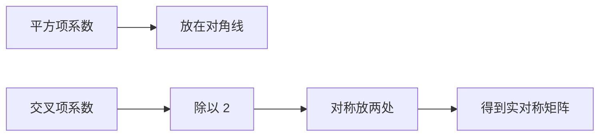

# 二次型的定义及其对应的实对称矩阵

## 二次型是什么

**二次型**是 $n$ 个变量 $x_1,x_2,\dots,x_n$ 的二次齐次多项式，即每一项的次数都是 $2$：

$$
f(x_1,\dots,x_n)=\sum_{i=1}^{n}a_{ii}x_i^2+2\sum_{1\le i<j\le n}a_{ij}x_ix_j .
$$

其中 $a_{ii}x_i^2$ 是**平方项**，$2a_{ij}x_ix_j$ 是**交叉项**。例如

$$
f(x_1,x_2)=x_1^2+2x_2^2+4x_1x_2
$$

是二次型，而 $x_1^2+x_2+1$ 不是，因为它含有一次项和常数项。

> [!IMPORTANT]
> 研究二次型的核心方法是把它写成矩阵形式：==$f(\boldsymbol x)=\boldsymbol x^{\mathsf T}A\boldsymbol x$，其中 $A$ 是实对称矩阵==。

## 为什么要对应实对称矩阵

把变量写成列向量 $\boldsymbol x=(x_1,x_2,x_3)^{\mathsf T}$，则

$$
\boldsymbol x^{\mathsf T}A\boldsymbol x
=\sum_{i=1}^{n}a_{ii}x_i^2+\sum_{i\ne j}a_{ij}x_ix_j .
$$

当 $A^{\mathsf T}=A$ 时，$a_{ij}x_ix_j$ 与 $a_{ji}x_jx_i$ 合并为 $2a_{ij}x_ix_j$，正好对应一个交叉项。这样，配方、正交变换、特征值以及正定性判断都可以转化为矩阵问题。

同一二次型也能写成非对称矩阵形式，例如 $x_1^2+4x_1x_2+x_2^2$ 可写成

$$
\boldsymbol x^{\mathsf T}
\begin{pmatrix}1&4\\0&1\end{pmatrix}\boldsymbol x,
$$

但通常所说的“二次型的矩阵”特指唯一的实对称矩阵

$$
\begin{pmatrix}1&2\\2&1\end{pmatrix}.
$$

## 怎样写出矩阵

规则可以概括为：

- 平方项 $a_{ii}x_i^2$：系数直接放在主对角线位置 $a_{ii}$；
- 交叉项 $c x_ix_j\ (i\ne j)$：把系数 $c$ **平分**，令 $a_{ij}=a_{ji}=c/2$；
- 没有出现的项：对应元素填 $0$。

例如

$$
f=x_1^2+2x_2^2+x_3^2+2x_1x_2+2tx_2x_3
$$

对应的实对称矩阵为

$$
A=\begin{pmatrix}
1&1&0\\
1&2&t\\
0&t&1
\end{pmatrix}.
$$

这里 $2x_1x_2$ 的系数 $2$ 平分为 $1,1$；$2tx_2x_3$ 的系数 $2t$ 平分为 $t,t$；没有 $x_1x_3$ 项，所以 $a_{13}=a_{31}=0$。

> [!WARNING]
> 最常见的错误是把交叉项系数原样填入两个位置。这样展开后，交叉项会变成原来的两倍。写完矩阵后，应代回 $\boldsymbol x^{\mathsf T}A\boldsymbol x$ 检查。

## 与相近概念的区别

| 概念 | 含义 | 与本知识点的关系 |
|---|---|---|
| 二次型 | 二次齐次多项式 | 研究对象 |
| 二次型的矩阵 | 满足 $f=\boldsymbol x^{\mathsf T}A\boldsymbol x$ 的实对称矩阵 $A$ | 与二次型一一对应 |
| 二次型的秩 | 矩阵 $A$ 的秩 | 不是变量个数，也不一定等于平方项个数 |
| 标准形 | 只含平方项的形式 | 可通过可逆线性替换获得 |

## 一个完整例子

判断上述二次型正定时，先写出矩阵 $A$，再计算顺序主子式：

$$
D_1=1>0,\qquad
D_2=\begin{vmatrix}1&1\\1&2\end{vmatrix}=1>0,
$$

$$
D_3=|A|=1(2-t^2)-1(1-0)=1-t^2.
$$

由西尔维斯特准则，$A$ 正定当且仅当各阶顺序主子式均大于零，因此

$$
1-t^2>0\iff -1<t<1.
$$

所以，**严格按照题面计算应选 A**。若资料所附答案为 B，则题面、选项或所附答案很可能存在转录差异；不能因为给定答案而改动矩阵元素或行列式计算。

> [!TIP]
> 做含参数二次型题目时，固定顺序：==先写对称矩阵，再检查交叉项，最后判断正定性==。矩阵写错，后面的特征值、合同变换和顺序主子式都会随之出错。
