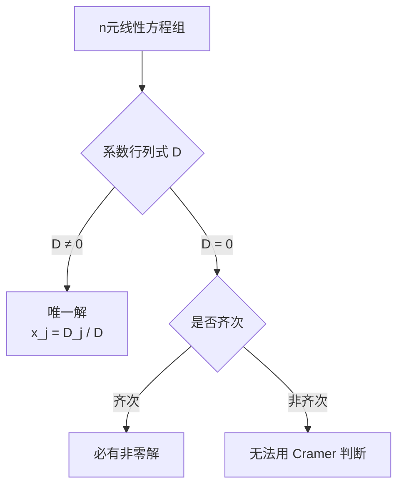

# 克莱姆(Cramer)法则及齐次方程组推论

## 克莱姆法则

先看一个具体问题：解三元线性方程组

$$
\left\{ \begin{aligned}
x_1 + x_2 + x_3 &= 1, \\
2x_1 + 3x_2 + 4x_3 &= 1, \\
4x_1 + 9x_2 + 16x_3 &= 1
\end{aligned} \right.
$$

相信你已经会消元法。但如果不急着消元，只盯着系数行列式，能不能直接把解“读”出来？

### 法则内容

> [!IMPORTANT]
> 设 $n$ 元线性方程组 $\sum_{j=1}^{n} a_{ij}x_j = b_i$（$i=1,2,\dots,n$）的系数行列式 $D = |a_{ij}| \neq 0$，则方程组有唯一解：
> $$
> x_j = \frac{D_j}{D}, \quad j = 1,2,\dots,n
> $$
> 其中 $D_j$ 是把 $D$ 中第 $j$ 列换成常数列 $b_1,b_2,\dots,b_n$ 后所得的行列式。

### 为什么成立

关键观察：把 $x_j$ 乘进系数行列式的第 $j$ 列，有

$$
x_j D = \left| \begin{matrix}
a_{11} & \cdots & a_{1j}x_j & \cdots & a_{1n} \\
\vdots & & \vdots & & \vdots \\
a_{n1} & \cdots & a_{nj}x_j & \cdots & a_{nn}
\end{matrix} \right|.
$$

再将其他各列的 $x_k$ 倍加到第 $j$ 列，由方程组可知第 $j$ 列恰好变成常数列，于是 $x_j D = D_j$。$D \neq 0$ 时除过去即可。这解释了为什么形式上如此对称：==每个未知数独占一个“替换列”的行列式==。

### 一个算对了的例子

回到开头的方程组，系数行列式是范德蒙德类型：

$$
D = \left| \begin{matrix}
1 & 1 & 1 \\
2 & 3 & 4 \\
4 & 9 & 16
\end{matrix} \right|
= (4-2)(3-2)(4-3) = 2 \neq 0.
$$

分别替换三列：

$$
D_1 = 6,\quad D_2 = -6,\quad D_3 = 2,
$$

于是

$$
x_1 = \frac{6}{2} = 3,\quad x_2 = \frac{-6}{2} = -3,\quad x_3 = \frac{2}{2} = 1.
$$

### 齐次方程组的推论

当常数列全为 $0$ 时，方程组称为齐次线性方程组：

$$
\sum_{j=1}^{n} a_{ij}x_j = 0, \quad i=1,2,\dots,n.
$$

> [!IMPORTANT]
> 若齐次方程组的系数行列式 $D \neq 0$，则它只有零解 $x_1 = x_2 = \cdots = x_n = 0$。
>
> 等价地：==齐次方程组有非零解 $\Rightarrow D = 0$==。

这是克莱姆法则最重要的理论用途。反过来要小心：

> [!WARNING]
> $D=0$ 时齐次方程组**必有**非零解（本课程范围），但非齐次方程组 $D=0$ 时**不能**用克莱姆法则判断——可能无解，也可能无穷多解。

### 使用条件与常见坑

常见坑：

> [!CAUTION]
> 克莱姆法则**只适用于**方程个数 = 未知量个数且系数行列式不为零的方程组。方程个数与未知量不等时，根本谈不上“系数行列式”和 $D_j$。

> [!TIP]
> 计算量提示：克莱姆法则要算 $n+1$ 个 $n$ 阶行列式，用于 $n \geq 4$ 时远不如消元法高效。它在理论推导（如证明解的唯一性、连续性）中更常用。

### 与逆矩阵的联系

若 $A = (a_{ij})$ 可逆，则方程组的唯一解可写成 $x = A^{-1}b$。克莱姆法则只是把这个解按分量展开了：$x_j = \dfrac{\det A_j}{\det A}$。而伴随矩阵公式

$$
A^{-1} = \frac{1}{|A|} A^*
$$

正是这一思想的矩阵形式——这也解释了开头“已知 $A^*$ 求 $A^{-1}$”的题为何直接除以 $|A|$。
