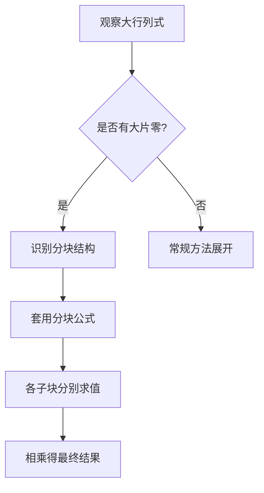

# 分块矩阵的行列式计算

> [!IMPORTANT]
> 分块矩阵的行列式，本质是利用矩阵中“大片零元素”的结构特征，将高阶行列式拆解为若干低阶子块行列式的乘积，从而大幅降低计算量。

## 它是什么与为什么需要

当我们面对一个 $5$ 阶、$7$ 阶甚至更高阶的行列式时，如果直接按定义展开或反复使用行列式性质化简，计算量会呈爆炸式增长。但仔细观察课件中的例题，你会发现很多大行列式中藏着大量的 $0$。

这些 $0$ 不是巧合，而是出题人留给你的“捷径”。如果我们用虚线把非零部分和零部分隔开，整个大矩阵就变成了由几个小矩阵（称为**子块**）拼成的“分块矩阵”。只要零块出现在特定位置，大行列式就能直接拆成小行列式的乘积。

## 怎么做：核心公式

设 $A$ 为 $m$ 阶方阵，$B$ 为 $n$ 阶方阵。根据零块的位置，我们主要掌握两种基本形态：

| 分块形态 | 结构图示 | 行列式计算公式 | 适用场景 |
| :--- | :---: | :--- | :--- |
| **主对角分块** | $\begin{vmatrix} A & 0 \\ 0 & B \end{vmatrix}$ 或 $\begin{vmatrix} A & * \\ 0 & B \end{vmatrix}$ | $|A|\cdot|B|$ | 左下或右上为零块 |
| **副对角分块** | $\begin{vmatrix} 0 & A \\ B & 0 \end{vmatrix}$ | $(-1)^{mn}|A|\cdot|B|$ | 左上右下为零块 |

> [!NOTE]
> 对于上三角分块 $\begin{vmatrix} A & C \\ 0 & B \end{vmatrix}$ 或下三角分块 $\begin{vmatrix} A & 0 \\ C & B \end{vmatrix}$，无论非零块 $C$ 里填什么数字（哪怕像课件里那样填入 $10035$ 这种干扰项），==其行列式始终等于 $|A|\cdot|B|$==。

对于副对角分块，为什么要乘 $(-1)^{mn}$？因为要把 $A$ 和 $B$ 换到主对角线上，相当于把 $A$ 的 $m$ 列依次跨过 $B$ 的 $n$ 列，总共需要交换 $mn$ 次列，每次交换变号一次。

## 常见的坑与易错点

> [!WARNING]
> **不要混淆副对角分块的符号！** 很多同学看到 $\begin{vmatrix} 0 & A \\ B & 0 \end{vmatrix}$ 就直接写 $-|A||B|$。记住，符号指数是 ==两个子块阶数的乘积 $mn$==，而不是简单的 $-1$。例如 $A$ 为 $2$ 阶，$B$ 为 $3$ 阶，则符号为 $(-1)^{2\times3}=1$，结果是正的。

> [!CAUTION]
> **一阶子块的处理。** 当某个子块只有 $1$ 个元素时，比如 $|5|$，它的行列式就是 $5$ 本身，千万不要写成绝对值或者漏掉它！

## 算对了的例子

来看课件中的一道经典 $7$ 阶题：

$$
D = \left| \begin{array}{ccccccc} 1 & 2 & 0 & 0 & 0 & 0 & 0 \\ 3 & 4 & 0 & 0 & 0 & 0 & 0 \\ a & b & 5 & 6 & 7 & 0 & 0 \\ c & d & 8 & 9 & 10 & 0 & 0 \\ e & f & 11 & 12 & 13 & 0 & 0 \\ g & h & i & j & k & 14 & 15 \\ l & m & n & o & p & 16 & 17 \end{array} \right|
$$

**第一步：找零块，划分子块。**
观察第 $3,4,5$ 行的后两列全为 $0$，第 $6,7$ 行的前 $5$ 列虽然有字母，但我们看右上角：前两行后 $5$ 列全是 $0$。这其实是一个**下三角分块矩阵**。我们沿对角线将其切分为三个方阵子块：

- 左上角 $2$ 阶子块：$A_1 = \begin{pmatrix} 1 & 2 \\ 3 & 4 \end{pmatrix}$
- 中间 $3$ 阶子块：$A_2 = \begin{pmatrix} 5 & 6 & 7 \\ 8 & 9 & 10 \\ 11 & 12 & 13 \end{pmatrix}$
- 右下角 $2$ 阶子块：$A_3 = \begin{pmatrix} 14 & 15 \\ 16 & 17 \end{pmatrix}$

那些 $a, b, c \dots$ 等字母全部落在左下角的非关键区域，对行列式的值**没有任何影响**。

**第二步：套用公式，逐个击破。**
根据下三角分块性质：
$$D = |A_1| \cdot |A_2| \cdot |A_3|$$

**第三步：计算各子块。**
- $|A_1| = 1\times4 - 2\times3 = -2$
- $|A_3| = 14\times17 - 15\times16 = 238 - 240 = -2$
- $|A_2|$ 可按常规方法计算（此处略去具体数值）。

> [!TIP]
> 遇到带有大量未知字母的高阶行列式，先别慌。画个十字线找找零块，一旦认出分块结构，那些吓人的字母就全成了不用管的背景板。
