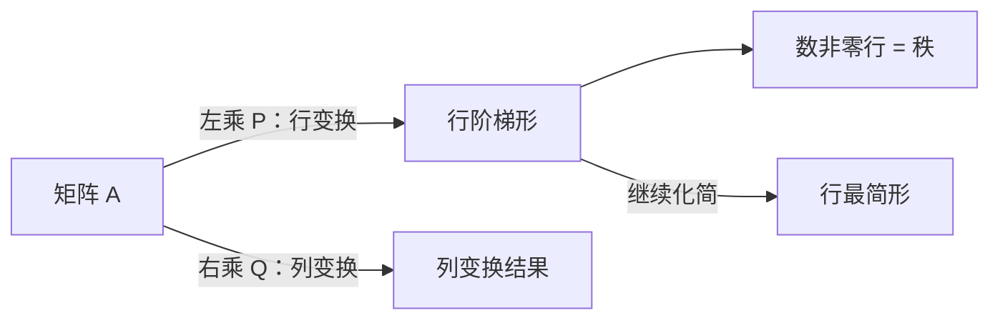

# 矩阵的初等变换与初等矩阵及其关系

## 什么是初等变换

对矩阵 $A$ 施行的以下三种操作称为**初等行变换**：

| 类型 | 记号 | 操作 |
|---|---|---|
| 对换 | $r_i \leftrightarrow r_j$ | 交换第 $i,j$ 两行 |
| 倍乘 | $r_i \times k$（$k\neq 0$） | 第 $i$ 行乘非零数 $k$ |
| 倍加 | $r_i + k r_j$ | 第 $j$ 行的 $k$ 倍加到第 $i$ 行 |

把“行”换成“列”（记 $c_i$）即得**初等列变换**。若 $A$ 经有限次初等变换化为 $B$，记 $A \to B$，称 $A$ 与 $B$ **等价**，记 $A \cong B$。初等变换都是可逆的，其逆变换仍是同类型初等变换。

> [!IMPORTANT]
> 初等变换 ==不改变矩阵的秩==。把 $A$ 用初等行变换化为行阶梯形，非零行的行数就是 $r(A)$——这是求数字矩阵秩最常用的方法。

## 初等矩阵及其与初等变换的关系

单位矩阵 $I$ 经过**一次**初等变换得到的矩阵称为初等矩阵，对应三类：$E(i,j)$（对换）、$E(i(k))$（倍乘，$k\neq0$）、$E(i,j(k))$（倍加）。

核心关系（“左行右列”）：

- 对 $A$ 作一次初等**行**变换 $\iff$ 用相应初等矩阵 $P$ **左乘**：$A \to PA$；
- 对 $A$ 作一次初等**列**变换 $\iff$ 用相应初等矩阵 $Q$ **右乘**：$A \to AQ$。

初等矩阵均可逆，且逆矩阵仍为同类初等矩阵：
$$E(i,j)^{-1}=E(i,j),\quad E(i(k))^{-1}=E(i(k^{-1})),\quad E(i,j(k))^{-1}=E(i,j(-k)).$$

由此得到两个常用结论：

- $A$ 可逆 $\iff$ $A$ 可表示为有限个初等矩阵的乘积 $\iff$ $A \cong I$；
- $m\times n$ 矩阵 $A,B$ 等价 $\iff$ 存在可逆矩阵 $P,Q$ 使 $B=PAQ$。

## 怎么用：求逆与解矩阵方程

**初等变换法求逆**：作增广矩阵 $(A \mid I)$，只用初等**行**变换把左半化为 $I$，右半即为 $A^{-1}$：
$$(A \mid I)\ \xrightarrow{\text{初等行变换}}\ (I \mid A^{-1}).$$
同理，解 $AX=B$ 可直接作 $(A\mid B)\to(I\mid A^{-1}B)$，即 $X=A^{-1}B$；解 $XA=B$ 则用列变换，或转化为 $X=BA^{-1}$。

## 一个算对的例子

设 $2X=AX+A$，其中 $A=\begin{pmatrix}1&-1&0\\1&1&1\\0&1&1\end{pmatrix}$，求 $X$。

移项得 $(2I-A)X=A$，而
$$2I-A=\begin{pmatrix}1&1&0\\-1&1&-1\\0&-1&1\end{pmatrix},\qquad |2I-A|=1\neq0,$$
故可逆，$X=(2I-A)^{-1}A$。对 $(2I-A\mid I)$ 作初等行变换：
$$\left[\begin{array}{ccc|ccc}1&1&0&1&0&0\\-1&1&-1&0&1&0\\0&-1&1&0&0&1\end{array}\right]
\to\cdots\to
\left[\begin{array}{ccc|ccc}1&0&0&0&-1&1\\0&1&0&1&1&-1\\0&0&1&1&1&-2\end{array}\right],$$
所以 $(2I-A)^{-1}=\begin{pmatrix}0&-1&1\\1&1&-1\\1&1&-2\end{pmatrix}$，于是
$$X=(2I-A)^{-1}A=\begin{pmatrix}-1&0&0\\2&-1&0\\2&-2&-1\end{pmatrix}.$$
代回 $2X=AX+A$ 检验成立。

## 相近概念与常见坑

| 概念 | 含义 | 与本知识点的关系 |
|---|---|---|
| 矩阵等价 $A\cong B$ | 经初等变换互化 | 秩相等（同型）即等价 |
| 矩阵相等 $A=B$ | 对应元素全等 | 初等变换后一般不再相等，只能用 $\to$ 连接 |
| 行列式变换 | 求 $|A|$ 时的恒等变形 | 对换变号、倍乘提出 $k$、倍加不变；矩阵变换无此说法 |

> [!WARNING]
> - 倍乘必须 $k\neq0$，否则不是初等变换，可能改变秩。
> - 求逆、解方程 $(A\mid I)$ 时 ==行变换要贯穿整个增广矩阵==，且求逆不能行列混用。
> - 左乘对应行变换、右乘对应列变换，方向记反是全错的开端。
> - 用初等行变换求向量组的秩与极大线性无关组时，主元列对应原向量；行变换不改变列向量间的线性关系，故可由行最简形直接读出表示系数。

> [!TIP]
> 口诀：**左行右列，行变求逆；化阶梯数非零行，秩即现形。**
