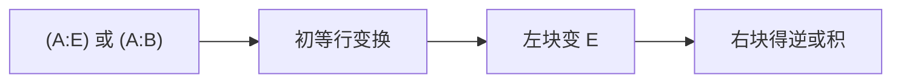

# 用初等行（列）变换求逆矩阵及解矩阵方程

## 它是什么

在《线性代数与解析几何》第 2 章里，求逆矩阵与解矩阵方程都可以统一成一句话：把矩阵并在一起，做**初等行变换**。

- 求 $A^{-1}$：对增广矩阵 $(A \vdots E)$ 做初等行变换，把左边化成 $E$，右边就变成 $A^{-1}$，即
  $$(A \vdots E) \xrightarrow{\text{初等行变换}} (E \vdots A^{-1})$$
- 求 $A^{-1}B$：对 $(A \vdots B)$ 做同样的行变换：
  $$(A \vdots B) \longrightarrow (E \vdots A^{-1}B)$$

如果方程是 $XA=B$（未知矩阵在左边），就转置后用 $(A^T \vdots B^T)$ 做行变换，或者改用初等**列**变换。

## 为什么需要

$n$ 阶矩阵 $A$ 可逆，当且仅当 $|A|\neq 0$，也等价于 $A$ 的秩为 $n$。用伴随矩阵求逆要算很多代数余子式，阶数一高就很痛苦；初等行变换把“求逆”和“解矩阵方程”变成一套机械操作，考试里更稳。

先想一个问题：矩阵方程 $AX=2X+A$，未知矩阵 $X$ 能直接除吗？不能。要像普通方程那样移项：
$$AX-2X=A \Rightarrow (A-2E)X=A$$
只要 $A-2E$ 可逆，就有 $X=(A-2E)^{-1}A$，然后继续用初等行变换求右边这个积。

## 怎么做

步骤只有三步：

1. 写增广矩阵 $(A \vdots E)$ 或 $(A \vdots B)$；
2. 只用**初等行变换**把左块化成单位矩阵 $E$；
3. 右边出来的就是答案。

过程中若左块出现全零行，说明原矩阵不可逆。行阶梯形里非零行的行数就是矩阵的秩，这也是判断能不能继续化简的依据。

> [!TIP]
> 记忆口诀：==“左化单位，右出结果”==；只能行变换，不能随便混列变换。

## 与相近概念的区别

| 场景 | 构造形式 | 目标 |
|---|---|---|
| 求 $A^{-1}$ | $(A \vdots E)$ | 右块为 $A^{-1}$ |
| 求 $A^{-1}B$ | $(A \vdots B)$ | 右块为 $A^{-1}B$ |
| 求秩 | 只对 $A$ 作行阶梯化 | 数非零行 |
| 解 $XA=B$ | 转置成 $A^T X^T = B^T$ | 再用行变换 |

## 常见的坑

> [!WARNING]
> 一是把初等**行**变换和**列**变换混用，求逆时一旦混用就前功尽弃；
> 二是矩阵方程没先化成 $(C)X=D$ 或 $X(C)=D$ 的形式就下手；
> 三是数乘某一行时漏乘右边的增广部分。

> [!CAUTION]
> 若左边化不出单位矩阵（出现零行），说明矩阵不可逆，此时不能用此法硬算逆矩阵。

## 一个算对了的例子

取课件中计算 4：$AB=A+2B$，移项得 $(A-2E)B=A$，所以
$$B=(A-2E)^{-1}A$$
已知
$$A-2E=\begin{pmatrix}2&2&3\\1&-1&0\\-1&2&1\end{pmatrix}$$
对 $(A-2E \vdots A)$ 做初等行变换，可得
$$(A-2E)^{-1}=\begin{pmatrix}1&-4&-3\\1&-5&-3\\-1&6&4\end{pmatrix}$$
再乘上
$$A=\begin{pmatrix}4&2&3\\1&1&0\\-1&2&3\end{pmatrix}$$
于是
$$B=\begin{pmatrix}1&-4&-3\\1&-5&-3\\-1&6&4\end{pmatrix}\begin{pmatrix}4&2&3\\1&1&0\\-1&2&3\end{pmatrix}=\begin{pmatrix}3&-8&-6\\2&-9&-6\\-2&12&9\end{pmatrix}$$
==核心结论==：矩阵方程先化成“系数矩阵 × 未知 = 已知”，再统一用 $(C \vdots D)$ 的初等行变换一次性算出未知矩阵。
