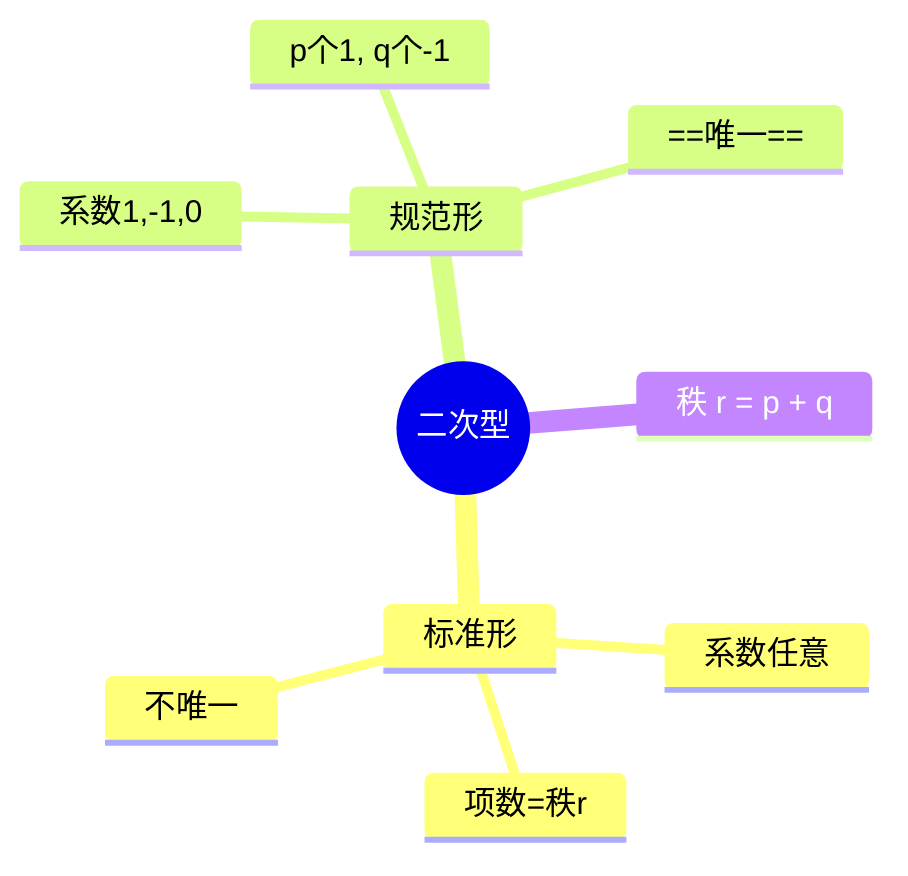

# 矩阵的合同关系与二次型的标准形、规范形

## 矩阵合同与二次型化简

在实对称矩阵的研究中，**合同关系**是连接代数形式与几何性质的桥梁。若存在可逆矩阵 $C$，使得 $B = C^T A C$，则称 $A$ 与 $B$ **合同**。这对应于二次型 $f=x^T A x$ 经非退化线性变换 $x=Cy$ 化为 $g=y^T B y$。

> [!IMPORTANT]
> ==惯性定理==：实二次型的标准形不唯一，但**规范形唯一**。其中正平方项个数 $p$（正惯性指数）和负平方项个数 $q$（负惯性指数）是不变量。

## 为什么需要规范形？

标准形仅消除了交叉项，系数仍复杂。规范形将系数简化为 $\pm 1$ 或 $0$，直接揭示了二次型的**定性特征**（如正定、负定）。判断矩阵是否合同，只需比较它们的**秩**和**正惯性指数**是否相同。

| 概念 | 定义特征 | 唯一性 | 决定因素 |
| :--- | :--- | :--- | :--- |
| **标准形** | $d_1 y_1^2 + \dots + d_r y_r^2$ | 否 | 变换方法不同而异 |
| **规范形** | $z_1^2 + \dots + z_p^2 - z_{p+1}^2 - \dots$ | **是** (实域) | 秩 $r$ 和正惯性指数 $p$ |

## 怎么做：配方法实战

配方法是手算化简的核心技巧，核心思想是“逐个消元”。

> [!TIP]
> **操作口诀**：有平方先配方，无平方先换元。注意变换矩阵的可逆性。

以真题为例，将 $f = x_1^2 + x_2^2 + x_3^2 + 4x_1x_2 + 4x_1x_3 + 4x_2x_3$ 化为规范形。

**第一步：处理含 $x_1$ 的项**
$$
\begin{aligned}
f &= [x_1^2 + 4x_1(x_2+x_3)] + x_2^2 + x_3^2 + 4x_2x_3 \\
&= (x_1 + 2x_2 + 2x_3)^2 - (2x_2+2x_3)^2 + x_2^2 + x_3^2 + 4x_2x_3 \\
&= (x_1 + 2x_2 + 2x_3)^2 - 3x_2^2 - 3x_3^2 - 4x_2x_3
\end{aligned}
$$

**第二步：处理剩余部分含 $x_2$ 的项**
$$
\begin{aligned}
-3x_2^2 - 4x_2x_3 - 3x_3^2 &= -3[x_2^2 + \frac{4}{3}x_2x_3] - 3x_3^2 \\
&= -3[(x_2 + \frac{2}{3}x_3)^2 - \frac{4}{9}x_3^2] - 3x_3^2 \\
&= -3(x_2 + \frac{2}{3}x_3)^2 + \frac{4}{3}x_3^2 - 3x_3^2 \\
&= -3(x_2 + \frac{2}{3}x_3)^2 - \frac{5}{3}x_3^2
\end{aligned}
$$

**第三步：整理并写出规范形**
令
$$
\begin{cases}
y_1 = x_1 + 2x_2 + 2x_3 \\
y_2 = \sqrt{3}(x_2 + \frac{2}{3}x_3) \\
y_3 = \sqrt{\frac{5}{3}}x_3
\end{cases}
$$
则 $f = y_1^2 - y_2^2 - y_3^2$。
此时，正惯性指数 $p=1$，负惯性指数 $q=2$，秩 $r=3$。规范形为 $z_1^2 - z_2^2 - z_3^2$（需进一步做缩放变换 $z_i = y_i$ 或调整系数使系数为 $\pm 1$）。

> [!WARNING]
> **常见坑**：
> 1. 配方时忘记减去“多出来的项”（如 $(a+b)^2 = a^2+2ab+b^2$，需减去 $b^2$）。
> 2. 混淆**坐标变换**与**规范形系数**。规范形系数只能是 $1, -1, 0$。
> 3. 若题目要求写出**线性变换矩阵**，务必反解出 $x=Cy$，确保 $C$ 可逆。
