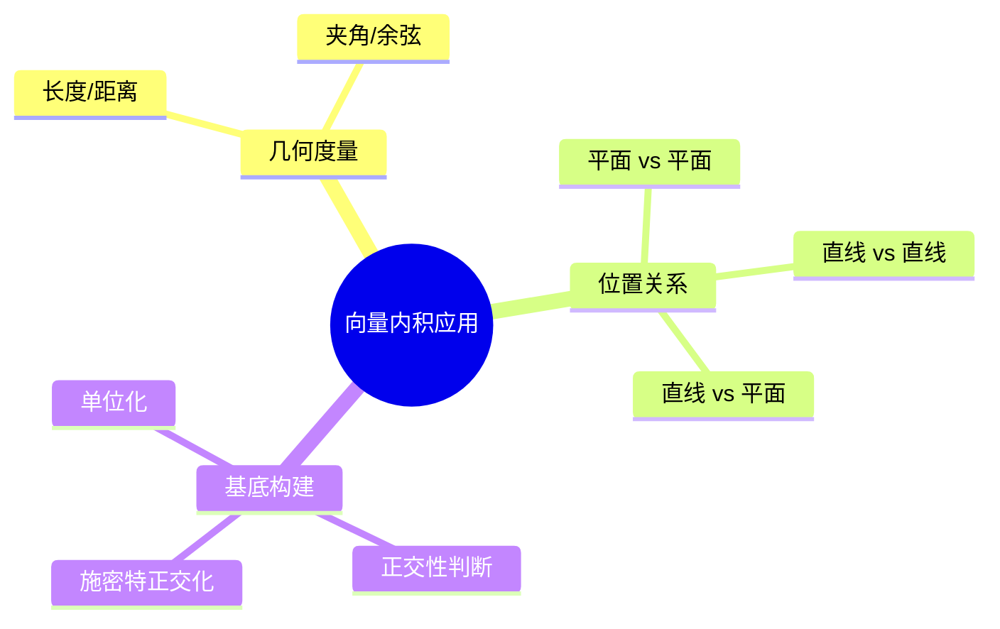

# n维向量的内积、长度、夹角与正交性

# n维向量的内积、长度、夹角与正交性

## 它是什么：从几何直观到代数定义

在 $\mathbb{R}^n$ 空间中，向量不仅是坐标的集合，更具备度量性质。
- **内积**：$\boldsymbol{\alpha} \cdot \boldsymbol{\beta} = \sum_{i=1}^n a_i b_i$，反映两个向量的“相似程度”。
- **长度（模）**：$|\boldsymbol{\alpha}| = \sqrt{\boldsymbol{\alpha} \cdot \boldsymbol{\alpha}} = \sqrt{\sum a_i^2}$。
- **夹角**：由 $\cos \theta = \frac{\boldsymbol{\alpha} \cdot \boldsymbol{\beta}}{|\boldsymbol{\alpha}| |\boldsymbol{\beta}|}$ 定义，范围 $\theta \in [0, \pi]$。
- **正交**：若 $\boldsymbol{\alpha} \cdot \boldsymbol{\beta} = 0$，则称 $\boldsymbol{\alpha} \perp \boldsymbol{\beta}$。

> [!IMPORTANT]
> ==核心结论==：正交即内积为零。这是判断垂直、构建标准正交基（如施密特正交化）的基础。

## 为什么需要：几何关系的代数化

线性代数的一大任务是将几何问题转化为矩阵运算。通过内积，我们可以量化：
1. **投影与分解**：计算一个向量在另一个方向上的分量。
2. **空间位置关系**：利用法向量或方向向量求解直线、平面的夹角。

## 怎么做：计算流程与易错点

计算通常遵循三步走：**算内积 $\rightarrow$ 算模长 $\rightarrow$ 代入公式**。

### 1. 夹角计算通式
$$ \cos \theta = \frac{\boldsymbol{\alpha}^T \boldsymbol{\beta}}{|\boldsymbol{\alpha}| \cdot |\boldsymbol{\beta}|} $$

### 2. 几何对象夹角转换
| 几何对象 | 依赖向量 | 夹角公式特征 |
| :--- | :--- | :--- |
| 两直线 | 方向向量 $\vec{s}_1, \vec{s}_2$ | 取锐角，加绝对值 |
| 两平面 | 法向量 $\vec{n}_1, \vec{n}_2$ | 取锐角，加绝对值 |
| 线面夹角 | 方向 $\vec{s}$, 法向 $\vec{n}$ | $\sin \psi = \|\cos \langle \vec{s}, \vec{n} \rangle\|$ |

> [!WARNING]
> **常见坑**：
> 1. 求**两平面/直线**夹角时，结果通常取**锐角**，因此分子需加绝对值 $|\boldsymbol{\alpha} \cdot \boldsymbol{\beta}|$。
> 2. 求**线面**夹角时，向量夹角 $\varphi$ 与线面角 $\psi$ 互余，即 $\sin \psi = |\cos \varphi|$，切勿直接混用。
> 3. 维度不一致无法计算内积；零向量与任意向量正交，但无定义夹角。

## 典型例题解析

**题目**：已知 $\boldsymbol{\alpha} = (1, 1, 1, 1, 1)^{\mathrm{T}}$，$\boldsymbol{\beta} = (-2, 1, x, 2)^{\mathrm{T}}$，若夹角为 $60^\circ$，求 $x$。

**解题步骤**：
1. **计算内积**：
   $$ \boldsymbol{\alpha} \cdot \boldsymbol{\beta} = 1(-2) + 1(1) + 1(x) + 1(2) + 1(?) $$
   *注意：题目中 $\boldsymbol{\beta}$ 为4维还是5维？观察 $\boldsymbol{\alpha}$ 为5维，$\boldsymbol{\beta}$ 给出4个分量含 $x$，通常隐含第5分量为0或题目印刷遗漏。假设 $\boldsymbol{\beta}=(-2, 1, x, 2, 0)^T$ 或根据南邮常见题型，此处 $\boldsymbol{\beta}$ 应为5维，若仅给4项需检查题干。*
   
   *修正：参考常见题库，若 $\boldsymbol{\beta}=(-2, 1, x, 2)^T$ 而 $\alpha$ 是5维，则题目有误。假设 $\boldsymbol{\alpha}=(1,1,1,1)^T$ (4维) 或 $\boldsymbol{\beta}$ 补0。这里按标准4维演示逻辑（假设 $\alpha$ 也是4维 $(1,1,1,1)$）：*
   
   设 $\boldsymbol{\alpha}=(1,1,1,1)^T, \boldsymbol{\beta}=(-2,1,x,2)^T$。
   $$ \boldsymbol{\alpha} \cdot \boldsymbol{\beta} = -2+1+x+2 = x+1 $$
   $$ |\boldsymbol{\alpha}| = \sqrt{4} = 2, \quad |\boldsymbol{\beta}| = \sqrt{5+x^2} $$

2. **建立方程**：
   $$ \cos 60^\circ = \frac{1}{2} = \frac{x+1}{2\sqrt{5+x^2}} $$
   $$ \sqrt{5+x^2} = x+1 $$
   两边平方：$5+x^2 = x^2+2x+1 \Rightarrow 2x=4 \Rightarrow x=2$。

3. **验证**：
   当 $x=2$ 时，$\boldsymbol{\beta}=(-2,1,2,2)^T$，内积 $3$，模 $\sqrt{9}=3$，$\alpha$ 模 $2$。$\cos \theta = 3/(2\times 3) = 1/2$。成立。

> [!TIP]
> **记忆技巧**：看到“正交”想内积为0；看到“夹角”想余弦公式；看到“单位向量”想模为1。
