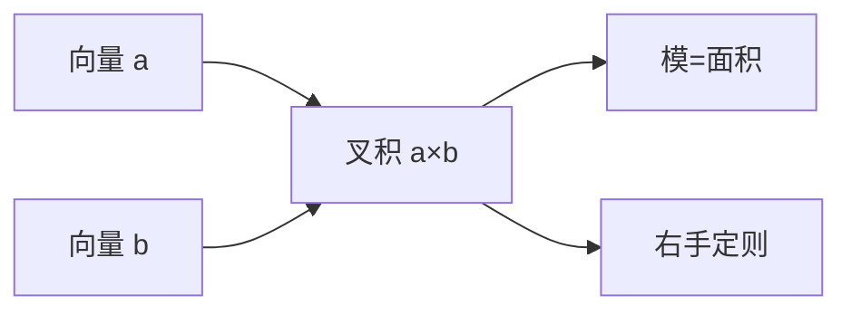

# 向量的向量积（外积、叉积）及坐标运算

## 它是什么

给定两个向量 $\vec{a},\vec{b}$（起点相同），把它们张成一个平行四边形。**向量积** $\vec{a}\times\vec{b}$ ==是一个向量，不是数字==，它由两件事完全决定：

- **大小**：$|\vec{a}\times\vec{b}| = |\vec{a}||\vec{b}|\sin(\vec{a},\vec{b})$，等于以 $\vec{a},\vec{b}$ 为邻边的平行四边形面积 $S_\square$；
- **方向**：$\vec{e}$ 为单位向量，$\vec{a},\vec{b},\vec{e}$ ==符合右手规则==，即 $\vec{a}\times\vec{b}\perp\vec{a}$ 且 $\vec{a}\times\vec{b}\perp\vec{b}$。

> [!IMPORTANT]
> 数量积 $\vec{a}\cdot\vec{b}$ 得到**标量**（投影相关），向量积 $\vec{a}\times\vec{b}$ 得到**向量**（面积 + 法向）。这两个"积"完全不是一回事，别混用公式。

## 为什么需要它

物理上力矩 $\vec{M}=\vec{r}\times\vec{F}$、洛伦兹力都是叉积；几何上，求==平面的法向量==、直线的方向向量、点到直线的距离、平行四边形/三角形面积，几乎都要用叉积。例：过直线作平面与已知平面垂直，该平面的法向量就是直线方向向量与已知平面法向量的叉积。

## 怎么算（坐标运算）

设 $\vec{a}=\{a_1,a_2,a_3\},\vec{b}=\{b_1,b_2,b_3\}$：

$$\vec{a}\times\vec{b}=\begin{vmatrix}\vec{i}&\vec{j}&\vec{k}\\ a_1&a_2&a_3\\ b_1&b_2&b_3\end{vmatrix}$$

展开时注意 $\vec{j}$ 分量前面有个负号，这是==最常见的手滑点==。

## 运算规律

- 反交换律：$\vec{a}\times\vec{b} = -\,\vec{b}\times\vec{a}$，交换一次变号；
- 数乘结合：$(\lambda\vec{a})\times\vec{b} = \lambda(\vec{a}\times\vec{b})$；
- 分配律：$\vec{a}\times(\vec{b}+\vec{c}) = \vec{a}\times\vec{b}+\vec{a}\times\vec{c}$；
- ==一般不满足结合律==：$(\vec{a}\times\vec{b})\times\vec{c}\neq \vec{a}\times(\vec{b}\times\vec{c})$。

> [!WARNING]
> $\vec{a}\times\vec{a}=\vec{0}$，因此展开时形如 $3(\vec{a}\times\vec{a})$ 的项直接为零；别忘了 $\vec{b}\times\vec{a} = -(\vec{a}\times\vec{b})$，符号错一道题就全错。

## 常用结论与应用

| 关系 | 等价条件 |
|---|---|
| $\vec{a}\perp\vec{b}$ | $\vec{a}\cdot\vec{b}=0$ |
| $\vec{a}\parallel\vec{b}$ | $\vec{a}\times\vec{b}=\vec{0}$ |
| 平行四边形面积 | $S=\|\vec{a}\times\vec{b}\|$ |
| 三角形面积 | $S=\frac12\|\vec{a}\times\vec{b}\|$ |
| 点 $P_1$ 到直线 $l(P_0,\vec{s})$ 距离 | $d=\frac{\|\overrightarrow{P_0P_1}\times\vec{s}\|}{\|\vec{s}\|}$ |

## 一个算对了的例子

$\vec{a},\vec{b}$ 均为单位向量，夹角 $\frac{\pi}{6}$，求 $\vec{a}+2\vec{b}$ 与 $3\vec{a}+\vec{b}$ 为邻边的平行四边形面积。

$$S=|(\vec{a}+2\vec{b})\times(3\vec{a}+\vec{b})|$$

展开：
$$(\vec{a}+2\vec{b})\times(3\vec{a}+\vec{b}) = 3(\vec{a}\times\vec{a})+\vec{a}\times\vec{b}+6(\vec{b}\times\vec{a})+2(\vec{b}\times\vec{b})$$
$$= \vec{a}\times\vec{b} - 6(\vec{a}\times\vec{b}) = -5(\vec{a}\times\vec{b})$$

所以
$$S = 5\,|\vec{a}||\vec{b}|\sin\frac{\pi}{6} = 5\cdot1\cdot1\cdot\frac12 = \frac{5}{2}$$

> [!TIP]
> 含参数的叉积展开题套路：先把每一项写成 $\vec{a}\times\vec{a},\vec{a}\times\vec{b},\vec{b}\times\vec{a},\vec{b}\times\vec{b}$，再利用前两者为零、后两者反号合并系数，最后套 $|\vec{a}\times\vec{b}|=|\vec{a}||\vec{b}|\sin\theta$。
