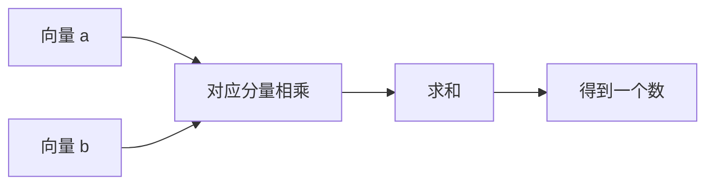

# 向量的数量积（内积、点积）及坐标运算

## 数量积是什么

两个向量 $\vec{a}$、$\vec{b}$ 的数量积（内积、点积）是一个**数**，定义为

$$
\vec{a}\cdot\vec{b}=|\vec{a}||\vec{b}|\cos\theta
$$

其中 $\theta$ 是两向量的夹角。它的物理背景是"力在位移方向做的功"：只有 $\vec{b}$ 在 $\vec{a}$ 方向上的投影 $|\vec{b}|\cos\theta$ 才"有效"。

> [!IMPORTANT]
> 数量积的结果是一个**数**（标量），不是向量。这是它与向量积（叉积，结果是向量）最本质的区别。

## 坐标运算

设 $\vec{a}=(a_1,a_2,a_3)$，$\vec{b}=(b_1,b_2,b_3)$，则

$$
\vec{a}\cdot\vec{b}=a_1b_1+a_2b_2+a_3b_3
$$

即**对应分量相乘再相加**。对 $n$ 维向量 $\boldsymbol{\alpha}=(a_1,\cdots,a_n)^{\mathrm{T}}$、$\boldsymbol{\beta}=(b_1,\cdots,b_n)^{\mathrm{T}}$ 同样适用，也常记作 $(\boldsymbol{\alpha},\boldsymbol{\beta})$ 或 $\boldsymbol{\alpha}^{\mathrm{T}}\boldsymbol{\beta}$。

## 为什么需要它

数量积把"长度、夹角、垂直"三件事统一起来：

| 应用 | 公式 | 说明 |
| :--- | :--- | :--- |
| 求模长 | $\|\vec{a}\|=\sqrt{\vec{a}\cdot\vec{a}}=\sqrt{a_1^2+a_2^2+a_3^2}$ | 向量与自身作内积 |
| 求夹角 | $\cos\theta=\dfrac{\vec{a}\cdot\vec{b}}{\|\vec{a}\|\|\vec{b}\|}$ | $0\leq\theta\leq\pi$ |
| 判垂直 | $\vec{a}\perp\vec{b}\iff\vec{a}\cdot\vec{b}=0$ | ==零向量与任何向量垂直== |

在解析几何中，线线角、线面角、面面角都要通过相应方向向量的内积来计算；在后续章节，正交矩阵、实对称矩阵不同特征值的特征向量正交、施密特正交化，全部以"内积为零"为核心条件。

## 运算性质

- 交换律：$\vec{a}\cdot\vec{b}=\vec{b}\cdot\vec{a}$
- 分配律：$(\vec{a}+\vec{b})\cdot\vec{c}=\vec{a}\cdot\vec{c}+\vec{b}\cdot\vec{c}$
- 数乘结合：$(\lambda\vec{a})\cdot\vec{b}=\lambda(\vec{a}\cdot\vec{b})$

> [!WARNING]
> 数量积**没有结合律**：$(\vec{a}\cdot\vec{b})\cdot\vec{c}$ 没有意义（左边是数，不能再与向量点乘）。同时 $\vec{a}\cdot\vec{b}=0$ 不能推出 $\vec{a}=\vec{0}$ 或 $\vec{b}=\vec{0}$，也可能是二者垂直。

## 算例

已知 $\vec{a}+3\vec{b}$ 与 $7\vec{a}-5\vec{b}$ 垂直，$\vec{a}-4\vec{b}$ 与 $7\vec{a}-2\vec{b}$ 垂直，且 $\vec{a},\vec{b}$ 非零，求夹角。

垂直即内积为零，展开：

$$
\begin{cases}
7|\vec{a}|^2+16\,\vec{a}\cdot\vec{b}-15|\vec{b}|^2=0 & (1)\\[4pt]
7|\vec{a}|^2-30\,\vec{a}\cdot\vec{b}+8|\vec{b}|^2=0 & (2)
\end{cases}
$$

$(1)-(2)$ 得 $46\,\vec{a}\cdot\vec{b}-23|\vec{b}|^2=0$，即 $2\,\vec{a}\cdot\vec{b}=|\vec{b}|^2$。代回 $(2)$ 得 $|\vec{a}|^2=|\vec{b}|^2$，故 $|\vec{a}|=|\vec{b}|$。

于是

$$
\cos\theta=\frac{\vec{a}\cdot\vec{b}}{|\vec{a}||\vec{b}|}=\frac{\tfrac12|\vec{b}|^2}{|\vec{b}|^2}=\frac12
\quad\Rightarrow\quad \theta=\frac{\pi}{3}
$$

> [!TIP]
> 处理"垂直求夹角"类题目，先把垂直条件全部翻译成 $\cdot=0$，再利用分配律展开成 $|\vec{a}|^2$、$\vec{a}\cdot\vec{b}$、$|\vec{b}|^2$ 的代数方程组，最后套 $\cos\theta$ 公式即可，全程不需要知道 $\vec{a},\vec{b}$ 的具体坐标。
