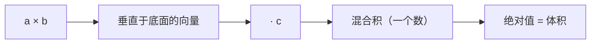
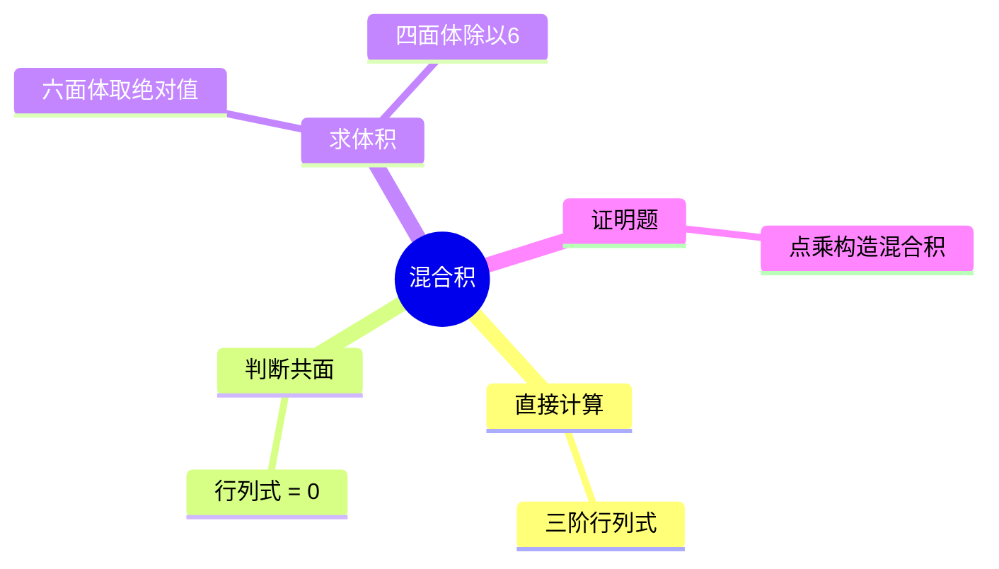

# 向量的混合积及其几何意义（体积）

## 什么是混合积

三个向量 $\vec{a}, \vec{b}, \vec{c}$，先做叉乘，再做点乘：

$$
(\vec{a} \times \vec{b}) \cdot \vec{c} = [\vec{a}\ \vec{b}\ \vec{c}] = \begin{vmatrix} a_1 & a_2 & a_3 \\ b_1 & b_2 & b_3 \\ c_1 & c_2 & c_3 \end{vmatrix}
$$

结果是一个**数**（标量），不是向量。

## 几何意义：平行六面体的体积

以 $\vec{a},\vec{b},\vec{c}$ 为棱作平行六面体。想一想：底面积是什么？高又是什么？

- **底面积**：$S = |\vec{a} \times \vec{b}|$（叉乘的模）
- **高**：$h = \big||\vec{c}|\cos\theta\big|$，即 $\vec{c}$ 在 $\vec{a}\times\vec{b}$ 方向上投影的绝对值

于是体积 = 底面积 × 高：

$$
V = |\vec{a} \times \vec{b}| \cdot \big||\vec{c}|\cos\theta\big| = \big|(\vec{a} \times \vec{b})\cdot \vec{c}\big| = \big|[\vec{a}\ \vec{b}\ \vec{c}]\big|
$$

> [!IMPORTANT]
> ==以 $\vec{a},\vec{b},\vec{c}$ 为棱的平行六面体体积 $V = \big|[\vec{a}\ \vec{b}\ \vec{c}]\big|$==；**四面体体积**是它的六分之一：$V_{四面体} = \dfrac{1}{6}\big|[\vec{a}\ \vec{b}\ \vec{c}]\big|$。

## 混合积的性质

$$
[\vec{a}\ \vec{b}\ \vec{c}] = [\vec{b}\ \vec{c}\ \vec{a}] = [\vec{c}\ \vec{a}\ \vec{b}] = -[\vec{c}\ \vec{b}\ \vec{a}]
$$

- **轮换不变**：按 $\vec{a}\to\vec{b}\to\vec{c}$ 顺序轮换，值不变
- **交换变号**：任意两个向量交换位置，值变号
- **有重复向量为零**：$[\vec{a}\ \vec{a}\ \vec{c}] = 0$（因为 $\vec{a}\times\vec{a} = \vec{0}$）

> [!TIP]
> ==$\vec{a},\vec{b},\vec{c}$ 共面 $\iff [\vec{a}\ \vec{b}\ \vec{c}] = 0$==。这是判断三点共线、四点共面的核心工具。

## 与相近概念的区别

| 运算 | 结果类型 | 几何意义 | 判零的含义 |
|------|----------|----------|------------|
| $\vec{a}\cdot\vec{b}$ | 数 | 投影 | $\vec{a}\perp\vec{b}$ |
| $\vec{a}\times\vec{b}$ | **向量** | 平行四边形面积 | $\vec{a}\parallel\vec{b}$ |
| $[\vec{a}\ \vec{b}\ \vec{c}]$ | 数 | 平行六面体体积 | **三向量共面** |

> [!WARNING]
> 混合积结果忘记加**绝对值**是常见错误——行列式可正可负，但体积必须非负。

## 算对的例子

**例**：设 $\vec{\alpha}=(1,0,-1)$，$\vec{\beta}=(2,1,0)$，$\vec{\gamma}=(0,0,1)$，求 $(\vec{\alpha}\times\vec{\beta})\cdot\vec{\gamma}$。

**解**：直接写三阶行列式，按第三行展开：

$$
(\vec{\alpha}\times\vec{\beta})\cdot\vec{\gamma} = \begin{vmatrix} 1 & 0 & -1 \\ 2 & 1 & 0 \\ 0 & 0 & 1 \end{vmatrix} = 1\cdot\begin{vmatrix} 1 & 0 \\ 2 & 1 \end{vmatrix} = 1\times 1 - 0\times 2 = 1
$$

结果为 $1$。这也意味着以这三个向量为棱的平行六面体体积为 $|1| = 1$。

## 常见题型与技巧

> [!CAUTION]
> 证明"三向量共面"时，常用技巧是：对等式两边**同时点乘某个向量**，利用"混合积中有两个相同向量则为零"来消项，最终得到 $[\vec{a}\ \vec{b}\ \vec{c}]=0$。

> [!NOTE]
> 若 $[\vec{\alpha}\ \vec{\beta}\ \vec{\gamma}] = 1$，则 $[(\vec{\alpha}+\vec{\beta})\times(\vec{\beta}+\vec{\gamma})]\cdot(\vec{\gamma}+\vec{\alpha}) = 2$。展开后利用轮换对称性 $[\vec{\beta}\ \vec{\gamma}\ \vec{\alpha}] = [\vec{\alpha}\ \vec{\beta}\ \vec{\gamma}]$ 与重复向量为零的性质，合并同类项即可。
