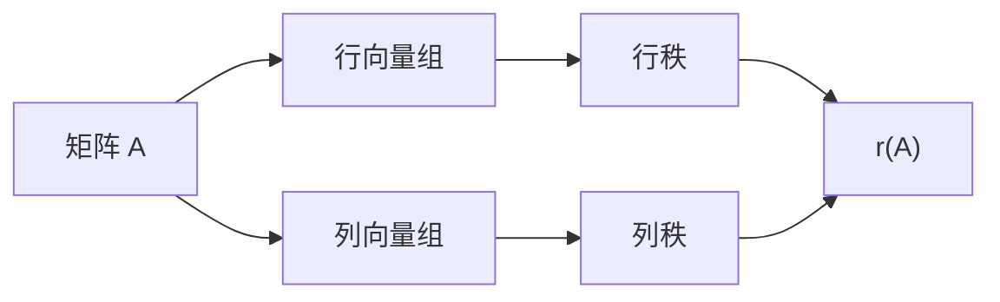

# 矩阵的行秩等于列秩等于矩阵的秩

## 是什么：行秩、列秩与矩阵的秩

先把三个词摆清楚。设 $A$ 是 $m\times n$ 矩阵：

- **行向量组**：$A$ 的 $m$ 个行向量组成的向量组，它的极大无关组所含向量个数叫 **行秩**；
- **列向量组**：$A$ 的 $n$ 个列向量组成的向量组，它的极大无关组所含向量个数叫 **列秩**；
- **矩阵的秩** $r(A)$：通常定义为 $A$ 的最高阶非零子式的阶数，或等价地 $A$ 经初等变换化为阶梯形后的非零行数。

先看一个小问题：如果一个矩阵你只数“横着看”和“竖着看”的方向，会不会得到两个不同的“秩”？直觉上好像该分开算，但结论很整齐。

> [!IMPORTANT]
> 对任意矩阵 $A$，都有
> $$
> \text{行秩}(A)=\text{列秩}(A)=r(A)
> $$
> 即 ==矩阵的行秩、列秩、矩阵的秩三者相等，统称为秩==。

## 为什么需要：把“矩阵”和“向量组”连起来

第 4 章研究向量组的线性相关性，而课件里明确写了一条关系：

**矩阵 $A$ 的秩等于 $A$ 的列（行）向量组的秩。**

这意味着：

- 想知道一个向量组秩是多少，可以把它按列拼成矩阵 $A$，再算 $r(A)$；
- 想知道矩阵里有多少“真正独立”的行或列，直接求 $r(A)$ 就够。

## 怎么做：求秩与判断题

常用做法：对 $A$ 作初等行变换化为阶梯形矩阵，非零行数就是 $r(A)$，于是也就等于列秩、行秩。

看一道考过的填空题风格：若已知 $r(A)\ge r(B)$，再结合上面结论，就能把“矩阵秩的大小”翻译成“某一组向量极大无关组规模的大小”。

> [!TIP]
> 记忆法：横竖都一样——只记一个 $r(A)$。

## 相近概念区别

| 概念 | 看的对象 | 与 $r(A)$ 关系 |
|---|---|---|
| 行秩 | 行向量组 | 等于 $r(A)$ |
| 列秩 | 列向量组 | 等于 $r(A)$ |
| 矩阵的秩 | 子式/阶梯形 | 就是它们共同值 |

## 常见坑

> [!WARNING]
> 不要把“秩”和“向量个数”混为一谈：$m\times n$ 矩阵有 $m$ 行、$n$ 列，但秩不超过 $\min(m,n)$。还要记住：只有初等变换不改变秩，随便删行删列会变。

> [!CAUTION]
> 若题目问“列向量组的秩”，别再去数行阶梯非零行以外的内容——化一次阶梯形，$r(A)$ 出来，列秩就出来了。

## 一个算对了的例子

设
$$
A=\begin{pmatrix}
1&2&3\\
2&4&6\\
0&1&1
\end{pmatrix}
$$
第 2 行是第 1 行的 2 倍。作行变换：
$$
\begin{pmatrix}
1&2&3\\
0&0&0\\
0&1&1
\end{pmatrix}
\to
\begin{pmatrix}
1&2&3\\
0&1&1\\
0&0&0
\end{pmatrix}
$$
阶梯形有 2 个非零行，所以 $r(A)=2$。于是：

- 行秩 $=2$（两个独立行）；
- 列秩 $=2$（三个列向量里极大无关组含 2 个）；
- 与“列向量组的秩 $= r(A)$”完全一致。

因此遇到填空题里写“矩阵 $A$ 的秩等于 $A$ 的列（行）向量组的秩”时，直接填 **列向量组的秩 / 行向量组的秩都等于 $r(A)$** 即可。
