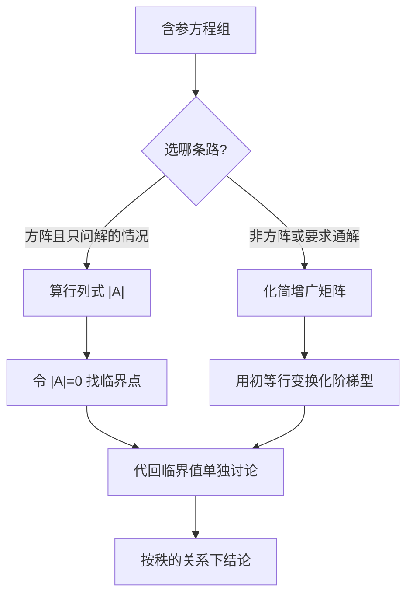

# 含参数线性方程组解的讨论与求解

含参数线性方程组，本质上是系数矩阵 $A$ 或增广矩阵 $\bar{A}$ 中含有未知常数（如 $\lambda, a, b$）的方程组。为什么需要专门讨论？因为参数的取值会改变矩阵的秩，从而直接决定方程组是无解、有唯一解还是有无穷多解。

> [!IMPORTANT]
> 判定依据：比较 $r(A)$ 与 $r(\bar{A})$ 以及未知数个数 $n$。
> - $r(A) \neq r(\bar{A})$：无解
> - $r(A) = r(\bar{A}) = n$：唯一解
> - $r(A) = r(\bar{A}) < n$：无穷多解

## 核心思路

拿到题目后，我们该从哪里下手？如果直接对带字母的矩阵做初等行变换，很容易陷入繁杂的分式运算。因此，通常有两条路：

> [!TIP]
> 若 $A$ 是 $n$ 阶方阵，优先计算 $|A|$。令 $|A|=0$ 解出的根就是“临界参数值”，只有这些值才可能导致无解或无穷多解；其余值必然对应唯一解。

## 两种题型的区别

| 对比维度 | 单参数 $\lambda$ 题型 | 多参数 $a,b$ 题型 |
| :--- | :--- | :--- |
| **常见设问** | 何时唯一解/无解/无穷多解 | 向量能否被线性表示及表示法 |
| **破局关键** | 求 $\|A\|$ 的零点 | 对 $\bar{A}$ 作初等行变换 |
| **联系** | 讨论 $\beta$ 能否由 $\alpha_1,\dots,\alpha_m$ 线性表示，本质上就是讨论非齐次线性方程组是否有解及求解的问题 | 同左 |

## 实战演练

以真题为例：当 $\lambda$ 取何值时，方程组
$$\left\{\begin{aligned}x_{1}+x_{2}+2x_{3}&=1\\ x_{1}+\lambda x_{2}+x_{3}&=2\\ \lambda x_{1}+x_{2}+x_{3}&=\lambda+1\end{aligned}\right.$$
无解、有唯一解或有无穷多解？并在无穷多解时求通解。

写出增广矩阵并施以初等行变换：
$$
\bar{A} = \left[\begin{array}{ccc|c} 
1 & 1 & 2 & 1 \\ 
1 & \lambda & 1 & 2 \\ 
\lambda & 1 & 1 & \lambda+1 
\end{array}\right]
\xrightarrow[r_3 - \lambda r_1]{r_2 - r_1}
\left[\begin{array}{ccc|c} 
1 & 1 & 2 & 1 \\ 
0 & \lambda-1 & -1 & 1 \\ 
0 & 1-\lambda & 1-2\lambda & 1 
\end{array}\right]
$$

继续消元，将第三行加上第二行（$r_3 + r_2$）：
$$
\rightarrow
\left[\begin{array}{ccc|c} 
1 & 1 & 2 & 1 \\ 
0 & \lambda-1 & -1 & 1 \\ 
0 & 0 & -2\lambda & 2 
\end{array}\right]
$$
*(注：此处第三行第三列元素为 $(1-2\lambda)+(-1)=-2\lambda$，常数项为 $1+1=2$)*

现在观察主对角线上的含参元素：$\lambda-1$ 和 $-2\lambda$。

- **唯一解**：需 $r(A)=r(\bar{A})=3$，即 $\lambda-1 \neq 0$ 且 $-2\lambda \neq 0$。故 ==$\lambda \neq 1$ 且 $\lambda \neq 0$ 时有唯一解==。
- **无解**：当 $\lambda = 0$ 时，矩阵末行为 $[0, 0, 0 \mid 2]$，出现 $0=2$ 的矛盾。此时 $r(A)=2, r(\bar{A})=3$，==方程组无解==。
- **无穷多解**：当 $\lambda = 1$ 时，代入得：
$$
\left[\begin{array}{ccc|c} 
1 & 1 & 2 & 1 \\ 
0 & 0 & -1 & 1 \\ 
0 & 0 & -2 & 2 
\end{array}\right]
\xrightarrow{r_3 - 2r_2}
\left[\begin{array}{ccc|c} 
1 & 1 & 2 & 1 \\ 
0 & 0 & -1 & 1 \\ 
0 & 0 & 0 & 0 
\end{array}\right]
$$
此时 $r(A)=r(\bar{A})=2 < 3$，有无穷多解。

> [!WARNING]
> 求通解时，自由变量必须找准！这里第 2 列没有主元，所以 $x_2$ 是自由变量。

由阶梯矩阵回代：$-x_3 = 1 \Rightarrow x_3 = -1$；$x_1 + x_2 + 2(-1) = 1 \Rightarrow x_1 = 3 - x_2$。
令 $x_2 = k$（$k \in \mathbb{R}$），写成通解形式（特解 + 基础解系）：
$$
\begin{pmatrix} x_1 \\ x_2 \\ x_3 \end{pmatrix} = \begin{pmatrix} 3 \\ 0 \\ -1 \end{pmatrix} + k \begin{pmatrix} -1 \\ 1 \\ 0 \end{pmatrix}, \quad k \in \mathbb{R}
$$

> [!CAUTION]
> 极易错点：在 $r_3 - \lambda r_1$ 计算常数项时，$(\lambda+1) - \lambda(1) = 1$，千万不要脑补出高次项！每一步消元务必把含参项当作普通数字仔细展开。
