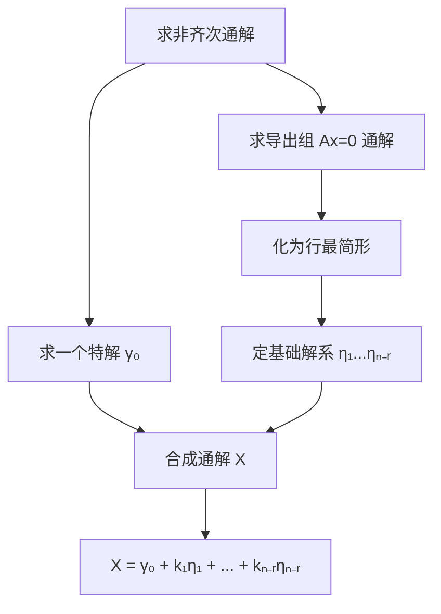

# 齐次线性方程组的基础解系与解的结构

## 解的结构：特解 + 齐次通解

非齐次线性方程组 $Ax=b$ 的解与其对应的齐次线性方程组（导出组）$Ax=0$ 的解有着极其紧密的“主从关系”。掌握这种结构，是求通解或利用抽象条件反推解的关键。

> [!IMPORTANT]
> **解的结构定理**
> 若 $\gamma_0$ 是 $Ax=b$ 的一个**特解**，$\eta$ 是导出组 $Ax=0$ 的**通解**，则 $Ax=b$ 的**全部解**（通解）为：
> $$ X = \gamma_0 + \eta $$
> 即：==非齐次通解 = 非齐次特解 + 齐次通解==。

我们可以用以下流程图清晰展示求解非齐次方程组的完整逻辑：

## 核心性质与推导

为什么特解与齐次解可以如此拼接？这依赖于以下两条基本性质：
1. 若 $\eta_1, \eta_2$ 是 $Ax=b$ 的解，则它们的差 $\eta_1 - \eta_2$ 是导出组 $Ax=0$ 的解。（因为 $A(\eta_1 - \eta_2) = b - b = 0$）
2. 若 $\gamma_0$ 是 $Ax=b$ 的解，$\xi$ 是 $Ax=0$ 的解，则它们的和 $\gamma_0 + \xi$ 仍是 $Ax=b$ 的解。（因为 $A(\gamma_0 + \xi) = b + 0 = b$）

> [!TIP]
> **基础解系的“尺寸”**
> 无论齐次还是非齐次，自由未知量的个数决定了通解中任意常数 $k$ 的个数。这个“尺寸”永远等于 ==$n - r(A)$==（未知数个数减去系数矩阵的秩）。

## 实战演算

以四阶方阵 $A$（$r(A)=3$）为例，已知 $\eta_3=(1,2,3,4)^T$ 和 $2\eta_1-\eta_2=(2,3,4,5)^T$ 都是 $Ax=b$ 的解，求通解。

**第一步：确定基础解系长度。**
因为 $n=4, r(A)=3$，所以导出组 $Ax=0$ 的基础解系包含 $4-3=1$ 个向量。这意味着通解中只有一个独立常数 $k$。

**第二步：构造齐次解。**
题目给出的是 $Ax=b$ 的两个解，如何得到 $Ax=0$ 的解？两个特解相减即可：
$$ \xi = (2\eta_1-\eta_2) - \eta_3 = (2,3,4,5)^T - (1,2,3,4)^T = (1,1,1,1)^T $$
验证：$A\xi = A(2\eta_1-\eta_2) - A\eta_3 = (2b-b) - b = 0$。构造成功。

**第三步：组装通解。**
任选其中一个作为特解（如 $\eta_3$），加上 $k$ 倍的齐次解：
$$ X = (1,2,3,4)^T + k(1,1,1,1)^T $$

## 常见误区与辨析

> [!WARNING]
> **“特解”的伪装**
> 在选择题中，命题人常给出解的线性组合（如 $2\eta_1-\eta_2$），你必须先验证它到底是 $Ax=b$ 的解还是 $Ax=0$ 的解。
> **判别法则**：计算系数之和。对于 $\sum c_i \eta_i$：
> - 若 $\sum c_i = 1$，它是 $Ax=b$ 的解（如 $2-1=1$）；
> - 若 $\sum c_i = 0$，它是 $Ax=0$ 的解。

> [!CAUTION]
> **混淆齐次与非齐次的“解”**
> 只有齐次线性方程组的解集才构成**向量空间**（对加法和数乘封闭）。非齐次方程组的解集不构成向量空间（例如两个解相加不再是解，因为 $A(\eta_1+\eta_2)=2b$）。因此，描述非齐次通解时，必须分离出“特解”部分，不能直接说“基础解系”。

| 特征 | 齐次方程组 $Ax=0$ | 非齐次方程组 $Ax=b$ ($b\neq0$) |
| :--- | :--- | :--- |
| **解集性质** | 向量空间（封闭） | 非向量空间（不封闭） |
| **通解结构** | $k_1\xi_1 + \dots + k_{n-r}\xi_{n-r}$ | $\gamma_0 + (k_1\xi_1 + \dots + k_{n-r}\xi_{n-r})$ |
| **核心任务** | 求基础解系 | 求特解 + 导出组基础解系 |
